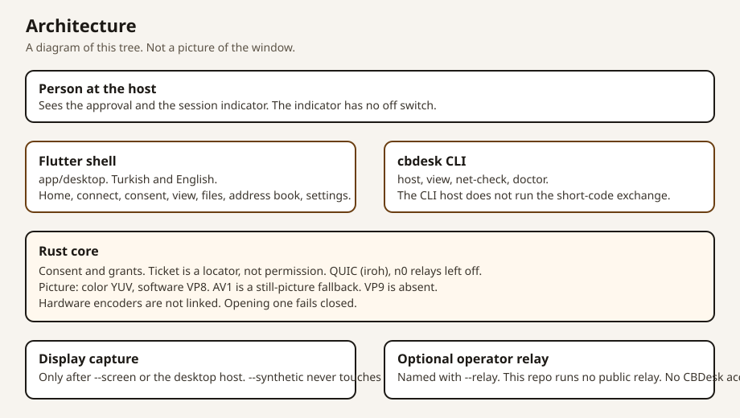
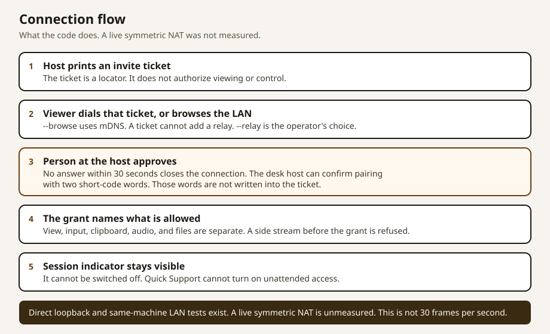
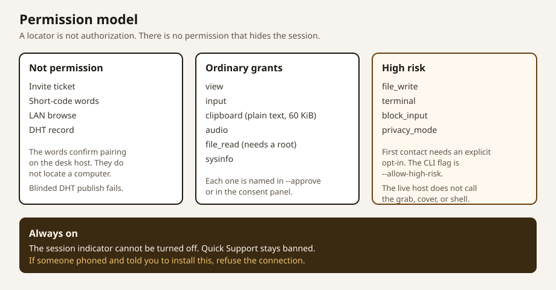
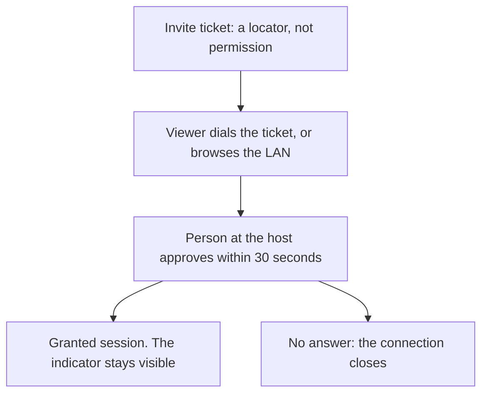

<div align="center">

# CBDesk

**A remote desktop that asks before anyone sees the screen.**

[](README.md)
[](README.tr.md)

[](https://github.com/cumabozkurt/cbdesk/actions/workflows/ci.yml)
[](https://github.com/cumabozkurt/cbdesk/releases/tag/v0.1.0-alpha.1)
[](LICENSE)
[](#download)

</div>

> **In one sentence:** CBDesk is an unsigned alpha of a consented remote desktop: the person at the host approves before a picture is sent, the session indicator cannot be switched off, and there is no CBDesk account.

The core is Rust. The desktop shell is Flutter. The license is AGPL-3.0-or-later. The user guide is [the Pages site](https://cumabozkurt.github.io/cbdesk/) (`docs/book`, Turkish and English). That site does not host a binary.

The crate version in this tree is **0.0.0**. That is not a product release. GitHub tag [`v0.1.0-alpha.1`](https://github.com/cumabozkurt/cbdesk/releases/tag/v0.1.0-alpha.1) is titled `v0.1.0-alpha.1 unsigned alpha` and attaches the files in the download table. Those files are an unsigned alpha. They are not version 1.0.0 and not the plan's alpha exit. On the day this page was written, GitHub did not mark that release as a prerelease. Treat the files as an unsigned alpha anyway.

---

## Contents

- [Why?](#why)
- [Features](#features)
- [Screenshots](#screenshots)
- [Install](#install)
- [First run](#first-run)
- [CLI reference](#cli-reference)
- [Recipes](#recipes)
- [How it works](#how-it-works)
- [Security and privacy](#security-and-privacy)
- [Troubleshooting / FAQ](#troubleshooting--faq)
- [Limitations](#limitations)
- [Comparison with similar projects](#comparison-with-similar-projects)
- [Roadmap](#roadmap)
- [Contributing](#contributing)
- [License](#license)

---

## Why?

Remote-access programs are a common fraud tool. A caller pretends to be a bank, a government office, or technical support, and asks the person to install software that can see and drive the computer.

CBDesk is being built so that a session is visible and chosen:

- The person at the host is asked before anyone sees the screen.
- The session indicator stays on the screen and has no off switch.
- An invite ticket, a short code, a LAN browse, or a DHT record locates a computer. None of them is permission.
- If nobody answers the approval within 30 seconds, the connection closes.
- Quick Support cannot enable unattended access.
- There is no CBDesk account and no project identity server.

That is the design. The download below is an early unsigned build of the code in this repository. It is not a finished product, and it does not match the programs people already use for day-to-day remote desktop. The limits are listed below and in [`docs/dev/m0-status.md`](docs/dev/m0-status.md).

<a id="features"></a>

## Features

| | In this tree | Not a claim |
|---|---|---|
| Consent before a picture is sent | The library, the CLI `--approve` flag, and the Flutter consent panel | A finished approval window |
| Session indicator that cannot be disabled | Shell and library. It is a semantics live region | A screen-reader test by a person |
| Fraud warning on the consent screen | Turkish and English catalogs | — |
| No CBDesk account | Direct dial and an optional operator relay | A measured NAT success rate |
| Color picture (YUV) over software VP8 | Live path. AV1 is a still-picture fallback | 30 frames per second. VP9 is absent |
| Flutter shell, Turkish and English | Home, connect, consent, remote view, files, address book, settings | Wireframe ids, a spoken usability test |
| Plain-text clipboard | After a `clipboard` grant, capped at 60 KiB | File or image paste |
| One file upload | `--put`, at most 32 MiB, under `--files-root` | zstd. Chunks are uncompressed |
| Audio devices | `--mic` and `--speaker` can open the default device | That a person heard the stream |
| LAN browse | mDNS on port 5353 when `--lan` / `--browse` is set | A check of the OS network category |
| Operator relay | `--relay URL`. Known public-relay suffixes are refused | A public relay run by this project |
| Android capture | Starts only after the system dialog. Longer side at most 960 | A phone install. The dialog was not accepted |
| Hardware encode | The hooks fail closed | A successful hardware encode |
| Signed installers, stores, notarization | — | None of these exist for the alpha |

<a id="screenshots"></a>

## Screenshots

No UI frame was captured. Flutter is not used in this documentation change to render a golden image, and a drawn window would be a fake screenshot. The three pictures are diagrams of the design in this repository.







<a id="install"></a>

## Install

<a id="download"></a>

### Download

If someone called you and told you to install this program, stop. Banks, government agencies, and support companies do not ask you for remote access.

The files are an **unsigned alpha**. Windows SmartScreen can warn or block them (unknown publisher). macOS Gatekeeper can warn or block them. There is no notarization, no Apple Developer account, and no Authenticode certificate. `SHA256SUMS` is a list of digests, not a signature. `sbom.spdx.json.sign-note` on that release reads `unsigned: CBDESK_SIGN_KEY is unset`.

No real-device test and no performance test of these binaries was recorded. A 30 frame-per-second stream was not measured. This page does not rebuild the files. The site does not host them.

| | File | What it is |
|---|---|---|
| Windows desktop x64 | [cbdesk-desktop-0.1.0-alpha.1-windows-x64.zip](https://github.com/cumabozkurt/cbdesk/releases/download/v0.1.0-alpha.1/cbdesk-desktop-0.1.0-alpha.1-windows-x64.zip) | Flutter bundle. `cbdesk/cbdesk.exe` plus `UNSIGNED.txt`. SmartScreen can block it |
| Windows CLI x64 | [cbdesk-0.1.0-alpha.1-x86_64-pc-windows-msvc.zip](https://github.com/cumabozkurt/cbdesk/releases/download/v0.1.0-alpha.1/cbdesk-0.1.0-alpha.1-x86_64-pc-windows-msvc.zip) | `cbdesk.exe` from `cargo build --release --locked` |
| Linux desktop x64 | [cbdesk-desktop-0.1.0-alpha.1-linux-x64.tar.gz](https://github.com/cumabozkurt/cbdesk/releases/download/v0.1.0-alpha.1/cbdesk-desktop-0.1.0-alpha.1-linux-x64.tar.gz) | Flutter bundle built on `ubuntu-24.04`. `cbdesk/cbdesk` plus libraries |
| Linux CLI x64 | [cbdesk-0.1.0-alpha.1-x86_64-unknown-linux-gnu.tar.gz](https://github.com/cumabozkurt/cbdesk/releases/download/v0.1.0-alpha.1/cbdesk-0.1.0-alpha.1-x86_64-unknown-linux-gnu.tar.gz) | Links system libraries from `ubuntu-24.04`. Not a static binary |
| Linux deb (CLI) | [cbdesk_0.1.0-alpha.1_amd64.deb](https://github.com/cumabozkurt/cbdesk/releases/download/v0.1.0-alpha.1/cbdesk_0.1.0-alpha.1_amd64.deb) | Unsigned. Installs `cbdesk` to `/usr/bin`. No `Depends` line. Not the Flutter app |
| macOS desktop Apple Silicon | [cbdesk-desktop-0.1.0-alpha.1-macos-arm64.zip](https://github.com/cumabozkurt/cbdesk/releases/download/v0.1.0-alpha.1/cbdesk-desktop-0.1.0-alpha.1-macos-arm64.zip) | `cbdesk.app` from `macos-14`, arm64 only. Not universal. Not notarized. Gatekeeper can block it |
| macOS CLI Apple Silicon | [cbdesk-0.1.0-alpha.1-aarch64-apple-darwin.tar.gz](https://github.com/cumabozkurt/cbdesk/releases/download/v0.1.0-alpha.1/cbdesk-0.1.0-alpha.1-aarch64-apple-darwin.tar.gz) | arm64 only. Not universal. Not notarized |
| Android arm64 | [cbdesk-0.1.0-alpha.1-android-arm64-debug.apk](https://github.com/cumabozkurt/cbdesk/releases/download/v0.1.0-alpha.1/cbdesk-0.1.0-alpha.1-android-arm64-debug.apk) | Debug APK. Not release-signed. Not installed on a phone. Application id `org.cbdesk.cbdesk` |
| Checksums | [SHA256SUMS](https://github.com/cumabozkurt/cbdesk/releases/download/v0.1.0-alpha.1/SHA256SUMS) | Digests of the files above. Not a signature |
| SBOM | [sbom.spdx.json](https://github.com/cumabozkurt/cbdesk/releases/download/v0.1.0-alpha.1/sbom.spdx.json) | SPDX from `cargo metadata`. `filesAnalyzed` is false |
| Android note | [UNSIGNED-android.txt](https://github.com/cumabozkurt/cbdesk/releases/download/v0.1.0-alpha.1/UNSIGNED-android.txt) | The APK is an unsigned debug build |

The release page is [`v0.1.0-alpha.1`](https://github.com/cumabozkurt/cbdesk/releases/tag/v0.1.0-alpha.1). After you download `SHA256SUMS` and a file into the same directory:

```sh
sha256sum -c SHA256SUMS
```

On macOS the matching command is `shasum -a 256 -c SHA256SUMS`. A matching digest shows that the bytes match the list. It does not show that a maintainer signed them.

No MSI, DMG, rpm, AppImage, or Flatpak was signed or published. Those scripts in the repository are templates. The Flatpak manifest id is `org.cbdesk.CBDesk`. It has not been submitted to Flathub. There is no TestFlight build.

### Build from source

A developer build needs Rust 1.91.0 and, for the shell, Flutter 3.47.7. Steps are in [`docs/dev/building.md`](docs/dev/building.md).

```sh
cargo fmt --all -- --check
cargo clippy --workspace --all-targets -- -D warnings
cargo test --workspace --all-targets
```

That build is for people working on the code. It is not a supported install for someone who was told to "just download remote access."

<a id="first-run"></a>

## First run

1. Read the fraud warning again. If a person on the phone wants this installed, do not continue.
2. Expect SmartScreen or Gatekeeper to warn. The alpha is unsigned on purpose in this tag. There is no signed exception to request.
3. Check `SHA256SUMS` as above.
4. The desktop zip is the Flutter shell. The other archives are the `cbdesk` command-line program. The deb is the command-line program, not the shell.
5. The shell's home screen shows a device id and a short code. The other screens are connect, consent, a remote view, files, an address book, and settings. The session indicator is painted above the pages and cannot be turned off.
6. Nothing in this repository records that those screens were exercised on a second physical computer, a second monitor, or a phone.

<a id="cli-reference"></a>

## CLI reference

`cbdesk` has three commands. `doctor` is an alias of `net-check`. The parser is `crates/cbdesk-cli/src/args.rs`.

```text
cbdesk host --bind ADDR (--synthetic|--screen) [--monitor N] [--approve view,input]
            [--frames N] [--lan] [--relay URL] [--files-root DIR]
            [--tone|--mic] [--speaker] [--profile full|balanced|preview] [--strips N]
cbdesk view (--ticket HEX|--browse) (--ppm FILE|--window|--put FILE|--audio|--mic|--speaker)
            [--pointer X,Y] [--key NAME] [--relay URL]
cbdesk net-check [--json] [--anonymous] [--loopback]
cbdesk doctor    [--json] [--anonymous] [--loopback]
```

### host

| Flag | Meaning |
|---|---|
| `--bind ADDR` | UDP socket for QUIC. Default `127.0.0.1:22116` |
| `--synthetic` | Paint a gray barcode. Does not touch a display. Required unless `--screen` is set |
| `--screen` | Capture the primary display. Required unless `--synthetic` is set |
| `--monitor N` | Index from `list_monitors` for this call. Not a stable hardware id. Only with `--screen`. An index past the list is refused. Omitting it keeps the primary display. A second physical monitor was not attached here. The desk session still calls `capture_picture` |
| `--approve LIST` | Comma-separated grants, applied after the first-contact delay. Empty rejects. Names: `view`, `input`, `clipboard`, `file_read`, `file_write`, `audio`, `terminal`, `block_input`, `privacy_mode`, `sysinfo` |
| `--allow-high-risk` | Required on first contact when the list contains `file_write`, `terminal`, `block_input`, or `privacy_mode` |
| `--frames N` | Stop after N frames. `0` (the default) streams until the viewer closes. The maximum is 30 |
| `--lan` | Announce on the LAN. The CLI marks the profile private and does not read the operating system's network category |
| `--relay URL` | Operator relay. Scheme must be `https://` or `relay://`. Repeatable. Known public-relay suffixes are refused. A ticket cannot add one. This repository does not run a public relay |
| `--files-root DIR` | Jail for `file_read` and `file_write`. Required when either is approved |
| `--tone` | After an `audio` grant, send one synthetic Opus packet per paced slot. Does not open a device. Not together with `--mic` |
| `--mic` | Open the default microphone after an `audio` grant. A missing device is an error |
| `--speaker` | Play received Opus on the default speaker. Needs `audio` in `--approve`. A missing device is an error |
| `--profile NAME` | `full` (default), `balanced`, or `preview`. The last two shrink a `--screen` capture by 2 or 4. `--synthetic` stays full size |
| `--strips N` | `1` to `16`, default `1`. Above 1, and only when the codec is VP8, each horizontal band is its own keyframe. The default stays the damage encoder. This is not 30 frames per second. The desk host does not take this flag |

Without `--approve`, the host rejects the prompt. The ticket it prints is still only a locator.

### view

| Flag | Meaning |
|---|---|
| `--ticket HEX` | Hex-encoded invite ticket. Exactly one of this or `--browse` |
| `--browse` | Find a host that announced on the LAN, then dial it |
| `--ppm FILE` | Write the first frame as a PPM and leave |
| `--window` | Keep showing frames until the window closes. Pointer and keyboard are forwarded only after an `input` grant |
| `--put FILE` | Upload one file after `file_write`. At most 32 MiB |
| `--audio` | Request audio and print the length of Opus packets the host sends |
| `--mic` | Send the default microphone when audio is granted |
| `--speaker` | Play received Opus on the default speaker |
| `--pointer X,Y` | One pointer sample after the first frame, if `input` was granted |
| `--key NAME` | `enter` or one ASCII character, if `input` was granted |
| `--relay URL` | Same rule as the host. The ticket's relay list is not contacted |

One of `--ppm`, `--window`, `--put`, `--audio`, `--mic`, or `--speaker` is required.

### net-check

Prints a local UDP and address-class report. It does not start a session. Symmetric NAT, UPnP, DHT, and hole punching are reported as not measured. `--anonymous` omits local source addresses. `--json` prints one JSON object. `--loopback` connects two endpoints on this computer and says that a direct path there is not a NAT hole punch.

<a id="recipes"></a>

## Recipes

These are local commands for people building or trying the alpha. They are not a support script, and they were not run as a two-computer smoke test for the published binaries.

### Synthetic picture on one machine

No display is captured.

```sh
cbdesk host --bind 127.0.0.1:22116 --synthetic --approve view --frames 1
```

Copy the ticket hex the host prints, then:

```sh
cbdesk view --ticket HEX --ppm frame.ppm
```

### One screen frame

Needs a display. `--screen` reads X11 on Linux, the Wayland ScreenCast portal and PipeWire when `WAYLAND_DISPLAY` is set, and the same capture library on Windows and macOS. Wayland ScreenCast was not run in CI.

```sh
cbdesk host --bind 127.0.0.1:22116 --screen --approve view --frames 1
cbdesk view --ticket HEX --window
```

### Ask what this machine can see

```sh
cbdesk net-check
cbdesk net-check --anonymous --json
```

The report includes the line `symmetric nat: unmeasured`.

### LAN announce

`--lan` opts in. It does not ask the operating system whether the network is public.

```sh
cbdesk host --bind 0.0.0.0:22116 --screen --approve view --lan
cbdesk view --browse --window
```

When port 5353 is busy, sends still aim at 5353 and the socket listens on an ephemeral port.

### One file, into a directory you choose

`file_write` is high-risk. Use an empty directory, not your home folder.

```sh
mkdir -p /tmp/cbdesk-in
cbdesk host --synthetic --approve view,file_write --allow-high-risk --files-root /tmp/cbdesk-in
cbdesk view --ticket HEX --put ./notes.txt
```

<a id="how-it-works"></a>

## How it works



What this alpha does:

- Two devices can connect directly. `cbdesk host` and `cbdesk view` can open a session on the local network after consent. Loopback QUIC and a same-machine mDNS browse that writes a PPM are covered by tests on a Linux machine.
- The picture is color (YUV). The synthetic source is a gray barcode. The live path keeps the capture's even width and height. The pacer targets 33 ms: an encode that misses that raises the VP8 quantizer and skips the next slot. A 1080p software timing in [`docs/dev/media-measurement.md`](docs/dev/media-measurement.md) is one machine and one synthetic picture (198 ms for one keyframe, 52 ms for four strips, 12 ms at quarter size). It is not 30 frames per second and it is not a measurement of the downloaded build.
- The codec is oxideav-vp8. The first frame is a keyframe. A later frame of the same size can be a motion-compensated inter frame. 4:4:4 is refused.
- The device seed is stored in the OS keychain (Secret Service, Keychain, or Credential Manager). When that store does not answer, the process keeps a new identity only in memory.
- On the desk host, two short-code words confirm pairing with the published `spake2` 0.4.0 crate. They are not written into the ticket. The CLI host does not run that exchange. The host still has to approve. That transcript has not had an external review.
- Clipboard text that contains HTML is reduced to plain text. A line that is `cbdesk-secret` is not shared. That mark is not password detection.
- `--relay` installs a relay the operator named. The session is carried over QUIC, so a relay that only forwards packets does not receive the session keys. It can still see addresses and traffic volume. A loopback relay test carries one probe with UDP off.

What the plan describes, and this tree does not do yet:

- The master plan's discovery stack (LAN, ticket, DHT, gossip, community relays) is the design in [`docs/MASTER_PLAN.md`](docs/MASTER_PLAN.md). Plan checkboxes stay unchecked.
- DHT records in this tree are signed with the long-term key. Blinded publishing returns an error and fails closed. [ADR-007](docs/adr/007-dht-blinding.md) stays Proposed. There is no "private by default" DHT.
- This repository does not run a public relay and does not ship a relay list. `cbdesk-relayd` binds loopback only.
- A live symmetric NAT was not measured. A loopback path is not a hole punch. n0 defaults stay off.
- The live `cbdesk host` session does not call the X11 grab, the privacy window, the shell, or the tunnel. Windows `BlockInput` and a macOS event tap compile and release on drop. This workspace did not record a successful grab on either system.

<a id="security-and-privacy"></a>

## Security and privacy

Reporting a vulnerability: [`SECURITY.md`](SECURITY.md). Use GitHub private vulnerability reporting. Do not put a device seed, a short-code password, or a live exploit in a public issue.

- A session cannot be hidden. There is no permission flag for a stealth mode.
- High-risk permissions on a first contact stay off unless the person at the host opts in.
- An echo probe does not open a session. A side stream opened before the grant is `PROTOCOL_VIOLATION`.
- Identity material is not written to a file by the keychain path. A store that does not answer keeps the new identity in memory for that process.
- The project does not run an account server and does not want a vendor relay in the default configuration.
- Public-key blinding is not implemented. A DHT record published in the clear is linkable to the device id.
- There has been no external cryptography review and no external audit.
- An operator who runs a relay can see IP addresses and how much traffic passed. They are not given the session keys by the QUIC path. Isolated mode refuses a relay and refuses DHT publish.
- The alpha binaries are unsigned. A checksum match is not a publisher identity.

Privacy notes for the guide are in the book (`privacy`). The project, as a project, does not operate a service that collects session contents.

<a id="troubleshooting--faq"></a>

## Troubleshooting / FAQ

**SmartScreen or Gatekeeper blocked the file.** That is the expected result for this unsigned alpha. The project has no Authenticode certificate and no Apple notarization ticket. Do not disable those protections because a stranger asked you to.

**The Linux CLI will not start on another distribution.** The `x86_64-unknown-linux-gnu` archive is built on `ubuntu-24.04` and links that image's system libraries. It is not a portable static binary. The deb has the same binary and no package dependencies declared.

**The macOS zip is the wrong Mac.** Both the desktop zip and the CLI archive are Apple Silicon (`arm64`) from `macos-14`. They are not universal binaries. Intel Macs are not in this tag.

**`cbdesk host` says it needs `--synthetic` or `--screen`.** One of those flags is required. `--monitor`, `--profile balanced`, and `--profile preview` belong with `--screen`.

**The approval disappeared.** An approval that nobody answers within 30 seconds closes. That is intentional.

**Audio is silent.** A missing device is an error on the CLI. The shell's microphone switch does not end the session when the device is missing. This repository does not record that a person heard the stream.

**Can I turn the indicator off for a presentation?** No. The indicator has no off switch. A change that adds one will not be accepted.

**Is the ticket a password?** No. Anyone who can read the ticket can try to knock. The person at the host still has to approve.

**Does `net-check` tell me my NAT type?** It prints an address class and then `symmetric nat: unmeasured`. `--loopback` is a path on this computer, not a hole punch.

<a id="limitations"></a>

## Limitations

These match [`docs/dev/m0-status.md`](docs/dev/m0-status.md). A greener sentence in this README would be a bug.

- Version 0.0.0 is not a release. Tag `v0.1.0-alpha.1` is an unsigned alpha, not the plan's M2 alpha exit and not 1.0.0. The desktop smoke matrix was not run by a person. This documentation change did not rebuild the binaries.
- No code signing, notarization, TestFlight, Flathub, F-Droid, winget, Homebrew, AUR, MSI, DMG, rpm, or AppImage publish. WiX, Flatpak, DMG, and AppImage in the tree are templates.
- No 30 frame-per-second claim. The 1080p numbers are one machine and one synthetic picture.
- No successful hardware encode. No 4:4:4. No VP9.
- No live symmetric NAT measurement. No claim that two home routers will connect. No public relay in this repository.
- No Linux-to-Windows session was run. No second physical monitor was attached. Wayland ScreenCast was not run in CI. A missing display is an error, not a silent fallback to the barcode.
- Nobody recorded hearing the audio. The jitter buffer waits 40 ms and drops audio older than 120 ms. That is a code fact, not a listening test.
- The Android APK was not installed. The system capture dialog was not accepted. The iOS controller crate is type-checked on macOS CI only.
- The live host does not hold the X11 grab, the privacy window, the shell, or the tunnel. No successful Windows or macOS input grab was recorded here.
- DHT blinding is not implemented. Blinded publish fails closed. There is no external review of the SPAKE2 transcript or the OPAQUE composition. The CLI does not enroll a password. TOTP is not on the consent prompt. RUSTSEC-2026-0387 stays ignored until a stable `opaque-ke` no longer depends on `crypto-bigint` 0.5.5.
- M0's "the fork builds on three desktops" exit stays unmet: there is no fork. See [ADR-015](docs/adr/015-clean-room-media.md) and [ADR-002](docs/adr/002-fork-sequencing.md).
- Quick Support stays banned. Plan checkboxes stay unchecked. Owner-owned items in the plan stay with the owner.

<a id="comparison-with-similar-projects"></a>

## Comparison with similar projects

RustDesk, AnyDesk, Chrome Remote Desktop, and Tailscale plus Remote Desktop are products people already use. CBDesk is an unsigned alpha of a different codebase. It does not match them on NAT traversal in the wild, performance, code signing, store distribution, or device testing. Nothing in this table says CBDesk is faster, more reliable, or safer in practice.

The comparison is nominative. Their names, logos, and colors are not used as CBDesk's identity. Facts below are the public shape of those products, not a benchmark.

| | **CBDesk (this repo)** | **[RustDesk](https://rustdesk.com/)** | **AnyDesk** | **Chrome Remote Desktop** | **Tailscale + RDP** |
|---|---|---|---|---|---|
| What you get today | Unsigned alpha. Crate 0.0.0. Tag `v0.1.0-alpha.1` | A finished AGPL remote desktop people install | A proprietary commercial remote desktop | Google's remote desktop | A mesh VPN, plus Microsoft Remote Desktop. Two products |
| Account | No CBDesk account and no project identity server | Public servers and a self-hosted ID/relay are both part of that product | The usual path is an AnyDesk account | A Google account | A Tailscale account, or Headscale if you run that coordination server yourself |
| License of the client | AGPL-3.0-or-later | AGPL-3.0 | Proprietary | Proprietary | Tailscale and Microsoft each have their own terms. Headscale is a separate project |
| Consent model this repo is aiming at | Host approval, 30 second timeout, indicator that cannot be hidden, no unattended Quick Support | Unattended access is a feature of that product | Commercial access controls, including unattended use | Access through the Google account | RDP asks for the Windows login. Tailscale does not implement this consent indicator |
| NAT | Direct dial, LAN mDNS, and an operator-named relay are in the code. A live symmetric NAT was not measured | Widely used across NATs with that project's rendezvous and relay | Widely used | Google's relays | Tailscale's NAT traversal is a finished product. This table does not borrow its results |
| Signing and stores | Unsigned. SmartScreen and Gatekeeper can block the alpha. No Flathub, TestFlight, or F-Droid submission | Ships installable clients | Ships signed commercial clients | Signed by Google, including a browser path | Ships signed clients |
| Relationship to this code | The tree you are reading | Not this code. [ADR-015](docs/adr/015-clean-room-media.md) declines a fork. Capture, codec, and input stay in this clean-room core | Not this code | Not this code | Not this code |

RustDesk is the closest open-source remote desktop. CBDesk does not copy it, does not reuse its ID server, and does not claim its deployment record. AnyDesk and Chrome Remote Desktop are finished proprietary products; one is tied to that company's account, the other to a Google account. Tailscale plus RDP reaches a machine by putting it on a network and then using Windows remote login. That is reachability plus a remote desktop protocol, not one consent-based application.

Corrections to this table are welcome when they cite the other project's own docs.

<a id="roadmap"></a>

## Roadmap

The plan is [`docs/MASTER_PLAN.md`](docs/MASTER_PLAN.md). Checkboxes there stay unchecked until the definition of done is met. Status of what is actually in the tree is [`docs/dev/m0-status.md`](docs/dev/m0-status.md).

- The M0 fork exit stays unmet on purpose (ADR-015).
- Later milestones in the plan cover a reviewed short code, DHT blinding, a relay the operator can run, signing, mobile hosts, and a usability round. Those items are not done because this README exists.
- Owner-owned items in the plan stay with the owner. This repository does not mark them done.
- There is no date on this list.

<a id="contributing"></a>

## Contributing

See [`CONTRIBUTING.md`](CONTRIBUTING.md). The license is AGPL-3.0-or-later. Contributions use the Developer Certificate of Origin (`git commit -s`). There is no CLA.

```sh
git clone https://github.com/cumabozkurt/cbdesk
cd cbdesk
cargo test --workspace --all-targets
```

A change that hides a session, treats a ticket as permission, or turns Quick Support into unattended access will not be accepted. Security reports go through [`SECURITY.md`](SECURITY.md), not a public issue. The changelog is [`CHANGELOG.md`](CHANGELOG.md).

<a id="license"></a>

## License

[AGPL-3.0-or-later](LICENSE).

This code is not derived from RustDesk. [ADR-015](docs/adr/015-clean-room-media.md) declines the fork and keeps capture, the codec, and input in this clean-room core. The sequencing record is [ADR-002](docs/adr/002-fork-sequencing.md). `tools/rebrand-check.sh` keeps that name in attribution files only.
