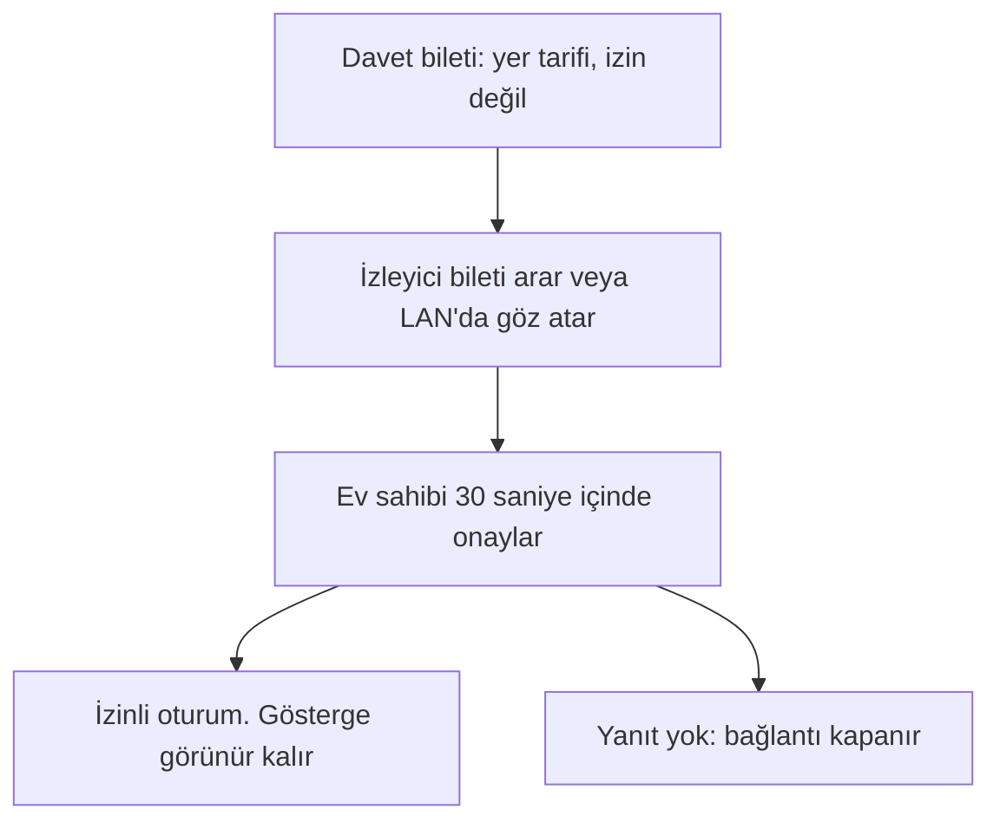

<div align="center">

# CBDesk

**Ekranınızı biri görmeden önce soran bir uzak masaüstü.**

[](README.md)
[](README.tr.md)

[](https://github.com/cumabozkurt/cbdesk/actions/workflows/ci.yml)
[](https://github.com/cumabozkurt/cbdesk/releases/tag/v0.1.0-alpha.1)
[](LICENSE)
[](#indirme)

</div>

> **Tek cümlede:** CBDesk, onaylı bir uzak masaüstünün imzasız alfasıdır: ev sahibi ekran gönderilmeden önce onaylar, oturum göstergesinin kapatma anahtarı yoktur ve bir CBDesk hesabı yoktur.

Çekirdek Rust'tır. Masaüstü kabuğu Flutter'dır. Lisans AGPL-3.0-or-later'dır. Kullanıcı kılavuzu [Pages sitesindedir](https://cumabozkurt.github.io/cbdesk/) (`docs/book`, Türkçe ve İngilizce). Site ikili dosya barındırmaz.

Bu ağaçtaki crate sürümü **0.0.0**'dır. Bu bir ürün yayını değildir. GitHub etiketi [`v0.1.0-alpha.1`](https://github.com/cumabozkurt/cbdesk/releases/tag/v0.1.0-alpha.1) `v0.1.0-alpha.1 unsigned alpha` başlığını taşır ve indirme tablosundaki dosyaları içerir. Bu dosyalar imzasız bir alfadır. 1.0.0 sürümü değildir ve planın alfa çıkışı değildir. Bu sayfa yazıldığında GitHub o sürümü ön sürüm olarak işaretlemiyordu. Dosyaları yine imzasız alfa olarak görün.

---

## İçindekiler

- [Neden?](#neden)
- [Özellikler](#ozellikler)
- [Ekran görüntüleri](#ekranlar)
- [Kurulum](#kurulum)
- [İlk çalıştırma](#ilk)
- [CLI başvurusu](#cli)
- [Tarifler](#tarifler)
- [Nasıl çalışır](#isleyis)
- [Güvenlik ve gizlilik](#guvenlik)
- [Sorun giderme / SSS](#sss)
- [Sınırlamalar](#sinirlar)
- [Benzer projelerle karşılaştırma](#karsilastirma)
- [Yol haritası](#yol)
- [Katkı](#katki)
- [Lisans](#lisans)

---

<a id="neden"></a>

## Neden?

Uzaktan erişim programları sık kullanılan bir dolandırıcılık aracıdır. Arayan, banka, kamu kurumu veya teknik destek gibi görünür ve kişiden bilgisayarını görebilecek bir program kurmasını ister.

CBDesk, oturumun görünür ve seçilmiş olması için tasarlanıyor:

- Ev sahibi, biri ekranı görmeden önce sorulur.
- Oturum göstergesi ekranda kalır ve kapatma anahtarı yoktur.
- Davet bileti, kısa kod, LAN göz atması veya bir DHT kaydı bilgisayarın yerini tarif eder. Hiçbiri izin değildir.
- Onayı 30 saniye içinde kimse yanıtlamazsa bağlantı kapanır.
- Hızlı Destek, gözetimsiz erişim açamaz.
- Bir CBDesk hesabı ve projenin kimlik sunucusu yoktur.

Bu tasarımdır. Aşağıdaki indirme, bu depodaki kodun erken ve imzasız bir derlemesidir. Bitmiş bir ürün değildir ve insanların her gün kullandığı uzak masaüstü programlarıyla aynı seviyede değildir. Sınırlar aşağıda ve [`docs/dev/m0-status.md`](docs/dev/m0-status.md) içindedir.

<a id="ozellikler"></a>

## Özellikler

| | Bu ağaçta | İddia değildir |
|---|---|---|
| Görüntü gönderilmeden önce onay | Kitaplık, CLI `--approve` bayrağı ve Flutter onay paneli | Bitmiş bir onay penceresi |
| Kapatılamayan oturum göstergesi | Kabuk ve kitaplık. Anlambilim canlı bölgesidir | Bir kişinin ekran okuyucu denemesi |
| Onay ekranında dolandırıcılık uyarısı | Türkçe ve İngilizce kataloglar | — |
| CBDesk hesabı yok | Doğrudan arama ve isteğe bağlı operatör aktarıcısı | Ölçülmüş bir NAT başarı oranı |
| Renkli görüntü (YUV), yazılım VP8 | Canlı yol. AV1 durağan yedektir | 30 kare/saniye. VP9 yoktur |
| Flutter kabuğu, Türkçe ve İngilizce | Ana sayfa, bağlan, onay, uzak görünüm, dosyalar, adres defteri, ayarlar | Tel kafes kimlikleri, sözlü kullanılabilirlik denemesi |
| Düz metin pano | `clipboard` izninden sonra, 60 KiB sınırı | Dosya veya görüntü yapıştırma |
| Tek dosya yükleme | `--put`, en çok 32 MiB, `--files-root` altında | zstd. Parçalar sıkıştırmasızdır |
| Ses aygıtları | `--mic` ve `--speaker` varsayılan aygıtı açabilir | Birinin sesi duyduğu |
| LAN'da göz atma | `--lan` / `--browse` ile 5353 üzerinde mDNS | İşletim sisteminin ağ sınıfını okumak |
| Operatör aktarıcısı | `--relay URL`. Bilinen genel aktarıcı sonekleri reddedilir | Bu projenin çalıştırdığı genel bir aktarıcı |
| Android yakalama | Sistem penceresinden sonra başlar. Uzun kenar en çok 960 | Telefona kurulum. Pencere kabul edilmedi |
| Donanım kodlama | Kancalar kapalı başarısız olur | Başarılı bir donanım kodlaması |
| İmzalı kurulum, mağaza, noter | — | Alfada bunların hiçbiri yok |

<a id="ekranlar"></a>

## Ekran görüntüleri

Bir arayüz karesi kaydedilmedi. Bu belge değişikliği Flutter ile bir golden görüntü üretmez. Çizilmiş bir pencere sahte ekran görüntüsü olurdu. Üç resim, bu depodaki tasarımın diyagramıdır.


<a id="kurulum"></a>

## Kurulum

<a id="indirme"></a>

### İndirme

Biri sizi arayıp bu programı kurmanızı söylediyse durun. Bankalar, kamu kurumları ve destek şirketleri uzaktan erişim istemez.

Dosyalar **imzasız bir alfadır**. Windows SmartScreen uyarı verebilir veya engelleyebilir (bilinmeyen yayımcı). macOS Gatekeeper uyarı verebilir veya engelleyebilir. Noter onayı, Apple geliştirici hesabı ve Authenticode sertifikası yoktur. `SHA256SUMS` bir özettir, imza değildir. O sürümdeki `sbom.spdx.json.sign-note` dosyası `unsigned: CBDESK_SIGN_KEY is unset` yazar.

Bu ikililer için gerçek bir cihaz denemesi ve bir performans ölçümü kaydedilmedi. 30 kare/saniye ölçülmedi. Bu sayfa dosyaları yeniden derlemez. Site onları barındırmaz.

| | Dosya | Ne olduğu |
|---|---|---|
| Windows masaüstü x64 | [cbdesk-desktop-0.1.0-alpha.1-windows-x64.zip](https://github.com/cumabozkurt/cbdesk/releases/download/v0.1.0-alpha.1/cbdesk-desktop-0.1.0-alpha.1-windows-x64.zip) | Flutter paketi. `cbdesk/cbdesk.exe` ve `UNSIGNED.txt`. SmartScreen engelleyebilir |
| Windows CLI x64 | [cbdesk-0.1.0-alpha.1-x86_64-pc-windows-msvc.zip](https://github.com/cumabozkurt/cbdesk/releases/download/v0.1.0-alpha.1/cbdesk-0.1.0-alpha.1-x86_64-pc-windows-msvc.zip) | `cargo build --release --locked` ile `cbdesk.exe` |
| Linux masaüstü x64 | [cbdesk-desktop-0.1.0-alpha.1-linux-x64.tar.gz](https://github.com/cumabozkurt/cbdesk/releases/download/v0.1.0-alpha.1/cbdesk-desktop-0.1.0-alpha.1-linux-x64.tar.gz) | `ubuntu-24.04` üzerinde Flutter paketi. `cbdesk/cbdesk` ve kitaplıklar |
| Linux CLI x64 | [cbdesk-0.1.0-alpha.1-x86_64-unknown-linux-gnu.tar.gz](https://github.com/cumabozkurt/cbdesk/releases/download/v0.1.0-alpha.1/cbdesk-0.1.0-alpha.1-x86_64-unknown-linux-gnu.tar.gz) | `ubuntu-24.04` sistem kitaplıklarına bağlanır. Statik ikili değildir |
| Linux deb (CLI) | [cbdesk_0.1.0-alpha.1_amd64.deb](https://github.com/cumabozkurt/cbdesk/releases/download/v0.1.0-alpha.1/cbdesk_0.1.0-alpha.1_amd64.deb) | İmzasız. `cbdesk` dosyasını `/usr/bin` altına koyar. `Depends` satırı yoktur. Flutter uygulaması değildir |
| macOS masaüstü Apple Silicon | [cbdesk-desktop-0.1.0-alpha.1-macos-arm64.zip](https://github.com/cumabozkurt/cbdesk/releases/download/v0.1.0-alpha.1/cbdesk-desktop-0.1.0-alpha.1-macos-arm64.zip) | `macos-14` üzerinde yalnız arm64 `cbdesk.app`. Evrensel değildir. Noter onaylı değildir. Gatekeeper engelleyebilir |
| macOS CLI Apple Silicon | [cbdesk-0.1.0-alpha.1-aarch64-apple-darwin.tar.gz](https://github.com/cumabozkurt/cbdesk/releases/download/v0.1.0-alpha.1/cbdesk-0.1.0-alpha.1-aarch64-apple-darwin.tar.gz) | Yalnız arm64. Evrensel değildir. Noter onaylı değildir |
| Android arm64 | [cbdesk-0.1.0-alpha.1-android-arm64-debug.apk](https://github.com/cumabozkurt/cbdesk/releases/download/v0.1.0-alpha.1/cbdesk-0.1.0-alpha.1-android-arm64-debug.apk) | Hata ayıklama APK'sı. Sürüm imzası yoktur. Telefona kurulmadı. Uygulama kimliği `org.cbdesk.cbdesk` |
| Sağlamalar | [SHA256SUMS](https://github.com/cumabozkurt/cbdesk/releases/download/v0.1.0-alpha.1/SHA256SUMS) | Yukarıdaki dosyaların özetleri. İmza değildir |
| SBOM | [sbom.spdx.json](https://github.com/cumabozkurt/cbdesk/releases/download/v0.1.0-alpha.1/sbom.spdx.json) | `cargo metadata` ile SPDX. `filesAnalyzed` false'tur |
| Android notu | [UNSIGNED-android.txt](https://github.com/cumabozkurt/cbdesk/releases/download/v0.1.0-alpha.1/UNSIGNED-android.txt) | APK imzasız bir hata ayıklama derlemesidir |

Sürüm sayfası [`v0.1.0-alpha.1`](https://github.com/cumabozkurt/cbdesk/releases/tag/v0.1.0-alpha.1) adresindedir. `SHA256SUMS` ile dosyayı aynı dizine indirdikten sonra:

```sh
sha256sum -c SHA256SUMS
```

macOS'ta karşılığı `shasum -a 256 -c SHA256SUMS` komutudur. Özetin tutması, baytların listeyle aynı olduğunu gösterir. Bir bakımcının imzaladığını göstermez.

İmzalı bir MSI, DMG, rpm, AppImage veya Flatpak yayımlanmadı. Depodaki bu betikler şablondur. Flatpak bildirim kimliği `org.cbdesk.CBDesk` şeklindedir. Flathub'a gönderilmedi. TestFlight derlemesi yoktur.

### Kaynaktan derlemek

Geliştirici derlemesi Rust 1.91.0 ister. Kabuk için Flutter 3.47.7 gerekir. Adımlar [`docs/dev/building.md`](docs/dev/building.md) dosyasındadır.

```sh
cargo fmt --all -- --check
cargo clippy --workspace --all-targets -- -D warnings
cargo test --workspace --all-targets
```

Bu derleme, kod üzerinde çalışanlar içindir. "Uzaktan erişimi indir" denmiş birine verilmiş desteklenen bir kurulum değildir.

<a id="ilk"></a>

## İlk çalıştırma

1. Dolandırıcılık uyarısını yeniden okuyun. Telefondaki biri bu programın kurulmasını istiyorsa sürdürmeyin.
2. SmartScreen veya Gatekeeper uyarısı bekleyin. Bu etiketteki alfa bilerek imzasızdır. İstenecek imzalı bir istisna yoktur.
3. Yukarıdaki gibi `SHA256SUMS` dosyasını denetleyin.
4. Masaüstü zip'i Flutter kabuğudur. Diğer arşivler `cbdesk` komut satırı programıdır. Deb paketi kabuk değil, komut satırı programıdır.
5. Kabuğun ana ekranı bir cihaz kimliği ve kısa kod gösterir. Diğer ekranlar bağlan, onay, uzak görünüm, dosyalar, adres defteri ve ayarlardır. Oturum göstergesi sayfaların üstünde durur ve kapatılamaz.
6. Bu depo, bu ekranların ikinci bir fiziksel bilgisayarda, ikinci bir monitörde veya bir telefonda denendiğini kaydetmez.

<a id="cli"></a>

## CLI başvurusu

`cbdesk` üç komut taşır. `doctor`, `net-check` ile aynıdır. Ayrıştırıcı `crates/cbdesk-cli/src/args.rs` dosyasındadır.

```text
cbdesk host --bind ADDR (--synthetic|--screen) [--monitor N] [--approve view,input]
            [--frames N] [--lan] [--relay URL] [--files-root DIR]
            [--tone|--mic] [--speaker] [--profile full|balanced|preview] [--strips N]
cbdesk view (--ticket HEX|--browse) (--ppm FILE|--window|--put FILE|--audio|--mic|--speaker)
            [--pointer X,Y] [--key NAME] [--relay URL]
cbdesk net-check [--json] [--anonymous] [--loopback]
cbdesk doctor    [--json] [--anonymous] [--loopback]
```

### host

| Bayrak | Anlamı |
|---|---|
| `--bind ADDR` | QUIC için UDP soketi. Varsayılan `127.0.0.1:22116` |
| `--synthetic` | Gri bir barkod üretir. Ekrana dokunmaz. `--screen` yoksa zorunludur |
| `--screen` | Birincil ekranı yakalar. `--synthetic` yoksa zorunludur |
| `--monitor N` | Bu çağrıdaki `list_monitors` indeksi. Sabit bir donanım kimliği değildir. Yalnız `--screen` ile. Liste dışı indeks reddedilir. Yazılmazsa birincil ekran kalır. Burada ikinci bir fiziksel monitör takılı değildi. Masaüstü oturumu hâlâ `capture_picture` çağırır |
| `--approve LIST` | İlk temas gecikmesinden sonra uygulanacak izinler, virgülle. Boş liste reddeder. Adlar: `view`, `input`, `clipboard`, `file_read`, `file_write`, `audio`, `terminal`, `block_input`, `privacy_mode`, `sysinfo` |
| `--allow-high-risk` | Listede `file_write`, `terminal`, `block_input` veya `privacy_mode` varsa ilk temasta zorunludur |
| `--frames N` | N kareden sonra durur. `0` (varsayılan) izleyici kapanana kadar akar. Üst sınır 30'dur |
| `--lan` | LAN'da duyuru. CLI profili özel işaretler ve işletim sisteminin ağ sınıfını okumaz |
| `--relay URL` | Operatör aktarıcısı. Şema `https://` veya `relay://` olmalıdır. Yinelenebilir. Bilinen genel aktarıcı sonekleri reddedilir. Bilet aktarıcı ekleyemez. Bu depo genel bir aktarıcı çalıştırmaz |
| `--files-root DIR` | `file_read` ve `file_write` için kafes. Biri onaylandıysa zorunludur |
| `--tone` | `audio` izninden sonra her tempo aralığında bir sentetik Opus paketi. Aygıt açmaz. `--mic` ile birlikte olmaz |
| `--mic` | `audio` izninden sonra varsayılan mikrofonu açar. Aygıt yoksa hata döner |
| `--speaker` | Gelen Opus'u varsayılan hoparlörde çalar. `--approve` içinde `audio` ister. Aygıt yoksa hata döner |
| `--profile NAME` | `full` (varsayılan), `balanced` veya `preview`. Son ikisi `--screen` yakalamasını 2 veya 4 kat küçültür. `--synthetic` tam boyda kalır |
| `--strips N` | `1` ile `16`, varsayılan `1`. 1'in üstünde ve kodek VP8 iken her yatay bant kendi ana karesidir. Varsayılan hasar kodlayıcısıdır. Bu 30 kare/saniye değildir. Masaüstü sunucusu bu bayrağı almaz |

`--approve` yoksa sunucu istemi reddeder. Yazdığı bilet yine yalnızca yer tarifidir.

### view

| Bayrak | Anlamı |
|---|---|
| `--ticket HEX` | Onaltılık davet bileti. Bunun veya `--browse` bayrağının tam biri |
| `--browse` | LAN'da duyuran bir sunucu bulur ve onu arar |
| `--ppm FILE` | İlk kareyi PPM olarak yazar ve çıkar |
| `--window` | Pencere kapanana kadar kareleri gösterir. İşaretçi ve klavye yalnız `input` izninden sonra gider |
| `--put FILE` | `file_write` izninden sonra bir dosya yükler. En çok 32 MiB |
| `--audio` | Ses ister ve sunucunun gönderdiği Opus paketlerinin uzunluğunu yazar |
| `--mic` | Ses izni varken varsayılan mikrofonu gönderir |
| `--speaker` | Gelen Opus'u varsayılan hoparlörde çalar |
| `--pointer X,Y` | `input` izni verildiyse ilk kareden sonra bir işaretçi örneği |
| `--key NAME` | `input` izni verildiyse `enter` veya bir ASCII karakter |
| `--relay URL` | Sunucu ile aynı kural. Biletin aktarıcı listesi aranmaz |

`--ppm`, `--window`, `--put`, `--audio`, `--mic` veya `--speaker` bayraklarından biri zorunludur.

### net-check

Yerel UDP ve adres sınıfı raporu yazar. Oturum açmaz. Simetrik NAT, UPnP, DHT ve delik açma ölçülmedi diye yazılır. `--anonymous` yerel kaynak adreslerini çıkarır. `--json` tek bir JSON nesnesi basar. `--loopback` bu bilgisayarda iki uç bağlar ve oradaki doğrudan yolun NAT deliği olmadığını söyler.

<a id="tarifler"></a>

## Tarifler

Bunlar, alfayı deneyen veya kodu derleyen kişiler için yerel komutlardır. Bir destek metni değildir. Yayımlanan ikililer için iki bilgisayarlı bir duman denemesi olarak çalıştırılmadılar.

### Tek makinede sentetik görüntü

Ekran yakalanmaz.

```sh
cbdesk host --bind 127.0.0.1:22116 --synthetic --approve view --frames 1
```

Sunucunun yazdığı biletin onaltılık metnini kopyalayın:

```sh
cbdesk view --ticket HEX --ppm frame.ppm
```

### Tek ekran karesi

Bir ekran gerekir. `--screen` Linux'ta X11'i, `WAYLAND_DISPLAY` varken Wayland ScreenCast portalını ve PipeWire'ı, Windows ve macOS'ta aynı yakalama kitaplığını okur. Wayland ScreenCast CI'da çalıştırılmadı.

```sh
cbdesk host --bind 127.0.0.1:22116 --screen --approve view --frames 1
cbdesk view --ticket HEX --window
```

### Bu makine ne görüyor

```sh
cbdesk net-check
cbdesk net-check --anonymous --json
```

Raporda `symmetric nat: unmeasured` satırı vardır.

### LAN duyurusu

`--lan` isteğe bağlıdır. Ağın herkese açık olup olmadığını işletim sistemine sormaz.

```sh
cbdesk host --bind 0.0.0.0:22116 --screen --approve view --lan
cbdesk view --browse --window
```

5353 doluysa gönderim yine 5353'e gider, soket geçici bir portta dinler.

### Seçtiğiniz bir dizine tek dosya

`file_write` yüksek risklidir. Ev dizininizi değil, boş bir dizin kullanın.

```sh
mkdir -p /tmp/cbdesk-in
cbdesk host --synthetic --approve view,file_write --allow-high-risk --files-root /tmp/cbdesk-in
cbdesk view --ticket HEX --put ./notes.txt
```

<a id="isleyis"></a>

## Nasıl çalışır



Bu alfanın yaptığı:

- İki cihaz doğrudan bağlanabilir. `cbdesk host` ve `cbdesk view`, onaydan sonra aynı yerel ağda bir oturum açabilir. Döngüsel QUIC ve aynı makinede bir PPM yazan mDNS göz atması, bir Linux makinesindeki testlerle kapsanır.
- Görüntü renklidir (YUV). Sentetik kaynak gri bir barkoddur. Canlı yol, yakalanan görüntünün çift enini ve boyunu korur. Tempo 33 ms'dir: kodlama bu süreyi aşarsa VP8 niceliği yükselir ve sonraki aralık atlanır. [`docs/dev/media-measurement.md`](docs/dev/media-measurement.md) içindeki 1080p yazılım süresi tek makine ve tek sentetik görüntüdür (bir ana kare 198 ms, dört şerit 52 ms, çeyrek boy 12 ms). 30 kare/saniye değildir ve indirilen derlemenin ölçümü değildir.
- Kodek oxideav-vp8'tir. İlk kare ana karedir. Aynı boyuttaki sonraki kare, hareket dengelemeli bir ara kare olabilir. 4:4:4 reddedilir.
- Cihaz tohumu işletim sistemi anahtarlığında durur (Secret Service, Keychain veya Credential Manager). Anahtarlık yanıt vermezse süreç yeni kimliği yalnız bellekte tutar.
- Masaüstü sunucusunda iki kısa kod sözcüğü, yayımlanmış `spake2` 0.4.0 ile eşleşmeyi doğrular. Bilete yazılmaz. CLI sunucusu bu değiş tokuşu çalıştırmaz. Sunucunun yine onaylaması gerekir. Bu transkriptin dış incelemesi yoktur.
- HTML içeren pano metni düz metne indirilir. `cbdesk-secret` satırı paylaşılmaz. Bu işaret parola tespiti değildir.
- `--relay`, operatörün adlandırdığı aktarıcıyı kurar. Oturum QUIC üzerindedir; yalnız paket taşıyan bir aktarıcı oturum anahtarlarını almaz. Adresleri ve trafik hacmini görebilir. Döngüsel aktarıcı testi, UDP kapalıyken bir sonda taşır.

Planın anlattığı ve bu ağacın henüz yapmadığı:

- Ana planın keşif yığını (LAN, bilet, DHT, dedikodu, topluluk aktarıcıları) [`docs/MASTER_PLAN.md`](docs/MASTER_PLAN.md) içindeki tasarımdır. Plandaki kutular işaretsiz kalır.
- Bu ağaçtaki DHT kayıtları uzun dönem anahtarla imzalanır. Kör yayın hata döner ve kayıt açılmaz. [ADR-007](docs/adr/007-dht-blinding.md) öneri durumundadır. "Varsayılan olarak gizli" bir DHT yoktur.
- Bu depo genel bir aktarıcı çalıştırmaz ve bir aktarıcı listesi taşımaz. `cbdesk-relayd` yalnız döngü adresine bağlanır.
- Canlı bir simetrik NAT ölçülmedi. Döngüsel bir yol delik açma değildir. n0 varsayılanları kapalıdır.
- Canlı `cbdesk host` oturumu X11 tutmayı, gizlilik penceresini, kabuğu veya tüneli çağırmaz. Windows `BlockInput` ve macOS olay tuzağı derlenir ve bırakılınca salınır. Bu çalışma alanında ikisinde de başarılı bir tutma kaydı yoktur.

<a id="guvenlik"></a>

## Güvenlik ve gizlilik

Bir açığı bildirmek: [`SECURITY.md`](SECURITY.md). GitHub'ın gizli bildirimini kullanın. Herkese açık bir konuya cihaz tohumu, kısa kod parolası veya canlı bir istismar koymayın.

- Oturum gizlenemez. Gizli kip için bir izin bayrağı yoktur.
- İlk temasta yüksek riskli izinler, ev sahibi ayrıca seçmezse kapalı kalır.
- Yankı sondası oturum açmaz. İzin verilmeden açılan bir yan akış `PROTOCOL_VIOLATION` olur.
- Anahtarlık yolu kimlik malzemesini dosyaya yazmaz. Depo yanıt vermezse yeni kimlik o süreçte bellekte kalır.
- Proje bir hesap sunucusu işletmez ve varsayılan yapılandırmada bir satıcı aktarıcısı istemez.
- Genel anahtar körleştirmesi yoktur. Açık yayımlanan bir DHT kaydı cihaz kimliğine bağlanabilir.
- Dış kriptografi incelemesi ve dış denetim yoktur.
- Aktarıcı işleten kişi IP adreslerini ve geçen trafik miktarını görebilir. QUIC yolu ona oturum anahtarlarını vermez. Yalıtık kip aktarıcıyı ve DHT yayını reddeder.
- Alfa ikilileri imzasızdır. Özetin tutması yayımcı kimliği değildir.

Kılavuzdaki gizlilik notları kitaptadır (`privacy`). Proje, oturum içeriği toplayan bir hizmet işletmez.

<a id="sss"></a>

## Sorun giderme / SSS

**SmartScreen veya Gatekeeper dosyayı engelledi.** Bu imzasız alfa için beklenen sonuç budur. Projenin Authenticode sertifikası ve Apple noter kaydı yoktur. Bir yabancı istedi diye bu korumaları kapatmayın.

**Linux CLI başka bir dağıtımda açılmıyor.** `x86_64-unknown-linux-gnu` arşivi `ubuntu-24.04` üzerinde derlenir ve o imajın sistem kitaplıklarına bağlanır. Taşınabilir statik bir ikili değildir. Deb paketi aynı ikiliyi taşır ve paket bağımlılığı bildirmez.

**macOS zip'i yanlış Mac.** Masaüstü zip'i de CLI arşivi de `macos-14` üzerinde Apple Silicon (`arm64`) derlemesidir. Evrensel ikili değildir. Intel Mac'ler bu etikette yoktur.

**`cbdesk host` `--synthetic` veya `--screen` istiyor.** Bu bayraklardan biri zorunludur. `--monitor`, `--profile balanced` ve `--profile preview` `--screen` ile kullanılır.

**Onay kayboldu.** 30 saniye içinde yanıtlanmayan onay kapanır. Bu bilinçlidir.

**Ses yok.** CLI'da eksik aygıt hatadır. Kabuktaki mikrofon anahtarı aygıt yokken oturumu düşürmez. Bu depo birinin sesi duyduğunu kaydetmez.

**Sunum için göstergeyi kapatabilir miyim?** Hayır. Göstergenin kapatma anahtarı yoktur. Bunu ekleyen bir değişiklik kabul edilmez.

**Bilet parola mı?** Hayır. Bileti okuyabilen kişi kapıyı çalabilir. Ev sahibinin yine onaylaması gerekir.

**`net-check` NAT türümü söyler mi?** Bir adres sınıfı yazar, sonra `symmetric nat: unmeasured` der. `--loopback` bu bilgisayardaki bir yoldur, delik açma değildir.

<a id="sinirlar"></a>

## Sınırlamalar

Bunlar [`docs/dev/m0-status.md`](docs/dev/m0-status.md) ile aynıdır. Bu README'de ondan yeşil bir cümle hata sayılır.

- 0.0.0 sürümü bir yayın değildir. `v0.1.0-alpha.1` etiketi imzasız bir alfadır; planın M2 alfa çıkışı ve 1.0.0 değildir. Masaüstü duman matrisi bir kişi tarafından çalıştırılmadı. Bu belge değişikliği ikilileri yeniden derlemedi.
- Kod imzası, noter, TestFlight, Flathub, F-Droid, winget, Homebrew, AUR, MSI, DMG, rpm veya AppImage yayını yoktur. Ağaçtaki WiX, Flatpak, DMG ve AppImage şablondur.
- 30 kare/saniye iddiası yoktur. 1080p sayıları tek makine ve tek sentetik görüntüdür.
- Başarılı bir donanım kodlaması yoktur. 4:4:4 yoktur. VP9 yoktur.
- Canlı simetrik NAT ölçümü yoktur. İki ev yönlendiricisinin bağlanacağı iddiası yoktur. Bu depoda genel aktarıcı yoktur.
- Linux'tan Windows'a bir oturum çalıştırılmadı. İkinci bir fiziksel monitör takılı değildi. Wayland ScreenCast CI'da çalıştırılmadı. Eksik ekran hata döner; sessizce barkoda düşmez.
- Sesin duyulduğu kaydedilmedi. Seğirme tamponu 40 ms bekler ve 120 ms'den eski sesi düşürür. Bu bir kod gerçeğidir, dinleme denemesi değildir.
- Android APK kurulmadı. Sistem yakalama penceresi kabul edilmedi. iOS denetleyici crate'i yalnız macOS CI'da tür denetiminden geçer.
- Canlı sunucu X11 tutmayı, gizlilik penceresini, kabuğu veya tüneli tutmaz. Burada başarılı bir Windows veya macOS girdi tutması kaydedilmedi.
- DHT körleştirmesi yoktur. Kör yayın kapalı başarısız olur. SPAKE2 transkriptinin ve OPAQUE bileşiminin dış incelemesi yoktur. CLI parola kaydetmez. TOTP onay isteminde değildir. Kararlı bir `opaque-ke` artık `crypto-bigint` 0.5.5'e bağlı olmayana kadar RUSTSEC-2026-0387 yok sayılır.
- M0'ın "çatal üç masaüstünde derlenir" çıkışı bilerek karşılanmamıştır: çatal yoktur. Bkz. [ADR-015](docs/adr/015-clean-room-media.md) ve [ADR-002](docs/adr/002-fork-sequencing.md).
- Hızlı Destek yasaktır. Plan kutuları işaretsiz kalır. Planda sahibinde kalan maddeler sahibiyle kalır.

<a id="karsilastirma"></a>

## Benzer projelerle karşılaştırma

RustDesk, AnyDesk, Chrome Remote Desktop ve Tailscale ile Uzak Masaüstü, insanların bugün kullandığı ürünlerdir. CBDesk, başka bir kod tabanının imzasız alfasıdır. Vahşi NAT geçişinde, performansta, kod imzasında, mağaza dağıtımında veya cihaz denemesinde onlarla aynı değildir. Bu tablo CBDesk'in daha hızlı, daha güvenilir veya pratikte daha güvenli olduğunu söylemez.

Karşılaştırma adları anmak içindir. Onların adları, logoları ve renkleri CBDesk'in kimliği olarak kullanılmaz. Aşağıdaki olgular o ürünlerin kamuya açık biçimidir, bir kıyas değildir.

| | **CBDesk (bu depo)** | **[RustDesk](https://rustdesk.com/)** | **AnyDesk** | **Chrome Remote Desktop** | **Tailscale + RDP** |
|---|---|---|---|---|---|
| Bugün elinize geçen | İmzasız alfa. Crate 0.0.0. Etiket `v0.1.0-alpha.1` | İnsanların kurduğu, bitmiş bir AGPL uzak masaüstü | Tescilli ticari bir uzak masaüstü | Google'ın uzak masaüstü | Bir örgü VPN artı Microsoft Uzak Masaüstü. İki ürün |
| Hesap | CBDesk hesabı ve proje kimlik sunucusu yok | O ürünün hem genel sunucuları hem kendi barındırılan kimlik/aktarıcısı vardır | Alışılmış yol bir AnyDesk hesabıdır | Bir Google hesabı | Bir Tailscale hesabı, ya da koordinasyonu kendiniz işletirseniz Headscale |
| İstemcinin lisansı | AGPL-3.0-or-later | AGPL-3.0 | Tescilli | Tescilli | Tailscale ve Microsoft'un kendi koşulları vardır. Headscale ayrı bir projedir |
| Bu deponun amaçladığı onay | Ev sahibi onayı, 30 saniye zaman aşımı, gizlenemeyen gösterge, gözetimsiz Hızlı Destek yok | Gözetimsiz erişim o ürünün bir özelliğidir | Gözetimsiz kullanım dahil ticari erişim denetimleri | Google hesabı üzerinden erişim | RDP, Windows oturumunu sorar. Tailscale bu onay göstergesini uygulamaz |
| NAT | Doğrudan arama, LAN mDNS ve operatörün adlandırdığı aktarıcı kodda vardır. Canlı simetrik NAT ölçülmedi | O projenin buluşma ve aktarıcısıyla NAT'lar arasında yaygın kullanılır | Yaygın kullanılır | Google'ın aktarıcıları | Tailscale'in NAT geçişi bitmiş bir üründür. Bu tablo onun sonuçlarını ödünç almaz |
| İmza ve mağazalar | İmzasız. SmartScreen ve Gatekeeper alfayı engelleyebilir. Flathub, TestFlight veya F-Droid gönderimi yok | Kurulabilir istemciler yayımlar | İmzalı ticari istemciler yayımlar | Google imzalar; tarayıcı yolu da vardır | İmzalı istemciler yayımlar |
| Bu kodla ilişkisi | Okuduğunuz ağaç | Bu kod değil. [ADR-015](docs/adr/015-clean-room-media.md) çatalı almaz. Yakalama, kodek ve girdi bu temiz oda çekirdeğinde kalır | Bu kod değil | Bu kod değil | Bu kod değil |

RustDesk, en yakın açık kaynak uzak masaüstüdür. CBDesk onu kopyalamaz, kimlik sunucusunu kullanmaz ve onun kurulum geçmişini üstlenmez. AnyDesk ve Chrome Remote Desktop bitmiş tescilli ürünlerdir; biri o şirketin hesabına, diğeri bir Google hesabına bağlıdır. Tailscale ile RDP, makineyi bir ağa koyup ardından Windows uzak oturumunu kullanır. Bu, erişim artı bir uzak masaüstü protokolüdür; tek bir onay uygulaması değildir.

Bu tabloya, diğer projenin kendi belgelerini gösteren düzeltmeler kabul edilir.

<a id="yol"></a>

## Yol haritası

Plan [`docs/MASTER_PLAN.md`](docs/MASTER_PLAN.md) dosyasındadır. Oradaki kutular, bitti tanımı karşılanana kadar işaretsiz kalır. Ağaçta gerçekten ne olduğu [`docs/dev/m0-status.md`](docs/dev/m0-status.md) içindedir.

- M0 çatal çıkışı bilerek karşılanmamıştır (ADR-015).
- Plandaki sonraki kilometre taşları incelenmiş bir kısa kod, DHT körleştirmesi, operatörün çalıştırabildiği bir aktarıcı, imza, mobil sunucular ve bir kullanılabilirlik turunu kapsar. Bu README yazıldığı için o maddeler bitmiş sayılmaz.
- Planda sahibinde kalan maddeler sahibiyle kalır. Bu depo onları bitti diye işaretlemez.
- Bu listede tarih yoktur.

<a id="katki"></a>

## Katkı

Bkz. [`CONTRIBUTING.md`](CONTRIBUTING.md). Lisans AGPL-3.0-or-later'dır. Katkılar Developer Certificate of Origin kullanır (`git commit -s`). CLA yoktur.

```sh
git clone https://github.com/cumabozkurt/cbdesk
cd cbdesk
cargo test --workspace --all-targets
```

Oturumu gizleyen, bileti izin sayan veya Hızlı Destek'i gözetimsiz erişime çeviren bir değişiklik kabul edilmez. Güvenlik bildirimleri herkese açık konu değil, [`SECURITY.md`](SECURITY.md) üzerinden gider. Değişiklik günlüğü [`CHANGELOG.md`](CHANGELOG.md) dosyasındadır.

<a id="lisans"></a>

## Lisans

[AGPL-3.0-or-later](LICENSE).

Bu kod RustDesk'ten türetilmemiştir. [ADR-015](docs/adr/015-clean-room-media.md) çatalı almaz; yakalama, kodlayıcı ve girdi bu temiz oda çekirdeğinde kalır. Sıralama kaydı [ADR-002](docs/adr/002-fork-sequencing.md) içindedir. `tools/rebrand-check.sh` o adı yalnız atıf dosyalarında tutar.
