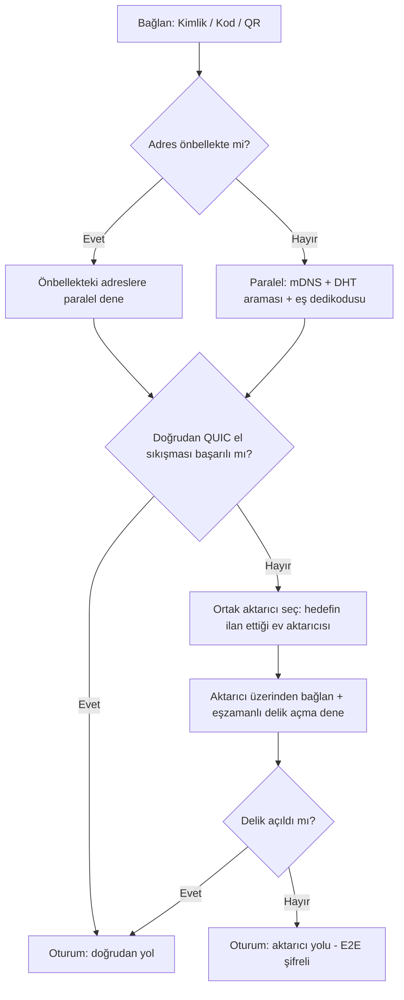
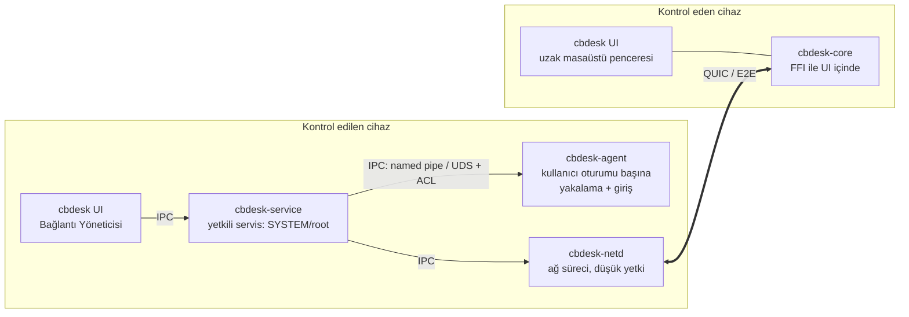
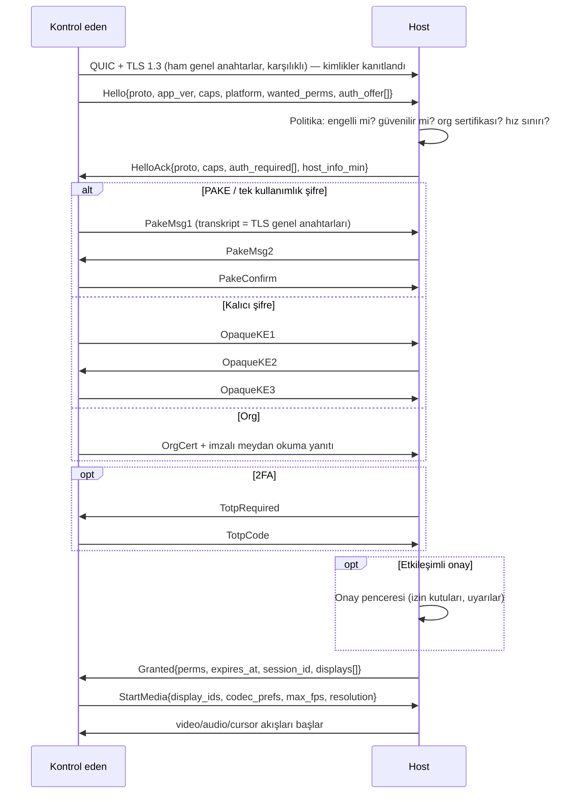
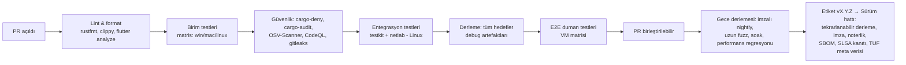
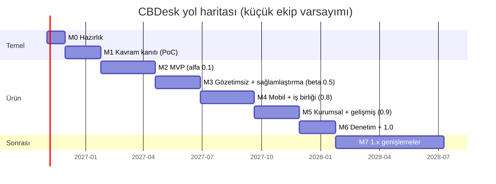
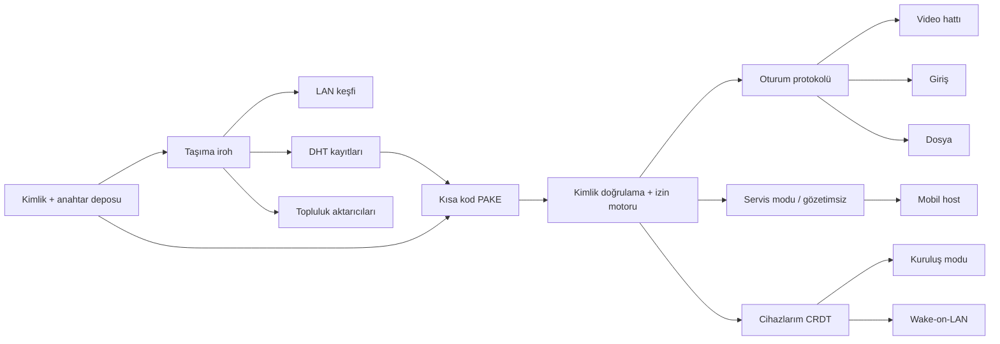

# CBDesk — Uçtan Uca Ana Plan (Master Plan)

> **Merkeziyetsiz, sunucusuz, açık kaynaklı, platformlar arası uzak masaüstü yazılımı**
> RustDesk + TeamViewer + AnyDesk + açık kaynak ekosistemin (MeshCentral, Guacamole, Sunshine/Moonlight, scrcpy, Deskflow, magic-wormhole, LocalSend, Syncthing…) özelliklerinin birleşimi.

| Alan | Değer |
|---|---|
| Proje adı | **CBDesk** (komut adı: `cbdesk`, paket kimliği: `org.cbdesk.CBDesk`) |
| Belge sürümü | 1.0 (ilk taslak) |
| Belge türü | Ana plan + mimari + test planı + yol haritası (tek kaynak — "single source of truth") |
| Hedef lisans | **AGPL-3.0-or-later** (gerekçe §3) |
| Hedef platformlar | Windows 10/11 (x64, ARM64), macOS 12+ (Apple Silicon + Intel), Linux (X11 + Wayland; x64, ARM64), Android 8+, iOS 15+ (yalnız kontrol eden taraf), Web/PWA (ileri faz) |
| Ana dil / UI | Rust (çekirdek) + Flutter (arayüz) |
| Durum | Planlama |

---

## İçindekiler

0. [Bu belge nasıl kullanılır](#0-bu-belge-nasıl-kullanılır)
1. [Vizyon, ilkeler ve kapsam](#1-vizyon-ilkeler-ve-kapsam)
2. ["Sunucusuz" gerçekliği: neyi vaat ediyoruz, neyi edemeyiz](#2-sunucusuz-gerçekliği)
3. [Lisans, marka ve hukuki temel](#3-lisans-marka-ve-hukuki-temel)
4. [Rakip analizi ve birleşik özellik envanteri](#4-rakip-analizi-ve-birleşik-özellik-envanteri)
5. [Sistem mimarisi](#5-sistem-mimarisi)
6. [Ağ, keşif ve NAT geçişi katmanı](#6-ağ-keşif-ve-nat-geçişi-katmanı)
7. [Kimlik, kimlik doğrulama ve yetkilendirme](#7-kimlik-kimlik-doğrulama-ve-yetkilendirme)
8. [Oturum protokolü](#8-oturum-protokolü)
9. [Medya hattı: video ve ses](#9-medya-hattı-video-ve-ses)
10. [Giriş, pano, dosya ve gelişmiş özellik tasarımları](#10-giriş-pano-dosya-ve-gelişmiş-özellik-tasarımları)
11. [Platforma özel uygulama detayları](#11-platforma-özel-uygulama-detayları)
12. [Kullanıcı arayüzü ve deneyimi (UI/UX)](#12-kullanıcı-arayüzü-ve-deneyimi)
13. [Güvenlik, tehdit modeli ve kötüye kullanımı önleme](#13-güvenlik-tehdit-modeli-ve-kötüye-kullanımı-önleme)
14. [Gizlilik](#14-gizlilik)
15. [Geliştirme süreci, depo yapısı ve CI/CD](#15-geliştirme-süreci-depo-yapısı-ve-cicd)
16. [Test stratejisi](#16-test-stratejisi)
17. [Test kataloğu (uçtan uca test vakaları)](#17-test-kataloğu)
18. [Yol haritası ve fazlar](#18-yol-haritası-ve-fazlar)
19. [Yayın, dağıtım ve güncelleme](#19-yayın-dağıtım-ve-güncelleme)
20. [Topluluk, yönetişim ve sürdürülebilirlik](#20-topluluk-yönetişim-ve-sürdürülebilirlik)
21. [Risk kaydı](#21-risk-kaydı)
22. [Ekler](#22-ekler)

---

## 0. Bu belge nasıl kullanılır

### 0.1 Amaç
Bu belge CBDesk'in **fikirden 1.0 sürümüne** kadar tüm aşamalarını tanımlar: ne yapılacağı, nasıl yapılacağı, hangi sırayla yapılacağı, nasıl test edileceği ve "bitti" sayılma ölçütleri. Depoya `docs/MASTER_PLAN.md` olarak eklenmesi ve her mimari karardan sonra güncellenmesi önerilir.

### 0.2 Kimlik numaralandırma kuralları
Belgedeki her öğenin izlenebilir bir kimliği vardır. GitHub Issue'ları, PR'lar ve test vakaları bu kimliklere atıf yapar.

| Önek | Anlamı | Örnek |
|---|---|---|
| `F-xxx` | Özellik (Feature) | `F-002` Kısa oturum kodu |
| `NFR-xxx` | İşlevsel olmayan gereksinim | `NFR-010` Gecikme hedefi |
| `ADR-xxx` | Mimari karar kaydı | `ADR-003` Ağ kütüphanesi seçimi |
| `T-<ALAN>-xxx` | Test vakası | `T-NET-014` Simetrik NAT ↔ simetrik NAT |
| `R-xxx` | Risk | `R-007` Kod imzalama maliyeti |
| `M<n>` | Kilometre taşı (milestone) | `M2` MVP |
| `P0..P3` | Öncelik | P0 = olmazsa olmaz, P3 = güzel olur |

### 0.3 Öncelik tanımları
- **P0** — MVP'de olmak zorunda; olmazsa ürün kullanılamaz.
- **P1** — 1.0 sürümünde olmalı; rakiplerle eşitlik (parity) için gerekli.
- **P2** — 1.x sürümlerinde; fark yaratan özellikler.
- **P3** — Araştırma/deneysel; topluluk katkısına açık.

### 0.4 "Bitti" tanımı (Definition of Done) — her özellik için geçerli
Bir özellik ancak aşağıdakilerin **tamamı** sağlandığında "bitti" sayılır:
1. Kod `main` dalına birleştirildi; en az 1 bakımcı incelemesi (güvenlikle ilgili kodda 2) var.
2. Birim testleri yazıldı; ilgili crate'te satır kapsamı düşmedi (hedef çekirdekte ≥ %80).
3. İlgili `T-*` test vakaları otomatikleştirildi **veya** manuel test kontrol listesine eklendi.
4. Desteklenen tüm platformlarda CI yeşil.
5. Kullanıcı belgesi (`docs/user/`) ve gerekiyorsa geliştirici belgesi güncellendi.
6. Arayüz metinleri çeviri dosyalarına (en az `tr` ve `en`) eklendi.
7. Erişilebilirlik kontrolü yapıldı (klavye ile kullanılabilir, ekran okuyucu etiketi var).
8. Güvenlik etkisi değerlendirildi (tehdit modeli §13'te gerekirse güncellendi).
9. Performans bütçesi aşılmadı (§16.8 ölçümleri).
10. CHANGELOG girdisi eklendi.

---

## 1. Vizyon, ilkeler ve kapsam

### 1.1 Vizyon
> "Herkesin, hiçbir şirkete, hesaba ya da sunucuya bağımlı olmadan, kendi cihazlarına ve izin verdiği kişilerin cihazlarına güvenli, hızlı ve ücretsiz şekilde uzaktan erişebilmesi."

### 1.2 Temel ilkeler (tasarımda her çatışmada bu sıraya göre karar verilir)
1. **Rıza ve güvenlik önce gelir.** Hiçbir cihaz, sahibinin açık ve bilinçli izni olmadan kontrol edilemez. Gizli/görünmez çalışma modu **yoktur** (§13.6).
2. **Merkezi otorite yok.** Çalışmak için CBDesk projesinin işlettiği hiçbir sunucuya ihtiyaç duyulmaz. Proje hiçbir kullanıcıyı engelleyemez, izleyemez, kaydedemez — ve bu teknik olarak doğrulanabilir olmalıdır.
3. **Uçtan uca şifreleme zorunludur**, kapatılamaz. Aktarıcılar (relay) dahil hiçbir ara düğüm içeriği göremez.
4. **Hesap yok.** Kimlik = cihazda üretilen kriptografik anahtar çifti. E-posta, telefon, kayıt istenmez.
5. **Telemetri yok.** Uygulama "eve telefon etmez". Güncelleme kontrolü bile kapatılabilir ve varsayılan davranışı belgelenir.
6. **Yerel öncelikli (local-first).** Adres defteri, ayarlar, günlükler kullanıcının cihazındadır; senkronizasyon yalnızca kullanıcının kendi cihazları arasında, şifreli ve eşler arası yapılır.
7. **Platformlar arası eşitlik.** Bir özellik bir platformda teknik olarak imkânsızsa bu açıkça belgelenir (örn. iOS kontrol edilemez).
8. **Doğrulanabilirlik.** Tekrarlanabilir derlemeler (reproducible builds), imzalı sürümler, SBOM.
9. **Sadelik.** "Kurulum gerektirmeden çalışır" deneyimi korunur (RustDesk'in en güçlü yanı).

### 1.3 Kapsam (In-scope)
- Masaüstü (Windows, macOS, Linux) hem **kontrol eden (controller)** hem **kontrol edilen (host)** olarak.
- Android hem kontrol eden hem kontrol edilen; iOS yalnız kontrol eden (+ ileride yalnız-izleme ekran paylaşımı).
- Eşler arası (P2P) bağlantı; LAN, DHT, topluluk aktarıcıları ve manuel davetle keşif.
- §4'teki birleşik özellik envanteri.

### 1.4 Kapsam dışı (Out-of-scope) — bilinçli olarak yapılmayacaklar
- Merkezi hesap/oturum açma sistemi, bulut panel, ücretli katman.
- Kullanıcının haberi olmadan çalışan, simgesi gizlenen, bağlantıyı gizleyen herhangi bir mod.
- Uzaktaki kullanıcının onayını otomatik olarak tıklayan/atlayan mekanizmalar (Android MediaProjection onayı, macOS TCC izinleri, Wayland portal onayı vb.).
- Reklam, analitik SDK'ları, kapalı kaynak bağımlılıklar (zorunlu olmayan sürücüler hariç; bkz. §11).
- RustDesk sunucularıyla (hbbs/hbbr) protokol uyumluluğu (1.0 sonrası opsiyonel "köprü" olarak değerlendirilebilir — P3).

### 1.5 Hedef kullanıcı profilleri (persona)
| Persona | İhtiyaç | Kritik özellikler |
|---|---|---|
| **Ayşe — ev kullanıcısı** | Annesinin bilgisayarına yardım etmek | Kısa kod (F-002), tek tıkla onay, dolandırıcılık uyarısı yok sayılabilir değil, Türkçe arayüz |
| **Mehmet — serbest BT destekçisi** | 30 müşteri cihazını yönetmek | Adres defteri, yönetilmeyen erişim, toplu dağıtım, dosya aktarımı, uzaktan yeniden başlatma |
| **Zeynep — yazılımcı** | Evdeki Linux makinesine işten bağlanmak | Kendi cihazlarım grubu, TCP tünel, terminal, Wayland desteği, CLI |
| **Can — oyuncu/yaratıcı** | Yüksek FPS, düşük gecikme | Donanım kodlama, 120 FPS, gamepad, göreli fare |
| **KOBİ BT yöneticisi** | 200 cihaz, rol bazlı erişim, sunucusuz | Kuruluş modu (F-041), politika dosyaları, erişim günlüğü |
| **Gazeteci/aktivist** | Gözetimden kaçınma | Tor üzerinden bağlantı (P3), DHT'de gizli kayıt (§14.3), meta veri en aza indirme |

### 1.6 İşlevsel olmayan gereksinimler (NFR) — özet
(Ölçüm yöntemleri §16.8'de.)

| ID | Gereksinim | Hedef |
|---|---|---|
| NFR-001 | LAN'da cam-camdan (glass-to-glass) gecikme, 1080p60, donanım kodlama | p50 ≤ 30 ms, p95 ≤ 50 ms |
| NFR-002 | WAN doğrudan bağlantıda ek gecikme (RTT üstüne) | p95 ≤ RTT + 45 ms |
| NFR-003 | LAN'da bağlantı kurulum süresi | p95 ≤ 1,5 s |
| NFR-004 | Bilinen eşle (önbellekte adres) WAN bağlantı kurulumu | p95 ≤ 4 s |
| NFR-005 | Soğuk DHT araması ile bağlantı | p95 ≤ 15 s |
| NFR-006 | Delik açma başarısızsa aktarıcıya geçiş | ≤ 8 s içinde görüntü |
| NFR-007 | Ağ değişikliğinde (Wi-Fi → 4G) oturum sürekliliği | Görüntü kesintisi ≤ 3 s, oturum düşmez |
| NFR-008 | Boştaki host CPU kullanımı (servis, oturum yok) | ≤ %0,5 (referans donanım), RAM ≤ 60 MB |
| NFR-009 | 1080p60 akış sırasında host CPU (donanım kodlama) | ≤ %15 |
| NFR-010 | Statik masaüstünde bant genişliği | ≤ 100 kbit/s |
| NFR-011 | Dosya aktarımı (1 Gbit LAN) | ≥ 700 Mbit/s |
| NFR-012 | Kontrol eden istemci bellek kullanımı (1 oturum 4K) | ≤ 400 MB |
| NFR-013 | Kurulum paketi boyutu (masaüstü) | ≤ 40 MB |
| NFR-014 | Kesintisiz çalışma (soak) | 72 saat bellek sızıntısı < %5 büyüme |
| NFR-015 | Çökme oranı (beta) | < 1 / 500 oturum-saati |
| NFR-016 | Erişilebilirlik | WCAG 2.2 AA eşdeğeri (masaüstü/mobil UI) |
| NFR-017 | Protokol uyumluluğu | N ve N-1 ana protokol sürümleri birbirine bağlanabilir |

---

## 2. "Sunucusuz" gerçekliği

Bu bölüm projenin en kritik dürüstlük bölümüdür. Kullanıcılara ve katkıcılara **yanlış vaatte bulunmamak** için README'de de özetlenmelidir.

### 2.1 Sorun: İnternet eşler arası bağlantı için tasarlanmamış
Cihazların çoğu NAT, CGNAT (operatör NAT'ı) ve güvenlik duvarı arkasındadır. İki cihazın birbirini bulması (keşif) ve aralarında yol açması (NAT geçişi) için normalde bir "buluşma sunucusu" (RustDesk'te `hbbs`) ve bir "aktarma sunucusu" (RustDesk'te `hbbr`) kullanılır. RustDesk'in kendi README'si de istemcinin rendezvous/relay sunucusuyla konuşarak doğrudan (TCP delik açma) ya da aktarılmış bağlantı beklediğini anlatır.

### 2.2 CBDesk'in çözümü: "Sunucusuz, ama yalnız değil"
CBDesk, **projenin işlettiği** hiçbir sunucuya ihtiyaç duymaz; bunun yerine şu katmanları kullanır:

| Katman | Ne işe yarar | Kim işletir | Merkezi mi? |
|---|---|---|---|
| L1 — LAN keşfi (mDNS/DNS-SD + UDP yayın) | Aynı ağdaki cihazları bulur | Kimse (yerel) | Hayır |
| L2 — Manuel davet (QR, bağlantı, bilet dosyası) | Adresleri bant dışı (out-of-band) paylaşır | Kimse | Hayır |
| L3 — BitTorrent Mainline DHT (pkarr imzalı kayıtlar) | Genel anahtardan güncel adrese çözümleme | Dünyadaki milyonlarca BitTorrent düğümü | Hayır (kimsenin sahibi değil) |
| L4 — CBDesk eşleri arası dedikodu (gossip) | Adres ve aktarıcı listesi paylaşımı | CBDesk kullanıcıları | Hayır |
| L5 — Topluluk aktarıcıları (gönüllü eşler) | Delik açılamayan durumlarda şifreli trafik aktarma | Gönüllü kullanıcılar (opt-in) | Hayır (çoklu, değiştirilebilir) |
| L6 — Kendi aktarıcın/önyükleme düğümün (opsiyonel) | Kurumsal/kısıtlı ağlarda garanti | Kullanıcının kendisi | Kullanıcının kontrolünde |

### 2.3 Dürüst sınırlamalar (README'ye girecek)
1. **DHT önyüklemesi (bootstrap):** Mainline DHT'ye ilk katılımda bilinen önyükleme düğümleri (BitTorrent istemcilerinin kullandığı genel düğümler) gerekir. Bunlar üçüncü taraflardır ama hiçbiri CBDesk'e özel değildir; ilk bağlantıdan sonra önbellekteki düğümler yeterlidir. Kullanıcı kendi listesini ekleyebilir.
2. **Simetrik NAT ↔ simetrik NAT:** Doğrudan delik açma çoğu zaman imkânsızdır. Bu durumda bir aktarıcı (L5/L6) **zorunludur**. Aktarıcı içeriği göremez ama IP adreslerini ve trafik hacmini görür.
3. **UDP tamamen engelliyse** (bazı kurumsal ağlar): TCP/443 üzerinden aktarıcı gerekir.
4. **DHT gizliliği:** DHT'ye yayımlanan adres kayıtları herkese açıktır. Varsayılan olarak CBDesk kayıtlarını yalnızca kimliği bilenlerin bulabileceği şekilde "körleştirir" (§14.3) ama IP adresi kaydı okuyan herkes tarafından görülebilir. Paranoyak mod: DHT'yi kapat, yalnızca davet/aktarıcı kullan.
5. **Uygulama mağazaları ve kod imzalama** merkezi kurumlardır (Apple, Microsoft, Google). Bunlar *dağıtım* katmanıdır, *çalışma* katmanı değil; mağazasız dağıtım (GitHub Releases, F-Droid, Flathub) her zaman mümkün olacaktır.
6. **Bağlantı başarı oranı** merkezi altyapılı ürünlerden (TeamViewer gibi) bir miktar düşük olabilir; topluluk aktarıcısı sayısı arttıkça iyileşir. Hedef: M5'te gerçek dünya testlerinde ≥ %97 başarı (aktarıcı dahil).

### 2.4 Bağlantı karar akışı (özet)



---

## 3. Lisans, marka ve hukuki temel

> ⚠️ Bu bölüm hukuki danışmanlık değildir. Yayın öncesi bir hukukçuya veya açık kaynak hukuk kuruluşuna (örn. Software Freedom Conservancy, FSFE Legal Network) danışılması önerilir.

### 3.1 Lisans kararı (ADR-001)
- RustDesk **AGPL-3.0** ile lisanslıdır. CBDesk, RustDesk kodundan (scrap, enigo, clipboard, hbb_common, Flutter UI parçaları vb.) türetilecekse **AGPL-3.0 uyumlu** kalmak zorundadır.
- **Karar:** CBDesk = `AGPL-3.0-or-later`. Bu, projenin hedefleriyle (tamamen özgür, kapatılamaz) zaten örtüşür.
- Her kaynak dosyasının başına SPDX başlığı: `// SPDX-License-Identifier: AGPL-3.0-or-later`
- RustDesk'ten alınan dosyalarda orijinal telif satırları **korunur**, altına `Modifications Copyright (C) 2026 CBDesk contributors` eklenir.
- `NOTICE` ve `THIRD_PARTY_LICENSES.md` dosyaları otomatik üretilir (`cargo-about`, `flutter pub` lisans dökümü).
- Katkılar için **DCO** (Developer Certificate of Origin, `Signed-off-by:`) kullanılır; CLA kullanılmaz (lisans değişikliği yapılmasını engellemek ve güven vermek için).

### 3.2 Bağımlılık lisans politikası
`cargo-deny` ile zorlanır:
- İzinli: MIT, Apache-2.0, BSD-2/3, ISC, Zlib, MPL-2.0, LGPL (dinamik bağlama), GPL-3.0, AGPL-3.0, Unicode-DFS, CC0.
- Yasak: GPL-2.0-only (AGPL-3 ile uyumsuz), SSPL, BUSL, "Commons Clause", tescilli lisanslar.
- Codec patent notu: H.264/H.265 yazılım kodlayıcılar (x264, x265) GPL ve patent yüküne sahiptir. **Varsayılan kodlayıcılar VP8/VP9/AV1** (telifsiz). H.264/H.265 yalnızca **işletim sisteminin/GPU sürücüsünün sağladığı donanım kodlayıcılar** üzerinden kullanılır (lisans OS/GPU üreticisinde). Cisco OpenH264 ikili dosyası opsiyonel indirme olarak değerlendirilebilir.

### 3.3 Marka
- "TeamViewer", "AnyDesk", "RustDesk" adları/logoları/renk şemaları **kullanılmaz**. Arayüzde onları taklit eden ikonografi yapılmaz.
- Karşılaştırma tablolarında adlarının geçmesi (nominatif kullanım) normaldir.
- "CBDesk" adı için önceden: GitHub, alan adı, Flathub, F-Droid, winget, Homebrew, TÜRKPATENT ve EUIPO marka aramaları yapılır (`R-012`).
- Logo ve marka kullanım kılavuzu (`docs/brand/`) — çatallar (fork) farklı ad kullanmak zorunda olmalı ki kötü niyetli kopyalar kullanıcıları yanıltmasın (TRADEMARK.md).

### 3.4 Kriptografi ve ihracat
- Kamuya açık açık kaynak kriptografi yazılımları birçok ülkede ihracat kontrolünden muaftır ancak bazı rejimler (örn. ABD EAR) bildirim isteyebilir. Yayın öncesi kontrol edilmelidir (`R-013`).
- Apple App Store yüklemelerinde şifreleme beyanı (`ITSAppUsesNonExemptEncryption`) doğru doldurulmalıdır.

### 3.5 KVKK / GDPR
- CBDesk proje olarak **hiçbir kişisel veri toplamaz/işlemez**; veri sorumlusu değildir. Bu, gizlilik politikasında (`PRIVACY.md`) açıkça yazılır.
- Topluluk aktarıcısı işletenler IP adreslerini görebilir; aktarıcı modunu açan kullanıcıya bunun sorumluluğu ve günlük tutmama varsayılanı açıklanır.
- Oturum kaydı (F-074) yapılırken karşı tarafa **zorunlu bildirim** gösterilir (birçok yargı bölgesinde rızasız kayıt yasa dışıdır).

### 3.6 Kötüye kullanım feragatnamesi
RustDesk deposundaki gibi bir "Kötüye Kullanım Feragatnamesi" README'ye eklenir; ancak CBDesk bunu yalnızca yazıyla değil, **tasarımla** da destekler (§13.6).


---

## 4. Rakip analizi ve birleşik özellik envanteri

### 4.1 İncelenen ürünler ve CBDesk'e kattıkları

| Ürün | Tür | CBDesk'e alınacak güçlü yanlar | Alınmayacaklar |
|---|---|---|---|
| **RustDesk** | Açık kaynak (AGPL), Rust+Flutter | Ekran yakalama (scrap), giriş (enigo), dosya kopyala-yapıştır, TCP tünel, gizlilik modu, sanal ekran, klavye modları, codec çeşitliliği, taşınabilir çalışma, LAN keşfi, CLI, Flatpak/F-Droid dağıtımı | Merkezi hbbs/hbbr bağımlılığı, sunucu tarafı adres defteri/OIDC (Pro), sunucu atamalı 9 haneli ID |
| **TeamViewer** | Tescilli | Kolay erişim (Easy Access), cihaz grupları, Wake-on-LAN, uzaktan yazdırma, oturum kaydı, beyaz tahta, VoIP, toplantı/sunum, taraf değiştirme, QuickSupport tek dosya, koşullu erişim, oturum sonunda kilitle, oturum notları | Hesap zorunluluğu, ticari kullanım tespiti, bulut konsolu |
| **AnyDesk** | Tescilli | Düşük gecikmeli codec yaklaşımı, izin profilleri, etkileşimli erişim ayarları, ACL, adres defteri etiketleri, kendi istemcini özelleştirme, LAN otomatik keşif, oturum davet, iki faktörlü doğrulama | Lisans sunucusu, my.anydesk portalı |
| **MeshCentral** | Açık kaynak (Apache-2.0) | Cihaz yönetimi: terminal, dosyalar, güç işlemleri, envanter, olay günlükleri, toplu komut | Web sunucusu merkezli mimari |
| **Apache Guacamole** | Açık kaynak | RDP/VNC/SSH protokol geçidi fikri | Sunucu gerektiren HTML5 geçit modeli |
| **Sunshine + Moonlight** | Açık kaynak | Oyun akışı: 120+ FPS, HDR, gamepad, düşük gecikme, NVENC/AMF/QSV | GameStream eşleme modeli |
| **scrcpy** | Açık kaynak | Android ekranını ADB ile yansıtma ve kontrol | — |
| **Deskflow / Input Leap / Barrier** | Açık kaynak | Klavye-fare paylaşımı (KVM), ekran kenarından geçiş | — |
| **Weylus** | Açık kaynak | Tableti kalem/grafik tablet olarak kullanma (basınç) | — |
| **magic-wormhole** | Açık kaynak | PAKE tabanlı kısa kodlar ("7-gitar-güneş") | Merkezi mailbox sunucusu |
| **LocalSend / KDE Connect** | Açık kaynak | Oturumsuz LAN dosya gönderme, bildirim/pano köprüsü | — |
| **Syncthing** | Açık kaynak | Cihaz kimliği = sertifika parmak izi, yerel keşif, relay havuzu fikri | Merkezi global discovery sunucuları (CBDesk DHT kullanır) |
| **Tailscale / NetBird / Headscale** | Açık kaynak/karma | NAT türü tespiti, ağ teşhis (`netcheck`), yol yükseltme (relay→direct) | Koordinasyon sunucusu |
| **Chrome Remote Desktop** | Tescilli | Tarayıcıdan erişim, PIN ile kolay giriş | Google hesabı |
| **NoMachine / Parsec** | Tescilli | Sanal ekran, yüksek performans, düşük gecikmeli oyun akışı | Kapalı kaynak |
| **Remmina / TigerVNC / x2go** | Açık kaynak | Çok protokollü istemci, VNC uyumluluğu, uzak oturum (headless) | — |
| **iroh / libp2p** | Açık kaynak ağ kütüphaneleri | Anahtarla arama, QUIC, delik açma, DHT, eş aktarıcı | — |

### 4.2 Birleşik özellik matrisi

Kaynak kısaltmaları: **RD**=RustDesk, **TV**=TeamViewer, **AD**=AnyDesk, **MC**=MeshCentral, **SS**=Sunshine/Moonlight, **DF**=Deskflow, **MW**=magic-wormhole, **LS**=LocalSend, **YENİ**=CBDesk'e özgü (merkeziyetsizlik gereği).

#### A. Bağlantı ve ağ

| ID | Özellik | Kaynak | Öncelik | Faz |
|---|---|---|---|---|
| F-001 | Kalıcı cihaz kimliği (Ed25519 genel anahtarı) ile bağlanma | RD/TV/AD (sunucu ID'si yerine) | P0 | M1 |
| F-002 | Kısa ömürlü oturum kodu (PAKE, örn. `428-KARTAL-DENİZ`) | MW + TV | P0 | M2 |
| F-003 | QR kod ve `cbdesk://` davet bağlantısı | YENİ | P0 | M2 |
| F-004 | LAN otomatik keşfi (mDNS/DNS-SD + UDP yayın) | RD/AD | P0 | M1 |
| F-005 | Doğrudan IP:port / ana makine adı ile bağlanma | RD | P0 | M1 |
| F-006 | QUIC üzerinden UDP delik açma | RD/TV | P0 | M2 |
| F-007 | UPnP-IGD / NAT-PMP / PCP otomatik port açma | YENİ | P1 | M3 |
| F-008 | IPv6 doğrudan bağlantı (tercihli) | RD | P0 | M2 |
| F-009 | Topluluk aktarıcıları (gönüllü eşlerin aktarması, E2E şifreli) | YENİ | P0 | M2 |
| F-010 | Kendi aktarıcını / önyükleme düğümünü çalıştırma (tek ikili, Docker) | RD (self-host) | P1 | M3 |
| F-011 | TCP/443 üzerinden aktarıcı geri dönüşü (UDP engelli ağlar) | TV | P1 | M3 |
| F-012 | SOCKS5 / HTTP CONNECT vekil sunucu desteği | RD | P1 | M3 |
| F-013 | Ağ değişiminde kesintisiz oturum (QUIC bağlantı göçü) | YENİ | P1 | M3 |
| F-014 | Otomatik yeniden bağlanma (geri çekilme ile) | RD/TV/AD | P0 | M2 |
| F-015 | Bağlantı kalitesi paneli (RTT, kayıp, bit hızı, FPS, yol türü) | RD/AD | P0 | M2 |
| F-016 | `cbdesk doctor` ağ teşhis aracı (NAT türü, UPnP, IPv6, DHT erişimi) | Tailscale netcheck | P1 | M3 |
| F-017 | İzole ağ modu (yalnız LAN, DHT/aktarıcı kapalı) | YENİ | P1 | M3 |
| F-018 | Tor/I2P üzerinden bağlantı (yüksek gecikme, gizlilik) | YENİ | P3 | M7 |
| F-019 | Çoklu yol (aynı anda Wi-Fi + kablolu) | YENİ | P3 | M7 |

#### B. Güvenlik, kimlik ve erişim

| ID | Özellik | Kaynak | Öncelik | Faz |
|---|---|---|---|---|
| F-030 | Zorunlu uçtan uca şifreleme (TLS 1.3 + ham genel anahtarlar / Noise) | Hepsi | P0 | M1 |
| F-031 | Tek kullanımlık geçici şifre (her oturumda yenilenir) | RD/TV/AD | P0 | M2 |
| F-032 | Kalıcı şifre (OPAQUE aPAKE; şifre hiçbir zaman iletilmez) | RD/TV/AD | P0 | M3 |
| F-033 | Güvenilir cihazlar (anahtar sabitleme, TOFU) | TV (Easy Access) | P0 | M2 |
| F-034 | İki adımlı doğrulama (TOTP, RFC 6238) | RD/TV/AD | P1 | M3 |
| F-035 | Etkileşimli onay penceresi + oturum bazlı izin seçimi | RD/AD | P0 | M2 |
| F-036 | İzin profilleri (Tam erişim, Yalnız izleme, Dosya, Destek…) | AD/TV | P1 | M3 |
| F-037 | İzin/engelleme listeleri (anahtar, IP aralığı, kuruluş) | RD/TV/AD | P1 | M3 |
| F-038 | Güvenlik numarası / parmak izi karşılaştırma (Signal benzeri) | YENİ | P0 | M2 |
| F-039 | Oturum süre sınırı, boşta kalma kapatması | TV | P1 | M3 |
| F-040 | Yerel, kurcalamaya dayanıklı erişim günlüğü (hash zinciri) | TV/AD | P1 | M3 |
| F-041 | Kuruluş modu: çevrimdışı kök anahtar, cihaz sertifikaları, roller, imzalı politikalar | TV/AD (sunucusuz uyarlama) | P2 | M5 |
| F-042 | Yönetilmeyen erişim (unattended), servis olarak çalışma | RD/TV/AD | P0 | M3 |
| F-043 | Oturum bitince uzak ekranı kilitle | TV/AD | P1 | M3 |
| F-044 | Dolandırıcılık uyarıları ve ilk-bağlantı soğuma süresi | AD/TV/RD | P0 | M2 |
| F-045 | Anahtar döndürme ve kayıp cihaz iptali | YENİ | P1 | M4 |
| F-046 | Donanım anahtarı desteği (FIDO2/YubiKey ile yerel kilit açma, org kök anahtarı) | YENİ | P3 | M7 |

#### C. Ekran ve görüntü

| ID | Özellik | Kaynak | Öncelik | Faz |
|---|---|---|---|---|
| F-060 | Ekran görüntüleme ve kontrol | Hepsi | P0 | M1 |
| F-061 | Çoklu monitör (tek tek, hepsi birden, her biri ayrı pencerede) | RD/TV/AD | P0 | M2 |
| F-062 | Codec seçimi: VP8, VP9, AV1, H.264, H.265 (otomatik pazarlık) | RD | P0 | M2 |
| F-063 | Donanım kodlama/çözme (NVENC, AMF, QSV, VAAPI, VideoToolbox, MediaCodec, D3D11VA) | RD/SS | P1 | M3 |
| F-064 | Uyarlanabilir bit hızı, FPS ve çözünürlük | Hepsi | P0 | M2 |
| F-065 | Kalite ön ayarları (En iyi görüntü / Dengeli / En düşük gecikme / Özel) | RD/AD | P0 | M2 |
| F-066 | 4:4:4 renk ve kayıpsız metin modu | RD | P2 | M5 |
| F-067 | Ölçekleme: orijinal, sığdır, uzak çözünürlüğü değiştir | RD/TV | P0 | M2 |
| F-068 | Sanal ekran (monitörsüz/headless host) | RD/NoMachine | P2 | M5 |
| F-069 | Gizlilik modu (uzak fiziksel ekranı karart; ekranda bildirim yazısı) | RD/TV/AD | P1 | M4 |
| F-070 | Uzak yerel girişi engelle (block input) | RD/TV | P1 | M3 |
| F-071 | İmleç: uzak imleç çizimi veya yerel imleç (ayrı kanal) | RD | P0 | M2 |
| F-072 | HDR akış | SS | P3 | M7 |
| F-073 | Oyun modu: 120/144 FPS, göreli fare, işaretçi kilitleme | SS/Parsec | P2 | M6 |
| F-074 | Oturum kaydı (yerel, şifreli, karşı tarafa zorunlu bildirim) | RD/TV/AD | P1 | M4 |
| F-075 | Ekran görüntüsü alma | RD | P1 | M3 |
| F-076 | Tek pencere/uygulama paylaşımı | TV | P2 | M6 |
| F-077 | Yalnız izleme modu | RD/TV/AD | P0 | M2 |
| F-078 | Çoklu izleyici / sunum yayını (1 host → N izleyici) | TV Meeting | P2 | M6 |
| F-079 | Taraf değiştirme (switch sides) | TV/AD | P2 | M5 |
| F-080 | Ekran yönü/döndürme, DPI farkındalığı | RD | P1 | M3 |

#### D. Giriş aygıtları

| ID | Özellik | Kaynak | Öncelik | Faz |
|---|---|---|---|---|
| F-090 | Klavye modları: Harita (scan code), Çeviri (karakter), Eski (legacy) | RD | P0 | M2 |
| F-091 | Özel tuş kombinasyonları (Ctrl+Alt+Del, Win/Cmd, Alt+Tab) gönderme | RD/TV/AD | P0 | M2 |
| F-092 | IME ve Unicode metin girişi (Türkçe Q/F klavye, CJK) | RD | P0 | M2 |
| F-093 | Mobil kontrol: dokunmatik fare ve doğrudan dokunma modları | RD/TV | P0 | M4 |
| F-094 | Çoklu dokunma ve hareketler (yakınlaştırma, kaydırma) | RD | P1 | M4 |
| F-095 | Kalem/stylus (basınç, eğim) | Weylus | P2 | M6 |
| F-096 | Gamepad aktarımı | SS | P2 | M6 |
| F-097 | Sistem kısayollarını yakalayıp uzağa gönderme | RD/AD | P1 | M3 |
| F-098 | Pano üzerinden "metni yaz" (paste-as-keystrokes; BIOS/konsol için) | TV | P1 | M3 |
| F-099 | KVM modu: fare ekran kenarından diğer cihaza geçer | DF | P3 | M7 |

#### E. Pano ve dosyalar

| ID | Özellik | Kaynak | Öncelik | Faz |
|---|---|---|---|---|
| F-110 | Metin panosu senkronizasyonu (çift yönlü, kapatılabilir) | Hepsi | P0 | M2 |
| F-111 | Zengin metin/HTML ve görüntü panosu | TV/AD | P1 | M3 |
| F-112 | Dosya kopyala-yapıştır (Ctrl+C/Ctrl+V ile dosya) | RD/TV/AD | P1 | M4 |
| F-113 | Çift panelli dosya yöneticisi | RD/TV/AD | P0 | M2 |
| F-114 | Sürükle-bırak ile dosya aktarımı | TV/AD | P1 | M3 |
| F-115 | Devam ettirilebilir aktarım, BLAKE3 bütünlük doğrulama, zstd sıkıştırma | YENİ | P0 | M2 |
| F-116 | Klasör senkronizasyonu (tek/çift yönlü) | TV | P2 | M6 |
| F-117 | Oturumsuz hızlı dosya gönderme (kod/QR ile) | LS/MW | P1 | M4 |
| F-118 | Aktarım kuyruğu, hız sınırı, çakışma çözümü | RD/TV | P1 | M3 |

#### F. İletişim ve iş birliği

| ID | Özellik | Kaynak | Öncelik | Faz |
|---|---|---|---|---|
| F-130 | Metin sohbeti | Hepsi | P0 | M2 |
| F-131 | Sesli arama / mikrofon aktarımı | RD/TV | P1 | M4 |
| F-132 | Uzak sistem sesini dinleme | RD/TV/AD | P0 | M3 |
| F-133 | Beyaz tahta / ekran üzerine çizim (ek açıklama) | TV/AD | P2 | M5 |
| F-134 | Lazer işaretçi | TV | P2 | M5 |
| F-135 | Oturuma ikinci operatör davet etme | TV/AD | P2 | M6 |
| F-136 | Oturum notları / bilet notu | TV | P2 | M5 |

#### G. Yönetim ve gelişmiş özellikler

| ID | Özellik | Kaynak | Öncelik | Faz |
|---|---|---|---|---|
| F-150 | Adres defteri: takma ad, etiket, grup, renk, arama | RD/AD/TV | P0 | M2 |
| F-151 | Son bağlantılar, favoriler, keşfedilen LAN cihazları sekmeleri | RD | P0 | M2 |
| F-152 | "Cihazlarım" grubu: adres defteri ve güven listesinin eşler arası şifreli senkronu (CRDT) | YENİ | P1 | M4 |
| F-153 | Wake-on-LAN (aynı LAN'daki başka bir CBDesk eşi sihirli paketi gönderir) | RD/TV/AD | P1 | M4 |
| F-154 | Uzaktan yeniden başlatma + otomatik yeniden bağlanma; Windows güvenli modda yeniden başlatma | RD/TV/AD | P1 | M3 |
| F-155 | Uzak terminal (Unix PTY / Windows ConPTY) | RD/MC | P1 | M4 |
| F-156 | TCP tünel / port yönlendirme (yerel ↔ uzak) | RD/AD | P1 | M4 |
| F-157 | RDP/VNC/SSH geçidi (bir CBDesk eşi üzerinden iç ağdaki hedefe) | Guacamole | P3 | M7 |
| F-158 | Uzaktan yazdırma (uzak belgeyi yerel yazıcıya) | RD/TV/AD | P2 | M6 |
| F-159 | Cihaz bilgisi/envanter (OS, CPU, RAM, disk, ağ) | TV/MC | P1 | M4 |
| F-160 | Güç işlemleri (kapat, uyku, oturumu kapat, kilitle) | MC/TV | P1 | M4 |
| F-161 | Komut/betik çalıştırma (ayrı izin, günlüklü) | TV/MC | P2 | M6 |
| F-162 | Toplu dağıtım: MSI/PKG/DEB parametreleri ile önyapılandırma | RD/TV/AD | P1 | M5 |
| F-163 | İmzalı yapılandırma paketi (özel istemci yerine; marka/izin/politika) | RD custom client/AD | P2 | M5 |
| F-164 | Tam özellikli CLI ve betiklenebilirlik | RD | P1 | M3 |
| F-165 | Taşınabilir (kurulumsuz) çalıştırma | RD/AD/TV | P0 | M2 |
| F-166 | Hızlı Destek ikilisi (tek dosya, yalnız host, kurulum yok) | TV QuickSupport | P1 | M4 |
| F-167 | Android cihazını ADB ile yönetme (scrcpy entegrasyonu) | scrcpy | P3 | M7 |
| F-168 | Erişilebilirlik (ekran okuyucu, yüksek kontrast, klavye gezintisi) | — | P1 | M3 |
| F-169 | Çoklu dil (başlangıç: Türkçe, İngilizce; topluluk çevirileri) | RD | P0 | M2 |
| F-170 | Açık/koyu tema, sistem temasını izleme | RD | P0 | M2 |
| F-171 | Sekmeli çoklu oturum penceresi | RD | P1 | M3 |
| F-172 | Host tarafında Bağlantı Yöneticisi (aktif oturumlar, izinleri canlı değiştir, kes) | RD | P0 | M2 |
| F-173 | Topluluk aktarıcısı modu (opt-in, kota, istatistik) | YENİ | P1 | M3 |
| F-174 | Bildirim/pano köprüsü (telefon bildirimi masaüstünde) | KDE Connect | P3 | M7 |

### 4.3 Platform destek matrisi (hedef durum, 1.0)

✅ tam destek · 🟡 kısmi/koşullu · ❌ teknik olarak imkânsız/planlanmıyor · ⏳ ileri faz

| Yetenek | Windows | macOS | Linux X11 | Linux Wayland | Android | iOS | Web/PWA |
|---|---|---|---|---|---|---|---|
| Kontrol eden (controller) | ✅ | ✅ | ✅ | ✅ | ✅ | ✅ | ⏳ (M7) |
| Kontrol edilen (host) — görüntü | ✅ | ✅ | ✅ | ✅ (portal onayı) | ✅ (MediaProjection onayı) | 🟡 yalnız izleme (ReplayKit, M7) | ❌ |
| Host — giriş kontrolü | ✅ | ✅ (Erişilebilirlik izni) | ✅ | 🟡 (portal/libei; uinput yedek) | 🟡 (Erişilebilirlik servisi) | ❌ (iOS izin vermez) | ❌ |
| Yönetilmeyen erişim | ✅ | ✅ | ✅ | 🟡 (oturum açıkken; kilit ekranında sınırlı) | 🟡 | ❌ | ❌ |
| Giriş ekranı / UAC / güvenli masaüstü | ✅ (SYSTEM servisi) | 🟡 (LaunchDaemon) | 🟡 (X11 greeter) | ❌/🟡 (araştırma) | ❌ | ❌ | ❌ |
| Uzak ses | ✅ | ✅ (macOS 13+) | ✅ | ✅ | ✅ (Android 10+) | ❌ | — |
| Dosya aktarımı | ✅ | ✅ | ✅ | ✅ | ✅ | ✅ (uygulama klasörü) | ⏳ |
| Dosya kopyala-yapıştır | ✅ | ✅ | ✅ | 🟡 | ❌ | ❌ | ❌ |
| Gizlilik modu | ✅ | 🟡 | 🟡 | ❌ | ❌ | ❌ | ❌ |
| Sanal ekran | ✅ (IDD sürücüsü) | 🟡 | ✅ (Xvfb/dummy) | 🟡 (compositor bağımlı) | ❌ | ❌ | ❌ |
| Terminal | ✅ ConPTY | ✅ | ✅ | ✅ | 🟡 (uygulama sandbox) | ❌ | ❌ |
| Topluluk aktarıcısı çalıştırma | ✅ | ✅ | ✅ | ✅ | 🟡 (yalnız şarjda + Wi-Fi) | ❌ | ❌ |


---

## 5. Sistem mimarisi

### 5.1 Kod tabanı stratejisi (ADR-002): Çatallama mı, sıfırdan mı?

| Seçenek | Artı | Eksi |
|---|---|---|
| A — RustDesk'i çatalla, ağ katmanını değiştir | En hızlı başlangıç; yakalama/giriş/UI hazır, yıllarca test edilmiş platform kodu | Büyük, iç içe geçmiş kod tabanı; sunucu varsayımları birçok yere yayılmış (`rendezvous_mediator.rs`, config, API çağrıları) |
| B — Yeni workspace, RustDesk kütüphanelerini (scrap, enigo, clipboard, virtual_display, hbb_common parçaları) bağımlılık olarak al | Temiz mimari, açık katman sınırları | UI'yi büyük ölçüde yeniden yazmak gerekir; başlangıç yavaş |
| C — Tamamen sıfırdan (clean room) | Lisans esnekliği | Yıllar sürer; platform tuzaklarını yeniden yaşamak |

**Karar: "A'dan başla, B'ye evril" (hibrit).**
1. **M0–M1:** RustDesk deposu çatallanır (git geçmişi atıf için korunur), marka tamamen değiştirilir, sunucu bağımlılıkları bir `trait Rendezvous` arkasına itilir ve yeni `cbdesk-net` uygulaması takılır.
2. **M2–M4:** Çekirdek modüller sırayla bağımsız crate'lere çıkarılır (`cbdesk-capture`, `cbdesk-input` …) ve her biri kendi testleriyle sağlamlaştırılır.
3. Upstream RustDesk'teki platform hata düzeltmeleri düzenli olarak (aylık) gözden geçirilir ve uygun olanlar AGPL uyumuyla alınır (`tools/upstream-sync.md` süreci).

### 5.2 Teknoloji yığını (ADR-003, ADR-004, ADR-005)

| Katman | Seçim | Alternatif | Gerekçe |
|---|---|---|---|
| Çekirdek dil | Rust (stable, MSRV sabitlenir) | C++, Go | Bellek güvenliği, RustDesk mirası, performans |
| Asenkron çalışma zamanı | Tokio | async-std | Ekosistem (quinn, iroh) |
| Taşıma | QUIC (quinn tabanlı **iroh 1.x**) | libp2p, özel UDP | Anahtarla arama, QUIC içine entegre delik açma, bağlantı göçü, aktarıcı geri dönüşü (bkz. §6) |
| Keşif | Mainline DHT (pkarr/BEP44) + mDNS + davet + gossip | libp2p Kademlia | Var olan dev ağ; kendi önyükleme altyapısı gerekmez |
| Serileştirme | Protocol Buffers (prost) | Cap'n Proto, bincode | RustDesk `message.proto` mirası, şema evrimi |
| UI | Flutter (masaüstü + mobil tek kod) + flutter_rust_bridge | Tauri, Slint, Qt | RustDesk mirası; mobil + masaüstü tek kod |
| Video codec | libvpx (VP8/9), libaom/SVT-AV1 + dav1d, FFmpeg hw (hwcodec) | GStreamer | RustDesk mirası |
| Ses | Opus | AAC | Telifsiz, düşük gecikme, FEC |
| Renk dönüşümü | libyuv | — | SIMD optimize |
| Kriptografi | rustls, ed25519-dalek, x25519-dalek, opaque-ke, spake2 / CPace, blake3, chacha20poly1305 | libsodium | Saf Rust, denetlenmiş crate'ler |
| Yerel veritabanı | SQLite (rusqlite, SQLCipher opsiyonel) | sled | Kararlı, araçları zengin |
| CRDT senkron | Automerge (veya Yrs) | Kendi | Çevrimdışı-öncelikli çoklu cihaz senkronu |
| Anahtar deposu | OS anahtarlığı: Windows DPAPI/Credential Manager, macOS Keychain, libsecret, Android Keystore, iOS Keychain/Secure Enclave | Dosya | Disk kopyalansa bile anahtar sızmasın |

> **Sürüm sabitleme kuralı:** Tüm bağımlılıklar `Cargo.lock`/`pubspec.lock` ile kilitlenir; yeni bir sürüm, yayımlanmasından **en az 14 gün sonra** alınır (tedarik zinciri saldırılarına karşı soğuma süresi), `cargo-vet` ile denetlenir.

### 5.3 Süreç (process) mimarisi



**Kurallar:**
- Ağdan gelen veriyi ayrıştıran kod (**saldırı yüzeyi**) yetkisiz `cbdesk-netd` sürecinde çalışır. Yetkili servis yalnızca doğrulanmış, şema-geçerli IPC mesajları alır.
- `cbdesk-agent` her etkileşimli kullanıcı oturumu (Windows session, Linux seat, macOS GUI oturumu) için ayrı başlatılır; oturum değişimini (kullanıcı değiştirme, kilit ekranı, UAC) servis izler.
- Taşınabilir modda (kurulumsuz) tek süreç çalışır; yönetilmeyen erişim ve güvenli masaüstü yoktur — arayüzde açıkça gösterilir.
- IPC: Windows'ta ACL'li named pipe (yalnız SYSTEM + ilgili kullanıcı SID'i), Unix'te `SO_PEERCRED` ile doğrulanan Unix domain socket. IPC mesajları da protobuf + sürüm alanı.

### 5.4 Katmanlı mantıksal mimari

```
┌─────────────────────────────────────────────────────────────────┐
│ Sunum: Flutter UI (masaüstü/mobil) · CLI · (ileride) Web PWA     │
├─────────────────────────────────────────────────────────────────┤
│ Uygulama: oturum yöneticisi · izin motoru · adres defteri ·      │
│           politika motoru · günlük · güncelleyici                │
├─────────────────────────────────────────────────────────────────┤
│ Oturum protokolü: kanallar (kontrol, video, ses, giriş, dosya,   │
│           pano, sohbet, tünel, terminal) · yetenek pazarlığı     │
├─────────────────────────────────────────────────────────────────┤
│ Güvenlik: kimlik · PAKE/OPAQUE · güven deposu · org sertifikası  │
├─────────────────────────────────────────────────────────────────┤
│ Ağ: QUIC uç noktası · delik açma · aktarıcı · keşif (mDNS, DHT,  │
│           davet, gossip) · port eşleme · vekil                   │
├─────────────────────────────────────────────────────────────────┤
│ Medya: yakalama · renk dönüşümü · kodlama/çözme · ses · imleç    │
├─────────────────────────────────────────────────────────────────┤
│ Platform: Windows · macOS · Linux(X11/Wayland) · Android · iOS   │
└─────────────────────────────────────────────────────────────────┘
```

### 5.5 Depo (monorepo) yapısı

```
cbdesk/
├── Cargo.toml                  # Rust workspace
├── rust-toolchain.toml         # sabit toolchain
├── deny.toml                   # cargo-deny: lisans, güvenlik, kopya bağımlılık
├── supply-chain/               # cargo-vet denetim kayıtları
├── crates/
│   ├── cbdesk-proto/           # .proto dosyaları + üretilmiş kod + sürüm sabitleri
│   ├── cbdesk-crypto/          # kimlik anahtarları, PAKE, OPAQUE, imza, anahtar deposu soyutlaması
│   ├── cbdesk-net/             # Transport trait, iroh uygulaması, yol yönetimi, port eşleme, vekil
│   ├── cbdesk-discovery/       # mDNS, Mainline DHT (pkarr), davet biletleri, kısa kod buluşması, gossip
│   ├── cbdesk-relay/           # gömülü topluluk aktarıcısı + bağımsız `cbdesk-relayd` ikilisi
│   ├── cbdesk-session/         # oturum durum makinesi, kanal çoklama, izin motoru
│   ├── cbdesk-capture/         # ekran yakalama (scrap türevi) + sentetik test kaynağı
│   ├── cbdesk-codec/           # video kodlama/çözme, bit hızı denetimi
│   ├── cbdesk-audio/           # yakalama, Opus, oynatma, mikrofon
│   ├── cbdesk-input/           # klavye/fare/dokunma/kalem/gamepad enjeksiyonu (enigo türevi)
│   ├── cbdesk-clipboard/       # metin/zengin/görüntü/dosya panosu
│   ├── cbdesk-fs/              # dosya aktarım protokolü, devam ettirme, senkron
│   ├── cbdesk-tunnel/          # TCP/UDP port yönlendirme, terminal (PTY/ConPTY)
│   ├── cbdesk-sync/            # CRDT: cihazlarım, adres defteri, org politika/iptal listeleri
│   ├── cbdesk-platform/        # servis kurulumu, oturum izleme, izin kontrolleri, WoL, güç
│   ├── cbdesk-store/           # SQLite şeması, göçler (migrations)
│   ├── cbdesk-update/          # TUF tabanlı güncelleme doğrulama
│   ├── cbdesk-service/         # (bin) yetkili servis
│   ├── cbdesk-agent/           # (bin) oturum ajanı
│   ├── cbdesk-netd/            # (bin) ağ süreci
│   ├── cbdesk-cli/             # (bin) `cbdesk` komutu
│   ├── cbdesk-ffi/             # flutter_rust_bridge API yüzeyi
│   └── cbdesk-testkit/         # sahte ağ, sahte ekran, sahte giriş, test eşleri
├── app/                        # Flutter uygulaması (lib/, test/, integration_test/)
├── drivers/
│   ├── windows-idd/            # sanal ekran (Indirect Display Driver)
│   ├── windows-printer/        # sanal yazıcı (P2)
│   └── README.md               # imzalama süreci
├── packaging/
│   ├── windows/ (WiX MSI, MSIX, winget, scoop, choco)
│   ├── macos/ (pkg, dmg, Homebrew cask, notarization betikleri)
│   ├── linux/ (deb, rpm, AppImage, Flatpak manifest, AUR PKGBUILD, Snap)
│   ├── android/ (F-Droid metadata, fastlane)
│   └── ios/
├── tools/
│   ├── netlab/                 # NAT simülasyon laboratuvarı (netns + nftables + tc)
│   ├── latency-probe/          # cam-camdan gecikme ölçer
│   ├── release/                # sürüm betikleri, imzalama, SBOM
│   └── i18n/                   # çeviri anahtarı denetleyici
├── fuzz/                       # cargo-fuzz hedefleri
├── tests/e2e/                  # platformlar arası uçtan uca senaryolar
├── docs/
│   ├── MASTER_PLAN.md          # bu belge
│   ├── adr/                    # ADR-001 … 
│   ├── protocol/               # protokol spesifikasyonu (RFC tarzı)
│   ├── threat-model.md
│   ├── user/                   # mdBook kullanıcı kılavuzu
│   └── dev/                    # geliştirici kılavuzu
├── .github/
│   ├── workflows/
│   ├── ISSUE_TEMPLATE/
│   ├── PULL_REQUEST_TEMPLATE.md
│   └── CODEOWNERS
├── README.md · LICENSE · NOTICE · SECURITY.md · PRIVACY.md · TRADEMARK.md
├── CONTRIBUTING.md · CODE_OF_CONDUCT.md · GOVERNANCE.md · CHANGELOG.md
```

### 5.6 Yapılandırma ve veri konumları

| Veri | Windows | macOS | Linux | Android/iOS |
|---|---|---|---|---|
| Kullanıcı ayarları (`config.toml`) | `%APPDATA%\CBDesk\` | `~/Library/Application Support/CBDesk/` | `$XDG_CONFIG_HOME/cbdesk/` | Uygulama özel dizini |
| Servis ayarları | `%ProgramData%\CBDesk\` | `/Library/Application Support/CBDesk/` | `/etc/cbdesk/` | — |
| Veritabanı (adres defteri, günlük) | `%LOCALAPPDATA%\CBDesk\data\` | `~/Library/Application Support/CBDesk/data/` | `$XDG_DATA_HOME/cbdesk/` | Uygulama özel |
| Günlükler (döngüsel, 7 gün / 50 MB) | `%LOCALAPPDATA%\CBDesk\logs\` | `~/Library/Logs/CBDesk/` | `$XDG_STATE_HOME/cbdesk/logs/` | Uygulama özel |
| Gizli anahtarlar | DPAPI (makine/kullanıcı) | Keychain | Secret Service; yoksa 0600 dosya + uyarı | Keystore / Keychain |

Yapılandırma şeması: Ek §22.3.

---

## 6. Ağ, keşif ve NAT geçişi katmanı

### 6.1 Ağ kütüphanesi seçimi (ADR-006)

| Ölçüt | iroh 1.x | rust-libp2p | Özel (RustDesk tarzı) |
|---|---|---|---|
| Anahtarla bağlanma | ✅ Uç nokta kimliği = Ed25519 anahtarı | ✅ PeerId | Yazılmalı |
| QUIC | ✅ (quinn, çoklu yol) | ✅ | Yazılmalı |
| Delik açma | ✅ QUIC içine entegre (QUIC-NAT-Traversal); sert NAT'ın her iki yönü de 1.0 öncesinde desteklendi | ✅ DCUtR (başarı oranı daha düşük) | TCP/UDP punch yazılmalı |
| Aktarıcı | ✅ iroh-relay (durumsuz, kendi barındırılabilir) | ✅ Circuit Relay v2 (varsayılan kotalar akış için çok küçük) | Yazılmalı |
| DHT | 🟡 Mainline DHT adres araması (pkarr) mevcut, varsayılan kapalı | ✅ Kademlia | Yok |
| Varsayılan merkeziyet | ⚠️ Varsayılan ön ayar n0 şirketinin DNS/pkarr ve aktarıcı sunucularını kullanır → **CBDesk bunu kesinlikle kullanmaz** | Önyükleme düğümleri | — |
| Olgunluk | 1.0 kararlı API (2026) | Olgun, geniş | — |

**Karar:** Birincil taşıma **iroh 1.x**, ancak:
- `Endpoint::empty_builder` ile **hiçbir n0 varsayılanı olmadan** kurulur (n0 DNS, n0 pkarr sunucusu, n0 aktarıcıları devre dışı). CI'da bunu doğrulayan bir test vardır (`T-NET-001`: ağ trafiği yakalanır, `*.iroh.link`/n0 alan adlarına hiçbir istek olmadığı doğrulanır).
- Adres araması: Mainline DHT (pkarr kayıtları) + mDNS + CBDesk gossip + davet biletleri.
- Aktarıcılar: gönüllü CBDesk eşlerinin gömülü `iroh-relay` örnekleri ve kullanıcıların kendi aktarıcıları.
- Tüm ağ kodu `cbdesk-net::Transport` trait'i arkasındadır; libp2p uygulaması bir **yedek plan** olarak (R-003) prototiplenip tutulur.

```rust
// cbdesk-net — soyutlama taslağı
#[async_trait]
pub trait Transport: Send + Sync {
    async fn dial(&self, peer: PeerId, hints: AddrHints) -> Result<Conn>;
    async fn accept(&self) -> Result<IncomingConn>;
    fn local_peer(&self) -> PeerId;
    fn path_events(&self) -> PathEventStream; // direct/relay geçişleri, RTT
}
pub trait Conn {
    async fn open_bi(&self, prio: Priority) -> Result<(SendStream, RecvStream)>;
    async fn open_uni(&self, prio: Priority) -> Result<SendStream>;
    fn send_datagram(&self, b: Bytes) -> Result<()>;
    fn remote_peer(&self) -> PeerId;      // TLS ile doğrulanmış
    fn stats(&self) -> ConnStats;
}
```

### 6.2 Keşif katmanları — ayrıntı

#### 6.2.1 L1 — LAN keşfi
- **mDNS/DNS-SD** hizmet adı: `_cbdesk._udp.local`. TXT kaydı: `v=1`, `pk=<z32 genel anahtar parmak izi ilk 16 bayt>`, `name=<kullanıcı izin verdiyse cihaz adı>`, `port`.
- **Gizlilik:** "LAN'da görünür ol" varsayılan **açık** ama cihaz adı yerine "CBDesk cihazı" yazar; kullanıcı ad yayınlamayı açabilir. Halka açık Wi-Fi algılanırsa (Windows ağ profili "Public", macOS/Linux NetworkManager bağlantı türü) LAN görünürlüğü otomatik kapanır.
- **UDP yayın yedek:** mDNS engelli ağlar için port `21118/udp` üzerinde yayın (RustDesk'in LAN keşfi yaklaşımına benzer).
- LAN'da bulunan bir eşe bağlanırken bile kimlik doğrulama aynıdır; LAN "güvenilir" sayılmaz.

#### 6.2.2 L2 — Davet biletleri (bant dışı)
Bilet = imzalı, kısa ömürlü yapı:
```
cbdesk://i/<base64url(protobuf InviteTicket)>
InviteTicket {
  version: 1
  peer_pk: 32B            // host genel anahtarı
  direct_addrs: [ip:port] // en fazla 8
  relay_urls: [..]        // hostun ev aktarıcıları
  expires_at: unix_ts
  purpose: SESSION | PAIR_DEVICE | JOIN_ORG
  pake_hint: optional     // kısa kodlu akış için
  sig: Ed25519(peer_sk, tüm alanlar)
}
```
- QR kodu, panoya kopyalama, `.cbdesk` dosyası, NFC (mobil, P3) ile paylaşılır.
- Bilet tek başına erişim yetkisi **vermez**; yalnızca "nerede" bilgisini taşır. Yetki için PAKE/şifre/güven gerekir.

#### 6.2.3 L3 — Mainline DHT (pkarr)
- Her cihaz, Ed25519 anahtarıyla imzalanmış bir DNS paketi (pkarr `SignedPacket`) olarak adres kaydını BitTorrent Mainline DHT'ye BEP44 değişebilir öğe olarak yayımlar.
- **Körleştirilmiş kayıt (varsayılan):** Kayıt doğrudan kalıcı kimlik anahtarı altında değil, **türetilmiş, dönemsel bir anahtar** altında yayımlanır:
  `dht_sk_epoch = HKDF(identity_sk, "cbdesk-dht-v1" || epoch_gün)` → bu sayede kaydı yalnızca kalıcı genel anahtarı bilenler (adres defterinde olanlar) türetebilir ve DHT gözlemcisi günden güne kayıtları birbirine bağlayamaz.
  > ⚠️ Ed25519 anahtar türetmede genel anahtardan dönemsel genel anahtarın hesaplanabilmesi gerekir (Tor v3 onion "blinded key" yöntemi). Bu şema bir kriptografi uzmanınca gözden geçirilecektir (`R-004`, `ADR-007`).
- Kayıt içeriği: doğrudan adresler (opsiyonel; "IP'mi DHT'ye yazma" seçeneği varsa yalnızca aktarıcı URL'leri), ev aktarıcısı URL'leri, protokol sürümü, zaman damgası.
- Yeniden yayımlama: her 30 dakikada ve adres değişince; kayıt TTL'si 2 saat.
- Önyükleme: yerleşik genel Mainline önyükleme listesi + son 500 başarılı DHT düğümünün önbelleği + kullanıcı tanımlı düğümler.
- **Kapatılabilir:** "DHT kullanma" ayarı → yalnız LAN/davet/aktarıcı.

#### 6.2.4 L4 — CBDesk gossip
- Bağlı eşler (özellikle "Cihazlarım" grubu) birbirleriyle küçük, imzalı mesajlar paylaşır: bilinen aktarıcılar listesi, adres güncellemeleri, iptal listeleri, sürüm bildirimleri (imzalı güncelleme manifestosu sürümü).
- Spam/sybil önlemi: yalnızca kimliği doğrulanmış oturumlarda, mesaj başına imza, hız sınırı, en fazla N öğe.

#### 6.2.5 Kısa kod ile buluşma (F-002) — "magic-wormhole'un sunucusuz hali"
Kod biçimi: `NNN-KELİME-KELİME` (örn. `428-KARTAL-DENİZ`). Türkçe ve İngilizce kelime listeleri (her biri 2048 kelime, sesteş/benzer kelimeler ayıklanmış; Türkçe listede ı/i, ö/o karışıklığı yaratan çiftler elenmiş).
- `NNN` = **yuva numarası** (buluşma noktası); yalnızca konum bulmak içindir, gizli değildir.
- `KELİME-KELİME` = **PAKE parolası** (~22 bit entropi); DHT'ye veya ağa **asla** yazılmaz.

Akış:
1. Host kodu üretir; yuva anahtarı = `BLAKE3("cbdesk-slot-v1" || NNN || floor(t/600))` (10 dakikalık dönem).
2. Host bu anahtar altında DHT'ye (BEP5 `announce_peer` benzeri; ya da yuvayı tutan pkarr kaydı) kendi geçici uç nokta kimliğini ve aktarıcı URL'sini ilan eder. Aynı yuvada başka hostlar olabilir (çakışma beklenir ve zararsızdır).
3. Kontrol eden taraf aynı yuvayı arar, bulunan adaylara paralel QUIC bağlantısı açar.
4. Her bağlantı içinde **SPAKE2 veya CPace** çalıştırılır; transkripte her iki tarafın TLS genel anahtarları dahil edilir (kanal bağlama → aradaki adam saldırısı engellenir).
5. Yanlış parola: host taraf **3 başarısız denemede kodu iptal eder** ve yenisini üretir. Böylece saldırgan 2²² olasılık için en fazla 3 çevrim içi tahmin hakkına sahiptir.
6. Başarılı PAKE → ortak anahtardan doğrulama → kullanıcıya **onay penceresi** (F-035). Kod tek kullanımlıktır.

#### 6.2.6 Aktarıcı (relay) ağı (F-009, F-173)
- **Kim aktarıcı olabilir:** Genel IP'si olan veya UPnP ile port açabilen, kullanıcının **açıkça** "Topluluğa aktarıcı olarak yardım et" seçeneğini açtığı masaüstü cihazlar; ayrıca `cbdesk-relayd` ikilisini (Linux/Docker) çalıştıranlar.
- **İlan:** Aktarıcılar kendilerini DHT'de iyi bilinen bir anahtar altında (`BLAKE3("cbdesk-relays-v1" || bölge_ipucu)`) ilan eder + gossip ile yayılır.
- **Seçim:** İstemci aday aktarıcılara ölçüm yapar (RTT, son başarı), en iyi 2–3 tanesini **ev aktarıcısı** olarak seçer ve DHT kaydına yazar.
- **Güvenlik:** Aktarıcı yalnızca uç nokta kimliğine adreslenmiş şifreli QUIC paketlerini iletir; içeriği göremez. TLS sertifikası yerine anahtar sabitleme (iroh-relay özel doğrulayıcı) kullanılır, böylece aktarıcının alan adı/CA'ya ihtiyacı olmaz.
- **Kötüye kullanım ve kaynak korumaları:** Varsayılan kota: eş başına 5 Mbit/s, aktarıcı başına toplam kullanıcı tanımlı tavan (varsayılan 20 Mbit/s, aylık 200 GB), eşzamanlı 50 oturum; mobilde yalnız şarjda + ölçülmeyen Wi-Fi'da; aşırı yükte nazikçe reddetme.
- **İtibar:** İstemciler yerel olarak aktarıcı başarı/başarısızlık istatistiği tutar; kötü aktarıcılar yerel kara listeye alınır. Merkezi itibar sistemi yoktur.
- **Kendi aktarıcın:** `cbdesk-relayd --listen 0.0.0.0:443 --key /etc/cbdesk/relay.key` → üretilen `relay://<pk>@ip:443` adresi istemcilere eklenir; kurumsal "yalnız kendi aktarıcım" politikası (F-017 ile birlikte).

### 6.3 NAT geçişi ayrıntıları
- **Adres keşfi:** Bağlı eşler ve aktarıcılar, istemcinin dışarıdan görünen adresini (QUIC `OBSERVED_ADDRESS` benzeri) bildirir; STUN sunucusu gerekmez. Opsiyonel: kullanıcı açarsa genel STUN sunucuları (varsayılan kapalı).
- **Port eşleme:** UPnP-IGD, NAT-PMP, PCP denenir; başarılıysa eşlenmiş adres kayda eklenir; uygulama kapanınca/servis durunca eşleme silinir; kira süresi yenilenir.
- **IPv6:** Varsa önce denenir (çoğu mobil ağda doğrudan erişim sağlar); güvenlik duvarı delik açma IPv6'da da yapılır.
- **NAT türü sınıflandırma** (`cbdesk doctor` çıktısı): Açık İnternet / Uç-nokta bağımsız eşleme (kolay) / Uç-nokta bağımlı eşleme (sert, simetrik) / CGNAT tespiti (100.64.0.0/10) / UDP engelli.
- **Yol yükseltme:** Aktarıcı üzerinden başlayan oturum arka planda delik açmayı denemeye devam eder; başarılı olursa kesintisiz doğrudan yola geçer (kullanıcı panelinde "Aktarıcı → Doğrudan" olayı).
- **Vekil sunucular:** SOCKS5 (UDP ASSOCIATE yoksa TCP aktarıcıya düş), HTTP CONNECT → TCP/443 aktarıcı.

### 6.4 Ağ olay ve zaman aşımı değerleri (başlangıç değerleri, ölçümle ayarlanacak)

| Parametre | Değer |
|---|---|
| Paralel aday bağlantı denemesi | en fazla 8 adres, 250 ms aralıkla (Happy Eyeballs benzeri) |
| Doğrudan deneme zaman aşımı | 3 s |
| Aktarıcıya geçiş kararı | 4 s içinde doğrudan yol yoksa |
| QUIC boşta zaman aşımı | 30 s (keep-alive 5 s) |
| Yeniden bağlanma geri çekilme | 0,5 s, 1 s, 2 s, 4 s, 8 s, sonra 15 s'de sabit; 10 dk sonra vazgeç (kullanıcıya sor) |
| DHT arama zaman aşımı | 12 s |
| mDNS sorgu aralığı | açılışta 3 kez (0, 1, 3 s), sonra 60 s |

---

## 7. Kimlik, kimlik doğrulama ve yetkilendirme

### 7.1 Cihaz kimliği
- İlk çalıştırmada Ed25519 anahtar çifti üretilir (OS CSPRNG). Gizli anahtar OS anahtarlığında saklanır.
- **Görünen kimlik (CBDesk ID):** Genel anahtarın z-base-32 gösterimi (52 karakter) uzun olduğundan arayüzde:
  - **Kısa parmak izi:** `BLAKE3(pk)`'nın ilk 60 biti → `4 × 5` haneli gruplar: `48213-90557-12094-77310`. Bu, kullanıcıların telefonda okuyabileceği **görüntüleme ve doğrulama** amaçlıdır.
  - Kısa parmak iziyle bağlanma: DHT'de parmak izinden tam anahtara giden bir dizin kaydı tutulur; bağlantı tam anahtarla doğrulanır ve ilk bağlantıda tam anahtar sabitlenir. 60 bitlik önimaj saldırısı maliyetli olsa da imkânsız değildir → bu nedenle **ilk bağlantıda güvenlik numarası karşılaştırması** (F-038) önerilir ve tam anahtarlı QR/bağlantı her zaman tercih edilir.
  - Kalıcı paylaşım: QR kod / `cbdesk://k/<z32>` bağlantısı (tam anahtar).
- **Cihaz adı:** Kullanıcı tanımlı; ağ üzerinde yalnızca kimliği doğrulanmış oturumlarda gönderilir.

### 7.2 Kimlik doğrulama yöntemleri (host tarafında birleştirilebilir)

| Yöntem | Ne zaman | Mekanizma |
|---|---|---|
| **Etkileşimli onay** | Varsayılan | Host ekranında onay penceresi; izinler seçilir; 30 s içinde yanıt yoksa ret |
| **Oturum kodu (PAKE)** | Ad-hoc destek | §6.2.5 |
| **Tek kullanımlık şifre** | RustDesk tarzı | Host ekranında 8 karakter (Base32, karışan karakterler yok); her oturumdan sonra yenilenir; aynı OPAQUE/PAKE ile doğrulanır, düz iletilmez |
| **Kalıcı şifre** | Yönetilmeyen erişim | OPAQUE (IETF CFRG aPAKE standardı): host yalnızca kayıt kaydını saklar; şifre ağa ve hosta hiç gitmez; çevrimdışı sözlük saldırısı hosttaki veriye erişilse bile zorlaşır. En az 10 karakter + zxcvbn skoru ≥ 3 |
| **Güvenilir cihaz** | Kendi cihazlarım | Kontrol edenin genel anahtarı hostun güven deposunda; TLS el sıkışmasıyla zaten kanıtlanır |
| **Kuruluş sertifikası** | Kurumlar | Kontrol edenin cihaz sertifikası org kök anahtarı (veya ara anahtar) ile imzalı + rol + geçerlilik; iptal listesi kontrolü |
| **TOTP (2. faktör)** | Ek koruma | Host üzerinde kayıtlı TOTP sırrı (QR ile kurulum); kalıcı şifre/güvenilir cihazla birleştirilir; 10 yedek kod |

Host politikası örneği (UI'de "Güvenlik" sekmesi):
- `onay_gerekli = her_zaman | güvenilmeyenler_için | asla (yalnız yönetilmeyen modda)`
- `izin_verilen_yöntemler = [onay, kod, tek_kullanımlık, kalıcı, güvenilir, org]`
- `2fa_gerekli = true/false`

### 7.3 Kaba kuvvet ve DoS korumaları
- Kimlik başına (kontrol eden genel anahtarı) ve IP /24 (IPv6 /56) başına başarısız deneme sayacı: 5 hata → 60 s, sonra üstel (en fazla 1 saat).
- Global: eşzamanlı bekleyen el sıkışma sayısı ≤ 16; aşılırsa yeni gelenler kuyruğa/ret.
- Etkileşimli onay penceresi spam'i: aynı kimlikten 60 s içinde en fazla 1 pencere; 3 ret → o kimlik 24 saat sessizce reddedilir (kullanıcı bildirim alır).
- Tek kullanımlık şifrede 3 hata → şifre yenilenir.

### 7.4 Yetkilendirme modeli
Oturumdaki her yetenek ayrı bir izindir:

| İzin | Açıklama | Varsayılan (etkileşimli) |
|---|---|---|
| `view` | Ekranı görme | ✅ |
| `input` | Klavye/fare | ✅ |
| `clipboard` | Pano senkronu | ✅ |
| `file_read` / `file_write` | Dosya okuma / yazma | ❌ / ❌ (onayda işaretlenir) |
| `audio` | Uzak sesi dinleme | ✅ |
| `mic` | Mikrofonu hosta aktarma | ❌ |
| `restart` / `power` | Yeniden başlatma / güç | ❌ |
| `terminal` | Uzak kabuk | ❌ |
| `tunnel` | Port yönlendirme | ❌ |
| `record` | Oturum kaydı (kontrol eden tarafta) | ❌ (host'a bildirilir) |
| `privacy_mode` | Host ekranını karartma | ❌ |
| `block_input` | Host yerel girişini engelleme | ❌ |
| `print` | Uzaktan yazdırma | ❌ |
| `sysinfo` | Cihaz bilgisi | ✅ |
| `script` | Komut çalıştırma | ❌ (yalnız org/kalıcı yetkili) |

- Host kullanıcısı izinleri **oturum sırasında** Bağlantı Yöneticisi'nden canlı değiştirebilir (anında uygulanır, kontrol edene bildirilir).
- İzin profilleri (F-036): "Tam erişim", "Yalnız izleme", "Dosya aktarımı", "Destek (dosyasız)", "Özel…".
- Her güvenilir cihaz/org rolü için ayrı varsayılan profil.

### 7.5 Kuruluş modu (F-041) — sunucusuz merkezî yönetim
- **Org kök anahtarı** çevrimdışı üretilir (`cbdesk org init`), tercihen donanım anahtarında veya hava boşluklu bir makinede saklanır.
- Kök anahtar **yönetici anahtarlarını** imzalar; yöneticiler **cihaz sertifikalarını** ve **politika belgelerini** imzalar.
- Cihaz sertifikası: `{device_pk, org_id, roles:[helpdesk, admin, …], not_before, not_after, serial}`.
- Politika belgesi (sürüm numaralı, imzalı TOML/protobuf): hangi roller hangi cihaz etiketlerine hangi izinlerle erişir, onay gerekir mi, kayıt zorunlu mu, aktarıcı listesi, DHT açık/kapalı.
- Dağıtım: politika ve **iptal listesi (CRL)** org cihazları arasında gossip + DHT'de org anahtarı altında imzalı kayıt; sürüm numarası geri alınamaz (rollback koruması).
- Merkezi sunucu yoktur; ama bir kurum isterse "her zaman açık bir org düğümü" çalıştırarak yayılımı hızlandırabilir (opsiyonel).

### 7.6 Anahtar yaşam döngüsü
- **Döndürme:** `cbdesk identity rotate` → yeni anahtar eski anahtarla imzalanan "devir belgesi" ile duyurulur; güvenen eşler otomatik günceller (kullanıcıya bildirim).
- **Kayıp cihaz:** Cihazlarım grubundaki başka bir cihazdan "Bu cihazı iptal et" → iptal kaydı gruba ve DHT'ye yayılır.
- **Yedekleme:** Kimlik yedeği opsiyonel, parola ile şifrelenmiş (Argon2id + XChaCha20-Poly1305) dosya; varsayılan **yedekleme yok** (cihaza bağlı kimlik).

---

## 8. Oturum protokolü

Tam spesifikasyon `docs/protocol/cbdesk-protocol-v1.md` olarak RFC biçiminde yazılacak; burada bağlayıcı taslak verilir.

### 8.1 Sürümleme
- ALPN: `cbdesk/1` (ana sürüm). Ana sürüm değişikliği = uyumsuz değişiklik.
- `Hello` mesajında `proto_minor` + `capabilities` bit kümesi; bilinmeyen alanlar yok sayılır (protobuf ileri uyumluluğu).
- Destek politikası: N ve N-1 ana sürüm (NFR-017).

### 8.2 Kanallar (QUIC akışları)

| Kanal | QUIC türü | Öncelik | Güvenilirlik | İçerik |
|---|---|---|---|---|
| `control` | çift yönlü, ilk akış | 0 (en yüksek) | güvenilir, sıralı | el sıkışma, yetki, yetenekler, oturum olayları, ping |
| `input` | çift yönlü | 1 | güvenilir, sıralı | klavye, fare, dokunma, kalem, gamepad |
| `cursor` | tek yönlü / datagram | 1 | konum: datagram (son değer kazanır); şekil: güvenilir | imleç şekli ve konumu |
| `video[n]` | **her kare için ayrı tek yönlü akış** | 2 | geç kalan kare `RESET_STREAM` ile iptal edilir | kodlanmış kareler (ekran başına) |
| `audio` | datagram | 2 | güvenilmez + Opus FEC/PLC | ses paketleri |
| `clipboard` | çift yönlü | 3 | güvenilir | pano içerikleri (büyükse parçalı) |
| `chat` | çift yönlü | 3 | güvenilir | sohbet, beyaz tahta vuruşları |
| `file[n]` | aktarım başına çift yönlü | 5 | güvenilir | dosya parçaları |
| `tunnel[n]` | bağlantı başına çift yönlü | 4 | güvenilir | TCP yönlendirme baytları |
| `terminal[n]` | çift yönlü | 3 | güvenilir | PTY giriş/çıkış, yeniden boyutlandırma |

> "Her kare ayrı akış" yaklaşımı (Media-over-QUIC tarzı) baş-of-line engellemesini önler: ağ tıkanırsa eski karelerin akışı sıfırlanır, yeni anahtar kare istenir.

### 8.3 El sıkışma sırası



### 8.4 Hata kodları (seçme)
`AUTH_FAILED`, `AUTH_RATE_LIMITED`, `REJECTED_BY_USER`, `TIMEOUT_USER_RESPONSE`, `PEER_BLOCKED`, `POLICY_DENIED`, `CERT_REVOKED`, `PROTO_UNSUPPORTED`, `HOST_BUSY` (azami oturum), `PERMISSION_REVOKED`, `SESSION_EXPIRED`, `HOST_SHUTDOWN`, `SESSION_LOCKED` (Wayland kilit ekranı vb.). Her kodun kullanıcıya gösterilecek yerelleştirilmiş açıklaması ve "ne yapmalıyım" önerisi vardır.

### 8.5 Protokol mesajları
RustDesk `message.proto`'su temel alınır, `cbdesk.v1` paketine taşınır, kimlik doğrulama mesajları tamamen yeniden yazılır. Taslak: Ek §22.4.

### 8.6 Protokol güvenlik kuralları
- Her mesajın azami boyutu (control: 64 KiB; pano: parçalı, toplam ayarlanabilir varsayılan 64 MiB; video karesi: 16 MiB).
- Yetkisiz kanal açma girişimi → bağlantı `PROTOCOL_VIOLATION` ile kapatılır.
- `Granted` öncesinde yalnızca `control` kanalı kabul edilir.
- Tüm ayrıştırıcılar fuzz edilir (§16.6).

---

## 9. Medya hattı: video ve ses

### 9.1 Video hattı

```
[Yakalama] → [Hasar/değişim tespiti] → [Renk dönüşümü BGRA→NV12/I420/I444]
   → [Kodlayıcı (HW > SW)] → [Paketleme + zaman damgası] → [QUIC kare akışı]
   → [Alıcı: titreşim tamponu (jitter buffer, 0–2 kare)] → [Çözücü (HW > SW)]
   → [Doku yükleme (GPU)] → [Çizim + yerel imleç]
```

### 9.2 Gecikme bütçesi (LAN, 1080p60 hedef)

| Aşama | Bütçe |
|---|---|
| Yakalama (DXGI/SCK/PipeWire) | 1–4 ms |
| Renk dönüşümü (GPU tercihli) | 0,5–2 ms |
| Kodlama (donanım) | 2–6 ms |
| Ağ (LAN) | 0,5–2 ms |
| Titreşim tamponu | 0–8 ms |
| Çözme (donanım) | 1–4 ms |
| Çizim + ekran yenileme | 0–16,7 ms (VSync) |
| **Toplam hedef** | **p50 ≤ 30 ms** |

### 9.3 Kodlayıcı seçimi ve pazarlık
1. Her iki taraf `Hello`'da desteklediği kodlayıcı/çözücüleri (donanım/yazılım, profil, 4:4:4 desteği) bildirir.
2. Varsayılan öncelik (otomatik mod): **HW H.265 > HW AV1 > HW H.264 > SW VP9 > SW VP8 > SW AV1** — kalite ön ayarına ve CPU yüküne göre ayarlanır.
3. Donanım kodlayıcı oturum ortasında çökerse/başarısız olursa → yazılım VP8'e anında düşüş + anahtar kare (`T-MED-030`).
4. Donanım kodlayıcı kara listesi: bilinen hatalı sürücü sürümleri (`res/hw_blacklist.toml`) — RustDesk deneyiminden alınır.
5. Kullanıcı manuel seçim yapabilir; seçim desteklenmiyorsa açık hata gösterilir.

### 9.4 Bit hızı ve tıkanıklık denetimi
- QUIC tıkanıklık denetimi (BBRv2 tercihi, quinn desteğine göre; yoksa Cubic) + uygulama katmanında **gecikme tabanlı uyarlama**: alıcı her 100 ms'de `{kare gecikmesi, kayıp, alınan bit hızı}` geri bildirimi gönderir (GCC benzeri).
- Kodlayıcı hedef bit hızı: `min(tahmini_bant × 0,85, kalite_tavanı)`.
- Ardışık 3 geri bildirimde gecikme artışı → bit hızı %15 düşür; kare hızını düşürmeden önce bit hızı, sonra FPS, en son çözünürlük düşürülür ("Dengeli" modda).
- "En iyi görüntü" modu: FPS düşer, keskinlik korunur. "En düşük gecikme" modu: bit hızı agresif düşer, FPS korunur.
- Statik ekran: değişim yoksa kare gönderilmez; ara sıra (her 10 s) bakım anahtar karesi opsiyonel kapalı; alıcı istediğinde (PLI) anahtar kare.
- Kayıp kare kurtarma: alıcı çözme hatasında `KeyframeRequest`; kodlayıcı LTR/referans kare desteği varsa kullanılır.

### 9.5 Ekran yakalama yöntemleri (özet; detay §11)

| Platform | Birincil | Yedek |
|---|---|---|
| Windows | DXGI Desktop Duplication | Windows.Graphics.Capture (WGC), GDI BitBlt |
| macOS | ScreenCaptureKit (12.3+) | CGDisplayStream |
| Linux X11 | XShm + XDamage | XGetImage |
| Linux Wayland | xdg-desktop-portal ScreenCast + PipeWire (DMA-BUF tercihli) | wlr-screencopy (wlroots) |
| Android | MediaProjection + VirtualDisplay → MediaCodec yüzeyi | — |
| iOS (yalnız izleme) | ReplayKit Broadcast Upload Extension | — |

### 9.6 İmleç
- İmleç ayrı kanalda: şekil (RGBA + hotspot, önbellek kimliğiyle) ve konum (datagram, 120 Hz'e kadar).
- Kontrol eden taraf yerel imleci çizer → algılanan gecikme düşer. "Uzak imleci göster" seçeneği (oyun modunda kapalı, göreli fare).

### 9.7 Ses hattı
- Yakalama: Windows WASAPI loopback; macOS ScreenCaptureKit ses (13+), daha eski sürümlerde sanal ses aygıtı gerekmez → özellik kapalı; Linux PipeWire/PulseAudio monitor kaynağı; Android AudioPlaybackCapture (10+, uygulama izin veriyorsa).
- Opus: 48 kHz, stereo, 20 ms çerçeve (düşük gecikme modunda 10 ms), FEC açık, DTX açık.
- Alıcı titreşim tamponu 40–120 ms uyarlanabilir; video ile dudak senkronu için ortak saat (host monotonik saat + offset tahmini).
- Mikrofon (F-131): kontrol eden → host; host'ta sanal mikrofon yerine varsayılan çıkışa oynatma (sesli arama amaçlı); sanal mikrofon aygıtı P3.
- Yankı engelleme: sesli aramada WebRTC AEC3 tabanlı modül (webrtc-audio-processing crate) — P2.

### 9.8 Çoklu monitör
- Host tüm ekranları `displays[]` ile bildirir (ad, çözünürlük, ölçek, konum, birincil mi).
- Kontrol eden: tek ekran, "tüm ekranlar birleşik görünüm", "her ekran ayrı pencere/sekme".
- Ekran ekleme/çıkarma/çözünürlük değişikliği olayları canlı bildirilir; hattın yeniden yapılandırılması ≤ 1 s.

---

## 10. Giriş, pano, dosya ve gelişmiş özellik tasarımları

### 10.1 Klavye
- **Harita (map) modu:** Fiziksel tuş konumu (USB HID kullanım kodu / scan code) gönderilir; host kendi düzenine göre yorumlar. Oyunlar ve kısayollar için doğrudur.
- **Çeviri (translate) modu:** Kontrol edenin düzeninde üretilen karakter gönderilir; host o karakteri üretecek tuşları sentezler veya Unicode enjeksiyonu yapar. Farklı düzenlerde (TR-Q ↔ US) metin yazmak için.
- **Eski (legacy) mod:** RustDesk uyumlu sanal tuş kodları.
- Ölü tuşlar, AltGr, Türkçe `ğ ü ş ı ö ç İ`, CapsLock/NumLock senkronu, tuş takılı kalma önleyici (oturum odak kaybında tüm basılı tuşları bırak — `T-INP-012`).
- Özel kombinasyon menüsü: Ctrl+Alt+Del (Windows'ta SAS), Win, Alt+Tab, Ctrl+Esc, Cmd+Tab, Cmd+Space, Print Screen, "Tüm tuşları bırak".

### 10.2 Fare, dokunma, kalem
- Mutlak konum (0–65535 normalize, ekran başına) ve göreli mod (oyun modu, işaretçi kilitleme).
- Kaydırma: piksel-hassas (trackpad) + satır tabanlı; yatay kaydırma.
- Mobil kontrol: "dokunmatik fare" (sanal touchpad) ve "doğrudan dokunma" modları; iki parmak kaydırma, kıstırma yakınlaştırma (yerel görüntü ölçekleme), uzun bas = sağ tık, üç parmak = klavye aç.
- Host'a dokunma enjeksiyonu: Windows `InjectTouchInput`/Pointer API; Linux uinput çoklu dokunma; macOS dokunma enjeksiyonu sınırlı (fareye çevrilir).
- Kalem (F-095): basınç/eğim → Windows Pen injection, Linux uinput tablet.

### 10.3 Pano
- Metin (UTF-8), HTML, RTF, PNG görüntü; boyut sınırı (varsayılan 64 MiB) ve "büyük içerikte sor".
- Yön: çift yönlü / yalnız host→kontrol eden / yalnız kontrol eden→host / kapalı.
- **Hassas içerik:** Parola yöneticilerinin "gizli" işaretli pano girdileri (Windows `ExcludeClipboardContentFromMonitorProcessing`, macOS `org.nspasteboard.ConcealedType`, KDE `x-kde-passwordManagerHint`) senkronize **edilmez**.
- Dosya kopyala-yapıştır (F-112): Windows `CF_HDROP` + gecikmeli işleme (IDataObject, ihtiyaç anında akış); macOS `NSFilePromiseProvider`; Linux FUSE tabanlı sanal dizin (RustDesk clipboard kütüphanesindeki yaklaşım).

### 10.4 Dosya aktarımı (F-113…F-118)
- Protokol: `ListDir`, `Stat`, `ReadFile{offset}`, `WriteFile{offset}`, `Mkdir`, `Rename`, `Delete`, `Hash`.
- 1 MiB parçalar (bant genişliğine göre 256 KiB–4 MiB uyarlanabilir), parça başına BLAKE3, dosya sonunda kök hash doğrulaması.
- Devam ettirme: `.cbdesk-part` geçici dosya + meta veri (hedef boyut, alınan parça bit haritası); bağlantı kopup geri gelince kaldığı yerden.
- Sıkıştırma: zstd seviye 3, sıkıştırılamaz içerik (entropi testi, bilinen uzantılar: zip, mp4, jpg…) için atla.
- Çakışma: sor / üzerine yaz / atla / yeniden adlandır / "tümüne uygula".
- Kenar durumları (testlerde zorunlu): 0 baytlık dosya, boş klasör, 50 GB dosya, 100.000 küçük dosya, Unicode/emoji adları, Windows yasak adları (`CON`, `NUL`, `aux.txt`), 260+ karakter yol (Windows uzun yol), büyük/küçük harf duyarsız dosya sistemlerinde çakışma, sembolik bağlar (varsayılan: takip etme), salt-okunur hedef, disk dolu, izin reddedildi, kilitli dosya (Windows), gizli/sistem öznitelikleri, zaman damgalarının korunması, Unix izin bitleri (opsiyonel).
- Güvenlik: yol geçişi (`../`) engeli, host tarafında izin verilen kök dizinler (politika), yazma izni ayrı.

### 10.5 Oturumsuz dosya gönderme (F-117)
- "Gönder" → dosyalar seçilir → kısa kod / QR üretilir → alıcı kodu girer → PAKE → onay → aktarım. Ekran oturumu açılmaz. LAN'da bulunan cihazlara doğrudan "Gönder" menüsü.

### 10.6 Uzak terminal (F-155)
- Unix: `openpty` + host kullanıcısının kabuğu (servis modunda: oturum açmış kullanıcının kimliğiyle; root kabuğu yalnız açık politika ile).
- Windows: ConPTY (`CreatePseudoConsole`), PowerShell/cmd seçimi.
- Kontrol eden: xterm uyumlu terminal bileşeni (Flutter `xterm` paketi), 256 renk/truecolor, yeniden boyutlandırma, kopyala-yapıştır, oturum günlüğü opsiyonel.

### 10.7 TCP tünel / port yönlendirme (F-156)
- Yerel → uzak: `cbdesk tunnel L 127.0.0.1:13389 → host:localhost:3389` (RDP'yi CBDesk üzerinden güvenle taşımak gibi).
- Uzak → yerel (ters): politika ile izinli.
- Hedef kısıtları: host politikası hangi hedef/portlara izin verildiğini belirler (varsayılan: yalnız `localhost`).
- UDP yönlendirme P3.

### 10.8 Wake-on-LAN (F-153)
- Sorun: sunucu yok → uyuyan cihazı kim uyandıracak?
- Çözüm: Kontrol eden, hedefle **aynı LAN'da çevrim içi olan başka bir güvenilir CBDesk eşine** (Cihazlarım grubu veya org) "şu MAC'e sihirli paket gönder" isteği yollar. Hedefin MAC adresi ve LAN alt ağı daha önceki oturumlarda öğrenilip adres defterinde saklanır.
- Alternatif: kullanıcının yönlendiricisi WoL destekliyorsa doğrudan, veya aynı LAN'dayken doğrudan.

### 10.9 Uzaktan yeniden başlatma (F-154)
- Host servis modunda kuruluysa: yeniden başlatma öncesi "yeniden bağlan" belirteci kontrol edenle paylaşılır; host açılınca servis otomatik çevrim içi olur; kontrol eden 5 dk boyunca otomatik dener.
- Windows güvenli mod: servis güvenli modda çalışacak şekilde kayıt defterine eklenir (`SafeBoot\Network`), yalnız açık kullanıcı onayıyla.

### 10.10 Oturum kaydı (F-074)
- Kayıt **kontrol eden** tarafta, alınan kodlanmış akış yeniden kodlanmadan WebM/MKV (VP8/VP9/AV1) veya MP4'e (H.264/H.265) yazılır; ses dahil.
- Host'a `RecordingStarted` bildirimi zorunlu; host ekranında kırmızı "Kaydediliyor" göstergesi; host politikası kaydı yasaklayabilir.
- Opsiyonel şifreli kayıt (age formatı) ve host tarafı zorunlu kayıt (kurumsal denetim; host'ta kaydedilir).

### 10.11 Beyaz tahta / ek açıklama (F-133)
- Kontrol eden ekran üzerine çizer; vuruşlar vektör olarak gönderilir; host'ta saydam, tıklama geçirgen üst katmanda (overlay) çizilir; 10 s sonra solar veya "temizle".

### 10.12 Çoklu izleyici ve davet (F-078, F-135)
- Host aynı anda N kontrol edene izin verebilir (varsayılan 1, en fazla 8); her biri ayrı izin seti.
- Tek kodlama, çoklu gönderim (aynı kodlanmış kare tüm izleyicilere; bit hızı en zayıf izleyiciye göre veya simulcast P3).
- Operatör, başka bir operatörü host onayıyla davet edebilir.

### 10.13 Uzaktan yazdırma (F-158)
- Host'ta sanal yazıcı (Windows: XPS/PDF tabanlı sanal yazıcı sürücüsü; macOS/Linux: CUPS backend) → iş PDF olarak kontrol edene gönderilir → kontrol eden tarafta sistem yazdırma iletişim kutusu.

### 10.14 Gizlilik modu (F-069)
- Windows: sanal ekran (IDD) ile fiziksel ekranları kapatma veya Magnification API ile kara üst katman (yakalamadan hariç tutulan pencere: `SetWindowDisplayAffinity(WDA_EXCLUDEFROMCAPTURE)`).
- Fiziksel ekranda **"Bu bilgisayar şu anda uzaktan bakım altında — <kontrol eden adı>"** yazısı gösterilir (karartma ≠ gizli kullanım; §13.6).
- Host yerel girişi de engellenir; acil durum: Ctrl+Alt+Del (Windows SAS) veya belirlenen tuş kombinasyonu ile host kullanıcısı her zaman oturumu sonlandırabilir.

### 10.15 Sanal ekran (F-068)
- Windows: Indirect Display Driver (IDD) — sürücü imzası gerekir (R-007).
- Linux: X11'de `xf86-video-dummy` veya Xvfb oturumu; Wayland'de compositor sanal çıkış desteği (GNOME headless, KWin sanal çıkış) — araştırma.
- macOS: `CGVirtualDisplay` (özel API) riskli → P3, araştırma.

---

## 11. Platforma özel uygulama detayları

### 11.1 Windows (10 21H2+, 11; x64 ve ARM64)

**Süreçler ve oturumlar**
- `cbdesk-service` LocalSystem olarak Windows Servisi (SCM) — otomatik (gecikmeli) başlatma, kurtarma: 3 kez yeniden başlat.
- Oturum izleme: `WTSRegisterSessionNotification`, `WTSGetActiveConsoleSessionId`; RDP oturumları dahil her etkileşimli oturum için `CreateProcessAsUserW` ile `cbdesk-agent` başlatılır.
- **Güvenli masaüstü (UAC, Ctrl+Alt+Del, oturum açma ekranı):** ajanın `winsta0\Winlogon` masaüstüne geçebilmesi için SYSTEM belirteciyle ilgili oturumda başlatılması; `OpenInputDesktop` + `SetThreadDesktop` ile masaüstü değişimini izleme.
- Ctrl+Alt+Del: `SendSAS` (sas.dll); yerel güvenlik ilkesinde `SoftwareSASGeneration` ayarı kurulumda (onayla) yapılır.

**Yakalama:** DXGI Desktop Duplication (ekran başına, GPU dokusu → doğrudan donanım kodlayıcıya sıfır kopya; D3D11), HDR ekranlarda tonlama; WGC (pencere paylaşımı F-076 için); GDI yedek (VM'ler, eski sürücüler).
**Giriş:** `SendInput` (klavye scan code + Unicode, fare), `InjectTouchInput`, Pen injection; UIPI kısıtları nedeniyle yükseltilmiş pencerelere giriş için ajan yüksek bütünlük düzeyinde.
**Ses:** WASAPI loopback (varsayılan render aygıtı, aygıt değişimini izle).
**Pano:** `AddClipboardFormatListener`, gecikmeli işleme, `CF_HDROP` sanal dosyalar (IDataObject + IStream).
**Terminal:** ConPTY.
**Sürücüler (opsiyonel):** IDD sanal ekran, sanal yazıcı. Windows çekirdek/kullanıcı modu sürücüleri Microsoft attestation imzası (Partner Center + EV sertifikası) gerektirir → maliyet ve süreç riski (R-007). Sürücüsüz yedekler her zaman mevcut olmalı.
**Gamepad:** ViGEmBus emeklilik sürecine girdiği için doğrudan bağımlı olunmaz; Windows'ta sanal gamepad P2 araştırma (alternatif sürücüler veya yalnız klavye/fare eşleme).
**Güvenlik duvarı:** Kurulumda `netsh advfirewall` / Firewall API ile uygulama kuralı (özel/genel ağ profili ayrımıyla).
**Paketleme:** WiX v4/v5 MSI (servis, kısayol, güvenlik duvarı, kaldırmada temizlik), MSI özellikleri ile önyapılandırma (`CBDESK_CONFIG=`, `CBDESK_TRUST=`, `CBDESK_SERVICE=1`), taşınabilir EXE, winget, Scoop, Chocolatey. ARM64 yerel derleme.
**İmzalama:** Authenticode — açık kaynak projeler için ücretsiz imzalama programları (örn. SignPath Foundation) veya düşük maliyetli bulut imzalama değerlendirilir; imzasız sürümlerde SmartScreen uyarısı belgelenir.

### 11.2 macOS (12 Monterey+; Apple Silicon + Intel, Universal 2)

**İzinler (TCC):** Ekran Kaydı (Screen Recording), Erişilebilirlik (Accessibility — giriş enjeksiyonu), Giriş İzleme (Input Monitoring — yerel kısayol yakalama), Mikrofon, Tam Disk Erişimi (opsiyonel, dosya aktarımı için). İlk kurulum sihirbazı her izni ekran görüntülü adımlarla ister ve **durumunu canlı kontrol eder**.
**Süreçler:** `LaunchDaemon` (root, yönetilmeyen erişim + giriş penceresi), kullanıcı başına `LaunchAgent` (yakalama/giriş), `LoginWindow` bağlamında ajan (`LimitLoadToSessionType = LoginWindow`).
**Yakalama:** ScreenCaptureKit (`SCStream`, 12.3+; ses için 13+), CGDisplayStream yedek. macOS 15+ periyodik "ekran kaydı izni hatırlatması" davranışları belgelenir.
**Giriş:** `CGEventPost` (Quartz Event Services), Unicode için `CGEventKeyboardSetUnicodeString`.
**Pano:** `NSPasteboard` değişim sayacı yoklama (250 ms), dosya sözleri (`NSFilePromiseProvider`).
**Paketleme:** `.pkg` (servis kurulumu) + `.dmg` (sürükle-kur, taşınabilir), Homebrew cask. Hardened Runtime + **noterlik (notarization)**: Apple Developer Program üyeliği (yıllık ücretli) gerekir (R-008). Üyelik yoksa: imzasız sürüm + "Sağ tık → Aç" kılavuzu + Homebrew `--no-quarantine` notu.
**Uyumluluk:** Universal binary; Intel'de VideoToolbox HEVC sınırlamaları için yazılım yedeği.

### 11.3 Linux

**Hedef dağıtımlar (test matrisi):** Ubuntu 22.04/24.04 LTS (GNOME), Fedora (son 2 sürüm, GNOME + KDE), Debian 12/13, Arch (KDE Plasma 6, Hyprland/Sway), Linux Mint (Cinnamon/X11), openSUSE Tumbleweed, Raspberry Pi OS (ARM64).

**X11:** XShm + XDamage + XFixes (imleç), XTest giriş, XRandR (çoklu ekran, çözünürlük değişimi), Xvfb/dummy ile sanal ekran.

**Wayland (en zor alan — R-005):**
- Yakalama: `org.freedesktop.portal.ScreenCast` + PipeWire (DMA-BUF → VAAPI sıfır kopya).
- Giriş: `org.freedesktop.portal.RemoteDesktop` + **libei** (`ConnectToEIS`); GNOME 46+ ve KDE Plasma 6 portal arka uçları bunu sağlar. Bazı wlroots tabanlı ortamlarda (Hyprland gibi) RemoteDesktop portalı henüz eksik olabilir → wlr sanal klavye/işaretçi protokolleri veya `uinput` yedeği (uinput için `input` grubu/udev kuralı gerekir; güvenlik etkisi açıklanır).
- **Yönetilmeyen erişim:** Portal `persist_mode` ile alınan `restore_token` saklanır; ancak oturum kilitliyken (GNOME/Mutter) ekran yayını oluşturulamaz/geri yüklenemez ve başarısız denemeler belirteci geçersiz kılabilir. Bu nedenle: (a) kilit ekranı davranışı arayüzde açıkça "Wayland'de kilitliyken bağlanılamaz" diye belgelenir, (b) belirteç her zaman opak dize olarak ele alınır (UUID varsayımı yapılmaz), (c) M6'da GNOME/KDE'nin sistem düzeyi uzak oturum (headless/remote login) API'leri araştırılır.
- Masaüstü ortamı tespiti: `XDG_SESSION_TYPE`, `XDG_CURRENT_DESKTOP`; portal sürümü ve yetenek sorgusu `cbdesk doctor` çıktısında.

**Süreçler:** systemd sistem servisi (`cbdesk.service`) + logind üzerinden oturum izleme (`org.freedesktop.login1`) + kullanıcı oturumunda ajan (`systemd --user` veya servis tarafından `machinectl`/`runuser` ile).
**Ses:** PipeWire (birincil), PulseAudio uyumluluk.
**Pano:** X11 seçimleri (CLIPBOARD, PRIMARY opsiyonel), Wayland `wlr-data-control`/`ext-data-control` (varsa) veya odaklı pencere üzerinden; dosyalar için FUSE.
**Paketleme:** `.deb`, `.rpm` (servis + udev + polkit kuralları), AppImage (taşınabilir), **Flatpak** (Flathub; portal tabanlı, servis modu yok — kısıtlar belgelenir), AUR PKGBUILD, Snap (opsiyonel), Nix paketi (topluluk).
**İmzalama:** deb/rpm depoları için GPG anahtarı; AppImage için gömülü imza + ayrık `.sig`.

### 11.4 Android (8.0 API 26+)

**Kontrol eden:** Tam destek; dokunmatik fare/doğrudan dokunma, sanal klavye + özel tuş çubuğu, harici fare/klavye desteği, Samsung DeX/ChromeOS masaüstü modu.
**Host:**
- Ekran: `MediaProjection` (her oturum başında kullanıcı onayı — Android 14+ her seferinde yeni onay gerektirir; bu **atlanmaz**), ön plan servisi (`foregroundServiceType=mediaProjection`) ve kalıcı bildirim.
- Giriş: `AccessibilityService` (`dispatchGesture`) — kullanıcı ayarlardan açar. Google Play'in Erişilebilirlik API politikası nedeniyle Play'de yayın riski var (R-009) → birincil dağıtım **F-Droid + GitHub APK**, Play'de "yalnız kontrol eden" sürüm opsiyonu.
- Ses: `AudioPlaybackCapture` (Android 10+).
- Dosya: Storage Access Framework; "Tüm dosyalara erişim" yalnız F-Droid/GitHub sürümünde opsiyonel.
- Pil: Doze/arka plan kısıtları; yönetilmeyen erişim için pil optimizasyonundan muafiyet isteği (kullanıcı onayıyla) — üreticiye özel kısıtlar (Xiaomi, Huawei, Samsung) için yardım sayfaları.
- Hassas içerik: Android 15+ ekran paylaşımında OTP bildirimleri ve hassas alanlar sistemce gizlenir — bu davranış saygıyla korunur.
**Paketleme:** F-Droid (tekrarlanabilir derleme, tescilli bağımlılık yok — Firebase vb. yasak), GitHub APK (ABI başına + evrensel), Play Store (opsiyonel).

### 11.5 iOS / iPadOS (15+)
- **Yalnız kontrol eden** (iOS başka uygulamaların girişini kontrol etmeye izin vermez).
- Harici klavye/fare/trackpad desteği (iPadOS işaretçi API'si), Apple Pencil ile çizim/beyaz tahta.
- Yalnız izleme ekran paylaşımı (P3, M7): ReplayKit Broadcast Upload Extension (bellek sınırı ~50 MB → düşük çözünürlüklü donanım kodlama).
- Dağıtım: App Store (Apple Developer üyeliği gerekir), TestFlight beta; alternatif pazar yerleri (AB) değerlendirilir. App Review'da "uzak masaüstü" uygulama kuralları kontrol edilir.

### 11.6 Web/PWA (P2–P3, M7)
- Tarayıcı Mainline DHT'ye katılamaz ve ham UDP açamaz → tarayıcı istemcisi, WebTransport/WebRTC destekleyen bir CBDesk eşi (kullanıcının kendi cihazı veya aktarıcı) üzerinden bağlanır.
- Statik PWA, GitHub Pages ve IPFS üzerinde barındırılabilir; içerik bütünlüğü için SRI + imzalı sürüm.
- WebCodecs ile çözme, Pointer Lock, Keyboard Lock API.

### 11.7 Diğer
- **ChromeOS:** Android uygulaması (kontrol eden) + Linux konteyneri (sınırlı).
- **Raspberry Pi / ARM64 Linux:** Host olarak desteklenir; V4L2 M2M donanım kodlayıcı araştırması.
- **Headless Linux sunucu:** `cbdesk-service --headless` + Xvfb sanal oturum + yalnız terminal/tünel/dosya modu.

---

## 12. Kullanıcı arayüzü ve deneyimi

### 12.1 Tasarım ilkeleri
1. **İlk 30 saniye:** Uygulamayı açan kişi, hiçbir ayar yapmadan ya kendi kodunu söyleyebilmeli ya da karşı tarafın kodunu girip bağlanabilmeli.
2. **Güvenlik görünür olmalı:** Kim bağlı, hangi izinlerle, doğrudan mı aktarıcı üzerinden mi — her zaman bir bakışta görülmeli.
3. **Tutarlılık:** Masaüstü ve mobilde aynı kavramlar, aynı kelimeler.
4. **Dil:** Teknik jargon yerine sade Türkçe ("Relay" → "Aktarıcı", "Unattended" → "Gözetimsiz erişim").

### 12.2 Ekran listesi (her biri için Figma/Penpot taslağı M1'de)

| # | Ekran | Ana öğeler |
|---|---|---|
| S-01 | İlk çalıştırma sihirbazı | Dil, cihaz adı, "Bu cihaza nasıl erişilsin?" (Yalnız onayla / Gözetimsiz), platform izinleri adımları (macOS TCC, Android, Wayland), gizlilik özeti |
| S-02 | Ana ekran | Sol: "Bu cihaz" kartı (kısa ID, oturum kodu üret, tek kullanımlık şifre, QR, kopyala). Sağ: "Bağlan" kutusu (ID/kod/bağlantı yapıştır), Bağlan / Dosya Aktar / Terminal / Tünel düğmeleri. Alt: sekmeler (Son, Favoriler, Adres Defteri, LAN'da Bulunanlar, Cihazlarım) |
| S-03 | Gelen bağlantı onay penceresi | Kontrol edenin adı + parmak izi + "ilk kez bağlanıyor" rozeti, **dolandırıcılık uyarısı**, izin onay kutuları, profil seçici, "Kabul et" (ilk bağlantıda 3 s gecikmeli aktifleşir), "Reddet", "Engelle" |
| S-04 | Bağlantı Yöneticisi (host) | Aktif oturumlar listesi, her biri için izin anahtarları, sohbet, "Bağlantıyı kes", oturum süresi, yol türü |
| S-05 | Uzak masaüstü penceresi | Üst araç çubuğu (gizlenebilir): ekran seçici, kalite, klavye modu, özel tuşlar, pano, dosya, sohbet, ses, kayıt, ekran görüntüsü, beyaz tahta, gizlilik modu, girişi engelle, yeniden başlat, tam ekran, bağlantı bilgisi |
| S-06 | Dosya yöneticisi | Çift panel, yol çubuğu, sıralama, filtre, gizli dosyalar, aktarım kuyruğu, hız, kalan süre |
| S-07 | Terminal | Sekmeli terminal, yazı tipi ayarı |
| S-08 | Tünel yöneticisi | Kurallar listesi, durum, bayt sayaçları |
| S-09 | Adres defteri | Etiketler, gruplar, arama, toplu işlemler, içe/dışa aktar (JSON, RustDesk/AnyDesk CSV içe aktarma — P2) |
| S-10 | Ayarlar | Genel · Güvenlik · Ağ (DHT, LAN görünürlüğü, aktarıcılar, vekil, port eşleme, aktarıcı ol) · Ekran · Ses · Giriş · Dosya · Kayıt · Kuruluş · Gelişmiş · Hakkında |
| S-11 | Güvenlik numarası doğrulama | İki taraf için aynı 12 haneli sayı + QR tarama |
| S-12 | Cihazlarım | Eşlenmiş cihazlar, çevrim içi durumu, "iptal et", eşleme kodu üret |
| S-13 | Ağ teşhis | `cbdesk doctor` sonuçları görsel: NAT türü, IPv6, UPnP, DHT düğüm sayısı, aktarıcı gecikmeleri, "Raporu kopyala" (gizli bilgiler maskelenmiş) |
| S-14 | Erişim günlüğü | Tarih, kim, süre, izinler, sonuç; dışa aktarma |
| S-15 | Mobil: kontrol ekranı | Dokunma modu düğmesi, klavye, özel tuş çubuğu, monitör geçişi |
| S-16 | Mobil host ekranı | "Paylaşımı başlat", izin durum kartları, aktif oturum bildirimi |

### 12.3 Kritik mikro etkileşimler
- **Kod okuma kolaylığı:** Kodlar büyük, eşit genişlikli yazı tipiyle; "Kopyala" ve "Sesli oku" (TTS) düğmesi; telefonda okunurken karışmaması için kelime listesinde benzer sesli kelimeler yok.
- **Onay penceresi her zaman en üstte**, tam ekran uygulamaların üzerinde; erişilebilir (ekran okuyucu ilk odak "Reddet"te — güvenli varsayılan).
- **Aktif oturum göstergesi:** Host ekranında renkli çerçeve (ince, ekran kenarı) + sistem tepsisi simgesi değişimi + yüzen küçük panel (taşınabilir, gizlenemez, "Kes" düğmeli).
- **Klavye kısayolları (kontrol eden):** `Ctrl+Alt+Shift+F` tam ekran, `…+M` monitör değiştir, `…+K` klavye modu, `…+Q` oturumu kapat; tamamı yeniden atanabilir.
- **Bağlantı durumu çubuğu:** "Doğrudan · 12 ms · 18 Mbit/s · 60 FPS · H.265 (GPU)" — tıklayınca ayrıntılı grafik.

### 12.4 Yerelleştirme (i18n)
- ARB dosyaları (Flutter) + Rust tarafı mesajları için Fluent (`.ftl`).
- Başlangıç: `tr`, `en`. Topluluk çevirileri için ücretsiz açık kaynak barındırmalı bir çeviri platformu (örn. Weblate libre planı).
- Kurallar: çoğul biçimler, cinsiyet nötr dil, sayı/tarih yerel biçimi, Türkçe büyük-küçük harf (`i`→`İ`) dönüşümü için yerel duyarlı fonksiyonlar (`T-I18N-004`), RTL düzen desteği (Arapça/Farsça).
- CI: eksik anahtar, kullanılmayan anahtar, yer tutucu uyuşmazlığı denetimi.

### 12.5 Erişilebilirlik
- Tüm kontroller klavye ile erişilebilir, odak sırası mantıklı, görünür odak halkası.
- Semantik etiketler (Flutter `Semantics`), ekran okuyucu testi: NVDA (Windows), VoiceOver (macOS/iOS), TalkBack (Android), Orca (Linux).
- Kontrast ≥ 4,5:1; yazı tipi ölçeklemede (200%) taşma yok; renk körlüğü dostu durum göstergeleri (renk + simge + metin).
- Uzak masaüstü penceresinde ekran okuyucu kullanıcıları için durum duyuruları ("Bağlandı", "Bağlantı kesildi").

---

## 13. Güvenlik, tehdit modeli ve kötüye kullanımı önleme

### 13.1 Varlıklar
Kimlik gizli anahtarları · kalıcı şifre kayıtları (OPAQUE) · güven deposu · org politikaları/CRL · ekran/ses/pano/dosya içerikleri · erişim günlükleri · kullanıcının IP adresi ve çevrim içi durumu (meta veri).

### 13.2 Saldırganlar
| Saldırgan | Yetenek |
|---|---|
| A1 — Ağ gözlemcisi (pasif) | Trafiği görür (ISS, halka açık Wi-Fi) |
| A2 — Aktif ağ saldırganı (MITM) | Paketleri değiştirir/enjekte eder |
| A3 — Kötü niyetli aktarıcı | Trafiği aktarır, meta veriyi görür, düşürebilir |
| A4 — DHT saldırganı | Sybil düğümleri, kayıt zehirleme, eclipse, gözetim |
| A5 — Kimliği doğrulanmış ama yetkisi kısıtlı eş | Protokolü kötüye kullanmaya çalışır (izin yükseltme) |
| A6 — Sosyal mühendis (dolandırıcı) | Kurbanı ikna ederek erişim alır |
| A7 — Yerel kötü amaçlı yazılım | Host'ta kullanıcı yetkisiyle çalışır, anahtar çalmaya çalışır |
| A8 — Tedarik zinciri saldırganı | Bağımlılık, derleme hattı veya sürüm kanalını ele geçirir |
| A9 — Kötü niyetli çatal (fork) | CBDesk adıyla arka kapılı sürüm dağıtır |

### 13.3 STRIDE tablosu (özet; tam hali `docs/threat-model.md`)

| Tehdit | Örnek | Önlem |
|---|---|---|
| **S**poofing | Saldırgan host gibi davranır | Kimlik = genel anahtar; TLS ham anahtar doğrulaması; ilk bağlantıda güvenlik numarası; PAKE kanal bağlama |
| **T**ampering | Aktarıcı paketleri değiştirir | AEAD (QUIC/TLS 1.3); değişen paket düşer |
| **R**epudiation | "Ben bağlanmadım" | Host'ta hash zincirli imzalı erişim günlüğü; kontrol edenin imzalı `Hello`'su |
| **I**nformation disclosure | DHT'den kimin çevrim içi olduğu | Körleştirilmiş DHT kayıtları; "IP'mi yayımlama"; Tor modu (P3) |
| **D**enial of service | Bağlantı sel saldırısı, onay penceresi spam'i | Hız sınırları (§7.3), QUIC retry token, kaynak kotaları |
| **E**levation of privilege | Yalnız izleme izniyle giriş göndermek | Host tarafında her mesajda izin kontrolü (istemciye güvenilmez); fuzz testleri |

### 13.4 Kriptografik tasarım özeti
- Taşıma: QUIC + TLS 1.3, sertifika yerine Ed25519 ham genel anahtarlar (RFC 7250); karşılıklı kimlik doğrulama.
- İleri gizlilik: TLS 1.3 (EC)DHE; uzun oturumlarda anahtar güncelleme (QUIC key update).
- PAKE: SPAKE2 veya CPace (karar ADR-008, kriptograf incelemesi sonrası); OPAQUE kalıcı şifre için.
- Hash: BLAKE3 (dosya, parmak izi), SHA-256 (standart gerektiren yerler).
- Parola türetme (yerel yedek şifreleme): Argon2id (m=64 MiB, t=3, p=1).
- Rastgelelik: yalnız OS CSPRNG (`getrandom`).
- **Kendi kriptografimizi icat etmeyiz**; tüm şemalar yayımlanmış/standartlaşmış yapı taşlarından kurulur ve **1.0 öncesi bağımsız güvenlik denetimi** yapılır (M6; fon kaynağı §20.4).

### 13.5 Uygulama güvenliği
- `#![forbid(unsafe_code)]` ağ/protokol/kripto crate'lerinde; platform crate'lerinde `unsafe` blokları gerekçe yorumu + inceleme zorunlu (`// SAFETY:`).
- Ayrıcalık ayrımı (§5.3); Linux'ta netd için seccomp + Landlock; macOS'ta netd için sandbox profili; Windows'ta netd düşük ayrıcalıklı sanal servis hesabı.
- Tüm ayrıştırıcılar fuzz'lanır (protobuf, davet biletleri, DHT kayıtları, dosya yolları, pano biçimleri, codec çerçeve başlıkları).
- Bellek hijyeni: gizli anahtarlar `zeroize`; şifreler UI'den Rust'a geçerken bellekte en kısa süre.
- Günlüklerde gizli bilgi yok: kodlar, şifreler, anahtarlar, pano içeriği, dosya içerikleri **asla** loglanmaz; IP adresleri yerel günlükte tutulur, teşhis raporunda maskelenir.
- Güncelleme kanalı: TUF (The Update Framework) meta verisi; eşik imza (2-of-3 bakımcı anahtarı); rollback ve dondurma saldırısı koruması.

### 13.6 Kötüye kullanımı önleme — tasarımla güvenlik
Uzak masaüstü araçları sahte "teknik destek" dolandırıcılıklarında sıkça kötüye kullanılır. Merkezi bir hesap/engelleme mekanizması olmadığı için CBDesk'te koruma **istemcinin içinde** olmalıdır:

1. **Görünmez mod yok.** Bir oturum aktifken host'ta çerçeve + tepsi simgesi + yüzen panel **her zaman** görünür. Bu, yapılandırma, politika dosyası, CLI veya kurulum parametresiyle kapatılamaz. (Gizlilik modunda bile fiziksel ekranda bildirim yazısı vardır.)
2. **Dolandırıcılık uyarısı:** Daha önce hiç bağlanmamış bir kimlikten gelen etkileşimli isteklerde onay penceresinde: "Sizi telefonla arayıp bu programı kurduran biri varsa bağlantıyı reddedin. Bankalar, devlet kurumları ve teknik destek firmaları sizden uzaktan erişim istemez." + "Kabul et" düğmesi 3 saniye sonra aktifleşir.
3. **İlk oturumda yüksek riskli izinler kapalı:** İlk kez bağlanan kimliğe dosya yazma, terminal, girişi engelleme, gizlilik modu varsayılan kapalıdır; host kullanıcısı bilinçli olarak açar.
4. **Gözetimsiz erişim yerel yönetici onayı ister** ve Ayarlar'da her zaman listelenir ("Bu cihaza onaysız erişebilenler: …"); her açılışta bir kez bildirimle hatırlatılır (kapatılabilir ama sessizce eklenemez).
5. **Oturum sonrası özet:** "Ahmet'in cihazı 12 dakika bağlı kaldı; 3 dosya indirdi." bildirimi.
6. **Acil kesme:** Global kısayol (varsayılan `Ctrl+Alt+Shift+X`) ve tepsi menüsünde "Tüm bağlantıları kes ve gözetimsiz erişimi askıya al".
7. **Hızlı Destek (F-166) ikilisi** asla gözetimsiz erişim kuramaz.
8. **Çatal koruması:** Resmî sürümler imzalı; uygulama "Resmî olmayan derleme" durumunu Hakkında ekranında gösterir; TRADEMARK.md çatalların farklı ad kullanmasını ister.

### 13.7 Güvenlik açığı bildirme süreci
- `SECURITY.md`: GitHub Private Vulnerability Reporting + PGP anahtarlı e-posta.
- Yanıt hedefi: 72 saatte ilk yanıt, 90 günlük koordineli açıklama.
- CVE: GitHub Security Advisories üzerinden.
- Güvenlik düzeltmeleri için hızlandırılmış yama sürümü (`x.y.z+1`) ve imzalı güvenlik duyurusu (gossip ile de yayılır).

---

## 14. Gizlilik

### 14.1 Toplanan veri: **Hiçbiri**
- Telemetri, analitik, çökme raporu otomatik gönderimi yok.
- Çökme dökümleri yerel tutulur; kullanıcı "Hata raporu hazırla" ile maskelenmiş bir paket oluşturup kendi isteğiyle GitHub issue'ya ekler.

### 14.2 Ağa sızan meta veri ve kontrolü

| Meta veri | Kim görür | Kontrol |
|---|---|---|
| IP adresi | Bağlanılan eş, aktarıcı, DHT okuyucuları (kayıt IP içeriyorsa) | "IP'mi DHT'ye yazma", yalnız aktarıcı modu, Tor (P3) |
| Çevrim içi olma | Kaydı çözebilenler (kimliğinizi bilenler) | Körleştirilmiş kayıtlar, "görünmez ol" (DHT yayınını durdur; yalnız giden bağlantı) |
| Trafik hacmi/zamanlaması | Aktarıcı, ağ gözlemcisi | Kaçınılmaz; Tor modunda azalır |
| Cihaz adı | Kimliği doğrulanmış eşler; LAN'da (açıksa) | LAN'da ad yayınlamama varsayılanı |

### 14.3 DHT kaydı körleştirme
§6.2.3'te anlatılan dönemsel türetilmiş anahtar; ayrıca kayıt içeriği isteğe bağlı olarak **yalnız güvenilir eşlerin çözebileceği şekilde şifrelenir** (`age`/X25519 alıcı listesi — "Cihazlarım" ve adres defterindeki güvenilenler), böylece yabancılar hostun adresini hiç göremez (bu modda yalnız güvenilir eşler bağlanabilir; kısa kod akışı ayrıca çalışır).

### 14.4 Gizlilik politikası (PRIVACY.md) iskeleti
1. Proje hiçbir veri toplamaz. 2. Ağ meta verisi tablosu (§14.2). 3. Aktarıcı işletmecilerinin sorumlulukları. 4. Oturum kaydı ve yasal bildirim yükümlülüğü. 5. Güncelleme kontrolünün yaptığı istekler (hangi URL, ne gönderilir: hiçbir kimlik bilgisi). 6. İletişim.

---

## 15. Geliştirme süreci, depo yapısı ve CI/CD

### 15.1 Dal ve sürüm stratejisi
- `main` her zaman derlenebilir ve testleri yeşil; doğrudan push yasak (branch protection).
- Özellik dalları: `feat/F-113-file-manager`, `fix/…`, `sec/…` (gizli güvenlik düzeltmeleri özel çatalda).
- Sürüm dalları: `release/1.2` — yalnız hata düzeltmeleri cherry-pick.
- Sürümleme: SemVer (`MAJOR.MINOR.PATCH`), protokol sürümü ayrı (`cbdesk/1`).
- Commit biçimi: Conventional Commits (`feat(net): DHT körleştirme (F-xxx)`), `Signed-off-by` (DCO) zorunlu; imzalı commit (SSH/GPG) bakımcılar için zorunlu.
- PR şablonu: ilgili F/T kimlikleri, test kanıtı, ekran görüntüsü, güvenlik etkisi onay kutusu, belge güncellemesi onay kutusu.

### 15.2 Kod standartları
- Rust: `rustfmt` (sabit yapılandırma), `clippy -D warnings` (pedantic seçili kurallar), `cargo-deny`, `cargo-audit`, `cargo-machete` (kullanılmayan bağımlılık), `cargo-semver-checks` (kütüphane crate'leri).
- Dart/Flutter: `dart format`, `flutter analyze` (very_good_analysis veya lints), `dart_code_metrics`.
- Hata yönetimi: kütüphanelerde `thiserror`, ikililerde `anyhow`; panik yok (ağ girişinde `unwrap` yasak — clippy kuralı `unwrap_used` ağ crate'lerinde deny).
- Günlük: `tracing` + yapılandırılmış alanlar; seviyeler: error/warn/info/debug/trace; gizli veri için `Redacted<T>` tipi.
- Belgelendirme: tüm `pub` API'ler `///` belgeli (`missing_docs` warn).

### 15.3 CI/CD hattı (GitHub Actions)



**Çalıştırıcı (runner) matrisi**

| İş | Çalıştırıcı | Not |
|---|---|---|
| Linux x64 | ubuntu-24.04, ubuntu-22.04 | glibc uyumluluğu için eski taban |
| Linux ARM64 | ubuntu-24.04-arm | |
| Windows x64 | windows-2022 / windows-latest | |
| Windows ARM64 | çapraz derleme + (varsa) ARM runner | |
| macOS ARM64 | macos-14/15 | |
| macOS x64 | macos-13 (mevcutsa) / çapraz | Universal 2 birleştirme |
| Android | ubuntu + NDK (sabit sürüm) | 4 ABI |
| iOS | macos | |
| GPU gerektiren testler (HW codec) | **topluluk barındırmalı self-hosted runner'lar** (NVIDIA, AMD, Intel) | Yalnız `main` ve güvenilir dallar için (güvenlik: PR'lardan çalıştırılmaz) |

**Önbellekleme:** `sccache`, `Swatinem/rust-cache`, vcpkg ikili önbelleği, Flutter pub önbelleği.
**Süre bütçesi:** PR hattı ≤ 25 dk; gece hattı ≤ 4 saat.

### 15.4 Tekrarlanabilir derleme ve tedarik zinciri
- Sabit toolchain (`rust-toolchain.toml`, Flutter sürümü `.fvmrc`), sabit NDK/SDK, `SOURCE_DATE_EPOCH`, `--remap-path-prefix`.
- Linux derlemeleri sabit bir konteyner imajında (digest ile sabitlenmiş).
- Bağımsız yeniden derleyiciler (gönüllüler) aynı hash'i üretmeli; sonuçlar `REPRODUCIBILITY.md`'de.
- SBOM: CycloneDX (Rust + Dart + yerel kütüphaneler).
- Kanıt: GitHub artifact attestations (SLSA build provenance) + Sigstore/cosign imzaları.
- GitHub Actions eylemleri **commit SHA ile sabitlenir**; Dependabot/Renovate güncellemeleri 14 gün bekletilir.
- Sürüm imzalama anahtarları: eşik (2-of-3) — tek bakımcının anahtarı ele geçirilse bile sahte sürüm yayımlanamaz.

### 15.5 Belgelendirme
- Kullanıcı kılavuzu: mdBook → GitHub Pages (Türkçe + İngilizce).
- Geliştirici kılavuzu: derleme (her OS için adım adım), mimari, protokol, katkı.
- ADR'ler: her önemli karar için `docs/adr/NNN-baslik.md` (şablon §22.6).
- API belgeleri: `cargo doc` → Pages.

---

## 16. Test stratejisi

### 16.1 Test piramidi ve hedefler

| Katman | Araçlar | Hedef | Ne zaman çalışır |
|---|---|---|---|
| Birim | `cargo test`, `cargo nextest`, `flutter test` | Çekirdek crate'lerde satır kapsamı ≥ %80, kripto/protokol ≥ %90 (`cargo-llvm-cov`) | Her PR |
| Özellik tabanlı | `proptest` | Tüm serileştirme/ayrıştırma, dosya parçalama, CRDT, klavye eşleme | Her PR (kısa), gece (uzun) |
| Fuzz | `cargo-fuzz` (libFuzzer), `cargo-afl` | Her ayrıştırıcı ≥ 1 hedef; gece 4 saat; OSS-Fuzz başvurusu | Gece + sürekli |
| Entegrasyon (süreç içi) | `cbdesk-testkit` | İki sanal eş, sahte ekran/giriş, gerçek protokol | Her PR |
| Ağ laboratuvarı | `tools/netlab` (Linux netns + nftables + tc) | NAT türleri × ağ profilleri matrisi | Her PR (duman), gece (tam) |
| DHT ölçek simülasyonu | Shadow ağ simülatörü veya testkit'te 1.000+ sanal düğüm | Keşif başarı/gecikme, sybil dayanıklılığı | Haftalık |
| Platform E2E | VM'ler + gerçek cihazlar, Flutter `integration_test`, Patrol | §17.21 çapraz matris | Gece + sürüm öncesi |
| Performans | `tools/latency-probe`, `criterion`, profil araçları | NFR-001…014; regresyon ≥ %10 → başarısız | Gece |
| Güvenlik | pentest kontrol listesi, kötü niyetli test eşleri | §17.17 | Sürüm öncesi + denetim |
| Kullanılabilirlik/erişilebilirlik | Kullanıcı testleri, ekran okuyucular | SUS ≥ 75, kritik görev başarısı ≥ %90 | Faz sonları |
| Manuel keşif testleri | Kontrol listeleri (§22.8) | — | Her sürüm adayı (RC) |

### 16.2 Birim testi kapsamı — crate bazında zorunlu konular

| Crate | Zorunlu birim test konuları |
|---|---|
| `cbdesk-proto` | Her mesajın gidiş-dönüş (encode→decode) eşitliği; bilinmeyen alanların korunması; azami boyut sınırları |
| `cbdesk-crypto` | Bilinen test vektörleri (Ed25519, X25519, BLAKE3, Argon2id, OPAQUE, SPAKE2/CPace); yanlış anahtar/parola reddi; zeroize; anahtar türetme belirlenimciliği; kısa parmak izi biçimi |
| `cbdesk-discovery` | Davet bileti imza doğrulama, süresi dolmuş/oynanmış bilet reddi; kod üretimi entropisi; kelime listesi benzersizliği; yuva anahtarı dönem sınırı (t=599→600 s); DHT kaydı körleştirme türetme |
| `cbdesk-net` | Aday adres sıralama (IPv6 öncelik), geri çekilme zamanlayıcısı, yol olay durum makinesi |
| `cbdesk-session` | Oturum durum makinesi: tüm geçerli/geçersiz geçişler; izin motoru (her mesaj türü × her izin kombinasyonu); hız sınırlayıcı |
| `cbdesk-codec` | Kodlayıcı seçim algoritması; bit hızı denetleyici tepkileri (sentetik geri bildirim serileri); HW→SW düşüş |
| `cbdesk-input` | Klavye eşleme tabloları (TR-Q, TR-F, US, DE, FR, JP…) → scan code; ölü tuş birleşimleri; takılı tuş temizliği |
| `cbdesk-fs` | Yol normalizasyonu ve `../` engeli; Windows yasak adları; parça bit haritası; devam ettirme meta verisi; çakışma politikaları |
| `cbdesk-clipboard` | Biçim dönüşümleri (HTML↔metin yedek), boyut sınırı, gizli içerik işaretinin atlanması |
| `cbdesk-sync` | CRDT birleşme yakınsaması (rastgele işlem sıraları), iptal kaydının geri alınamazlığı, politika sürüm geri alma reddi |
| `cbdesk-update` | TUF meta veri doğrulaması: süresi dolmuş, eşik altı imza, rollback, karışık sürüm |
| `app/` (Flutter) | Widget testleri: her ekranın durumları (yükleniyor, boş, hata, dolu), altın (golden) görüntü testleri açık/koyu temada |

### 16.3 Entegrasyon test kiti (`cbdesk-testkit`)
- **SyntheticCapturer:** Belirlenimci desenler üretir (renk çubukları, hareketli kare, kaydırılan metin, tam ekran gürültü — kodlayıcıyı zorlamak için) ve her kareye **zaman damgası + kare numarası barkodu** gömer.
- **RecordingInjector:** Host'a gelen tüm giriş olaylarını kaydeder → test, gönderilen ve alınan olayları birebir karşılaştırır.
- **MemoryClipboard, TempFs:** Platformdan bağımsız pano/dosya sistemi.
- **TestPeer:** Tek satırda bir host/kontrol eden eş oluşturur (`TestPeer::host().with_policy(..)`).
- **MaliciousPeer:** Bozuk/aşırı büyük/yanlış sıralı mesaj, izinsiz kanal açma, yeniden oynatma (replay) gönderen eş.
- **FakeRelay / MaliciousRelay:** Paket düşüren, geciktiren, sıralamayı bozan, bayt değiştiren aktarıcı.
- **FakeDht:** Bellek içi DHT; gecikme ve zehirleme enjeksiyonu.

### 16.4 Ağ laboratuvarı (`tools/netlab`)

```
           ┌───────────── "İnternet" (netns: wan, 203.0.113.0/24) ─────────────┐
           │      [aktarıcı R1]   [aktarıcı R2]   [DHT düğümleri ×50]          │
           └───────┬──────────────────────────────────────────────┬───────────┘
              [NAT-A router netns]                           [NAT-B router netns]
              nftables profili: X                             nftables profili: Y
                     │                                               │
              [Host eşi netns]                               [Kontrol eden netns]
```

**NAT profilleri (nftables ile):**

| Kod | Profil | Eşleme / filtreleme |
|---|---|---|
| N0 | NAT yok (genel IP) | — |
| N1 | Tam koni (full cone) | Uç-nokta bağımsız eşleme + bağımsız filtreleme |
| N2 | Kısıtlı koni | Bağımsız eşleme + adres bağımlı filtreleme |
| N3 | Port kısıtlı koni | Bağımsız eşleme + adres:port bağımlı filtreleme |
| N4 | Simetrik | Uç-nokta bağımlı eşleme (rastgele port) |
| N5 | Çift NAT / CGNAT | N3 arkasında N3 (100.64.0.0/10) |
| N6 | UDP engelli | Yalnız TCP 80/443 çıkış |
| N7 | Yalnız IPv6 + NAT64/DNS64 | — |
| N8 | Hairpin'siz NAT | Aynı NAT arkasındaki iki eş |
| N9 | Kurumsal vekil | Yalnız HTTP CONNECT vekil üzerinden çıkış |

**Bağlantı profilleri (`tc netem` + `tbf`):**

| Kod | Profil | RTT | Titreşim | Kayıp | Bant |
|---|---|---|---|---|---|
| P-LAN | Kablolu LAN | 0,5 ms | 0,1 ms | %0 | 1 Gbit |
| P-WIFI | İyi Wi-Fi | 4 ms | 2 ms | %0,1 | 200 Mbit |
| P-FIBER | Şehir içi fiber | 15 ms | 2 ms | %0 | 100 Mbit |
| P-4G | 4G mobil | 50 ms | 15 ms | %0,5 | 20 Mbit |
| P-3G | Kötü mobil | 150 ms | 50 ms | %2 | 2 Mbit |
| P-INTL | Kıtalar arası | 180 ms | 10 ms | %0,2 | 50 Mbit |
| P-SAT | Uydu (GEO) | 600 ms | 30 ms | %1 | 10 Mbit |
| P-LOSSY | Kayıplı | 30 ms | 20 ms | %5 | 10 Mbit |
| P-FLAP | Dalgalı | 20→300 ms her 10 s | — | %0→10 | 50→1 Mbit |

Matris: 10 NAT profili (her iki taraf için) × 9 bağlantı profili → gece hattında ana kombinasyonlar (≈ 120 senaryo); her PR'da 8 temsilî duman senaryosu.

### 16.5 Gerçek dünya bağlantı testleri
- **Topluluk test günleri:** Ayda bir, gönüllüler farklı ISS/ülke/mobil operatörlerden `cbdesk doctor --share-anonymous-report` ile (yalnız NAT türü, başarı, süre — IP yok) sonuç paylaşır; sonuçlar bir GitHub Discussion'da toplanır.
- Türkiye'deki başlıca ISS'ler ve mobil operatörler (CGNAT yaygın) özellikle test edilir.

### 16.6 Fuzzing hedefleri
`fuzz_proto_message`, `fuzz_invite_ticket`, `fuzz_dht_record`, `fuzz_pake_messages`, `fuzz_opaque_messages`, `fuzz_file_path_normalize`, `fuzz_clipboard_html`, `fuzz_clipboard_image`, `fuzz_video_frame_header`, `fuzz_policy_document`, `fuzz_crdt_sync_message`, `fuzz_tuf_metadata`, `fuzz_config_toml`, `fuzz_terminal_escape` (kontrol eden tarafta terminal kaçış dizileri).
Kurallar: her bulunan çökme → regresyon girdisi `fuzz/corpus/` + birim testi.

### 16.7 Platform E2E altyapısı
- **VM havuzu:** Windows 10/11 (Hyper-V/QEMU), macOS (Apple Silicon üzerinde UTM/Tart — lisans koşullarına uygun olarak Apple donanımında), Ubuntu GNOME Wayland, Fedora KDE Wayland, Mint X11, Arch Hyprland.
- **Gerçek cihaz rafı (minimum):** 1 Windows dizüstü (Intel iGPU), 1 Windows masaüstü (NVIDIA), 1 AMD GPU'lu makine, 1 Apple Silicon Mac, 1 Intel Mac (mümkünse), 1 Linux dizüstü, 3 Android (düşük/orta/üst segment, farklı üreticiler), 1 iPhone, 1 iPad, 1 Raspberry Pi 5.
- **Otomasyon:** Kontrol eden tarafta Flutter `integration_test` ile UI adımları; host tarafında `RecordingInjector` yerine gerçek OS girişini doğrulamak için **"giriş yankı uygulaması"** (tüm klavye/fare olaylarını ekrana ve dosyaya yazan küçük test uygulaması); görüntü doğrulama için host'ta barkodlu test deseni penceresi.
- **Mobil:** Patrol (Android/iOS yerel izin diyalogları dahil), Firebase Test Lab **kullanılmaz** (tescilli hizmet bağımlılığı yaratmamak için; gerekirse opsiyonel).

### 16.8 Performans ölçüm yöntemi
- **Sentetik cam-camdan gecikme:** Host'ta `SyntheticCapturer` her kareye host monotonik zaman damgası gömer; kontrol eden çizim sonrası (Flutter doku sunumu) barkodu okur; saat farkı, oturum başında NTP benzeri ping-pong ile tahmin edilir (±1 ms). Rapor: p50/p95/p99.
- **Fiziksel cam-camdan gecikme (sürüm öncesi):** İki ekran yan yana, 240 FPS kamera ile host ekranındaki milisaniye sayacı ve kontrol eden ekranındaki yansıması aynı karede çekilir; 100 örnek.
- **Kaynak kullanımı:** CPU/GPU/RAM her 1 s örneklenir (Windows PDH, macOS `proc_pid_rusage`, Linux `/proc`); güç tüketimi (dizüstü) RAPL/powermetrics.
- **Bant genişliği:** Senaryolar: boşta masaüstü, metin yazma, web kaydırma, 1080p video oynatma, 3B oyun.
- **Regresyon kapısı:** Gece sonuçları geçmiş 7 günün medyanıyla karşılaştırılır; ≥ %10 kötüleşme → otomatik issue + sürüm engeli.

### 16.9 Hata önem dereceleri ve sürüm kapıları

| Seviye | Tanım | Örnek | Sürümü engeller mi? |
|---|---|---|---|
| S1 — Kritik | Güvenlik açığı, veri kaybı, izin atlatma, yaygın çökme | Yalnız izleme izniyle giriş gönderilebiliyor | Evet, her zaman |
| S2 — Yüksek | Ana özellik bir platformda çalışmıyor | Wayland'de giriş çalışmıyor | Evet (RC'de) |
| S3 — Orta | Geçici çözümü olan hata | Belirli klavye düzeninde bir tuş yanlış | Hayır (belgelenir) |
| S4 — Düşük | Kozmetik | Hizalama sorunu | Hayır |

**Sürüm adayı (RC) çıkış ölçütleri:** açık S1/S2 = 0 · tüm otomatik testler yeşil · çapraz platform matrisi (§17.21) tüm hücrelerde duman takımı geçti · performans regresyonu yok · manuel kontrol listesi (§22.8) tamam · 7 gün beta kanalında S1 yok.

---

## 17. Test kataloğu

Sütunlar: **ID · Senaryo · Beklenen sonuç · Otomasyon** (O=otomatik, M=manuel, Y=yarı otomatik).

### 17.1 Ağ ve NAT geçişi (T-NET)

| ID | Senaryo | Beklenen | Oto |
|---|---|---|---|
| T-NET-001 | Tüm oturum boyunca trafik yakalanır | n0/iroh varsayılan alan adlarına veya CBDesk'e ait herhangi bir merkezi alana **hiç** istek yok | O |
| T-NET-002 | N0 ↔ N0 doğrudan bağlantı | ≤ 1 s'de doğrudan yol | O |
| T-NET-003 | N1 ↔ N3 | Delik açma başarılı, doğrudan yol | O |
| T-NET-004 | N3 ↔ N3 | Doğrudan yol ≤ 4 s | O |
| T-NET-005 | N4 ↔ N3 (simetrik ↔ port kısıtlı) | Doğrudan yol (QUIC NAT geçişi ile) veya ≤ 8 s'de aktarıcı | O |
| T-NET-006 | N4 ↔ N4 | Aktarıcı yolu ≤ 8 s, E2E şifreli | O |
| T-NET-007 | N5 (CGNAT) ↔ N5 | Aktarıcı veya doğrudan; oturum kurulur | O |
| T-NET-008 | N6 (UDP engelli) ↔ N1 | TCP/443 aktarıcı ile bağlantı | O |
| T-NET-009 | N7 (IPv6-only) ↔ çift yığın | IPv6 doğrudan bağlantı | O |
| T-NET-010 | N8 aynı NAT arkası iki eş | LAN adresiyle doğrudan (hairpin gerekmez) | O |
| T-NET-011 | N9 HTTP vekil | Vekil üzerinden aktarıcı bağlantısı | O |
| T-NET-012 | SOCKS5 vekil | Bağlantı kurulur | O |
| T-NET-013 | UPnP açık yönlendirici | Port eşlenir, kayıtta görünür, uygulama kapanınca silinir | O |
| T-NET-014 | Aktarıcıyla başlayıp delik açılması | Oturum kesilmeden doğrudan yola geçer; olay günlüğünde görünür | O |
| T-NET-015 | Oturum sırasında Wi-Fi → 4G | ≤ 3 s görüntü kesintisi, oturum düşmez (QUIC göçü) | Y |
| T-NET-016 | Host IP değişimi (DHCP yenileme) | Oturum devam eder veya ≤ 10 s otomatik yeniden bağlanır | O |
| T-NET-017 | Ağ kablosu 30 s çekilir, geri takılır | Otomatik yeniden bağlanma, izinler yeniden onay istemez (oturum belirteci süresi içinde) | Y |
| T-NET-018 | Aktarıcı oturum ortasında çöker | ≤ 5 s'de ikinci aktarıcıya veya doğrudan yola geçiş | O |
| T-NET-019 | Kötü niyetli aktarıcı bayt değiştirir | Paketler AEAD hatasıyla düşer; oturum aktarıcı değiştirir; içerik sızmaz | O |
| T-NET-020 | Kötü niyetli aktarıcı tüm paketleri düşürür | Aktarıcı kötü olarak işaretlenir, alternatif seçilir | O |
| T-NET-021 | P-SAT profili | Oturum kurulur, kullanılabilir (≤ 1,2 s etkileşim gecikmesi) | O |
| T-NET-022 | P-LOSSY %5 kayıp | Görüntü bozulmadan (anahtar kare kurtarma), ses PLC ile sürekli | O |
| T-NET-023 | P-FLAP | Bit hızı uyarlanır, oturum düşmez, FPS toparlanır | O |
| T-NET-024 | İzole ağ modu (F-017) | DHT/aktarıcı trafiği sıfır; LAN bağlantısı çalışır | O |
| T-NET-025 | Kendi aktarıcısı (`cbdesk-relayd`) + "yalnız kendi aktarıcım" politikası | Başka aktarıcı kullanılmaz | O |
| T-NET-026 | Aktarıcı kotası aşımı | Yeni oturum nazikçe reddedilir, mevcutlar etkilenmez | O |
| T-NET-027 | 50 eşzamanlı aktarılan oturum | Aktarıcı CPU ≤ %50 (referans 4 çekirdek), adil paylaşım | O |
| T-NET-028 | `cbdesk doctor` her NAT profilinde | NAT türünü doğru sınıflandırır | O |

### 17.2 Keşif (T-DISC)

| ID | Senaryo | Beklenen | Oto |
|---|---|---|---|
| T-DISC-001 | Aynı LAN'da iki cihaz | ≤ 3 s'de "LAN'da bulunanlar" listesinde | O |
| T-DISC-002 | mDNS engelli LAN | UDP yayın yedeği ile bulunur | O |
| T-DISC-003 | Halka açık ağ profili | Cihaz LAN'da yayın yapmaz | Y |
| T-DISC-004 | "Cihaz adını yayınla" kapalı | mDNS TXT'de ad yok | O |
| T-DISC-005 | Soğuk başlangıç DHT araması (önbellek boş) | p95 ≤ 15 s'de adres bulunur | O |
| T-DISC-006 | Sıcak DHT (önbellekte düğüm) | p95 ≤ 5 s | O |
| T-DISC-007 | Önyükleme düğümlerinin tamamı erişilemez, önbellek dolu | DHT'ye önbellekten katılır | O |
| T-DISC-008 | DHT kayıt zehirleme (sahte imzalı kayıt) | İmza doğrulaması reddeder | O |
| T-DISC-009 | DHT eski kayıt yeniden oynatma | Sıra numarası/zaman damgası eski → reddedilir | O |
| T-DISC-010 | Körleştirilmiş kayıt: farklı günlerin anahtarları | Gözlemci iki günün kaydını ilişkilendiremez (anahtarlar farklı); yetkili eş her ikisini çözer | O |
| T-DISC-011 | Davet bileti: süresi dolmuş | Reddedilir, anlaşılır hata | O |
| T-DISC-012 | Davet bileti: tek bayt değiştirilmiş | İmza hatası | O |
| T-DISC-013 | QR kod tarama (mobil) | Bilet okunur, bağlantı ekranı açılır | M |
| T-DISC-014 | Gossip: yeni aktarıcı ilanı | 3 atlamada (hop) gruptaki tüm eşlere ulaşır | O |
| T-DISC-015 | DHT kapalı ayarı | Hiç DHT paketi gönderilmez | O |
| T-DISC-016 | 1.000 sanal düğümlü simülasyon, %20 sybil | Keşif başarısı ≥ %95 | O |

### 17.3 Kimlik doğrulama (T-AUTH)

| ID | Senaryo | Beklenen | Oto |
|---|---|---|---|
| T-AUTH-001 | Kısa kodla doğru bağlantı | PAKE başarılı → onay penceresi | O |
| T-AUTH-002 | Kısa kod, yanlış kelime | Ret; deneme sayacı +1 | O |
| T-AUTH-003 | Kısa kod 3 yanlış deneme | Kod iptal, host'ta yeni kod; kullanıcıya bildirim | O |
| T-AUTH-004 | Kısa kodun 10 dk dönem sınırında kullanılması | Önceki ve mevcut dönem yuvası aranır; bağlantı başarılı | O |
| T-AUTH-005 | Süresi dolmuş kod | Bulunamaz / ret | O |
| T-AUTH-006 | Kod ikinci kez kullanılmak istenir | Ret (tek kullanımlık) | O |
| T-AUTH-007 | PAKE'de MITM (TLS anahtarı farklı) | Kanal bağlama nedeniyle doğrulama başarısız | O |
| T-AUTH-008 | Tek kullanımlık şifre doğru | Bağlantı; şifre oturum sonrası yenilenir | O |
| T-AUTH-009 | Kalıcı şifre (OPAQUE) doğru/yanlış | Doğru → kabul, yanlış → ret, ağ yakalamasında parola veya hash izi yok | O |
| T-AUTH-010 | Kalıcı şifre zayıf (`123456`) | UI kabul etmez | O |
| T-AUTH-011 | 5 başarısız şifre denemesi | 60 s kilit; sonra üstel | O |
| T-AUTH-012 | Farklı IP'lerden dağıtık deneme (aynı kimlik) | Kimlik bazlı sınır uygulanır | O |
| T-AUTH-013 | TOTP doğru / yanlış / ±1 zaman adımı | Doğru ve ±30 s kabul, ötesi ret | O |
| T-AUTH-014 | TOTP yedek kodu | Bir kez kabul, ikinci kez ret | O |
| T-AUTH-015 | Güvenilir cihaz bağlantısı | Onaysız (politika izin veriyorsa) bağlanır | O |
| T-AUTH-016 | Güvenilir cihaz anahtarı değişti | Ret + "kimlik değişti" uyarısı; yeniden doğrulama gerekir | O |
| T-AUTH-017 | Güvenlik numarası iki tarafta aynı | Görsel karşılaştırma eşleşir | M |
| T-AUTH-018 | Onay penceresi 30 s yanıtsız | Otomatik ret, kontrol edene `TIMEOUT_USER_RESPONSE` | O |
| T-AUTH-019 | Onay penceresi spam (aynı kimlik 10 istek/dk) | En fazla 1 pencere/dk; 3 ret → 24 saat sessiz ret | O |
| T-AUTH-020 | Org sertifikası geçerli | Rol politikasına göre erişim | O |
| T-AUTH-021 | Org sertifikası süresi dolmuş / iptal edilmiş | Ret (`CERT_REVOKED`) | O |
| T-AUTH-022 | Org politika sürümü geri alma denemesi | Eski sürüm reddedilir | O |
| T-AUTH-023 | Kimlik döndürme | Güvenen eşler devri doğrular, bağlantı devam eder | O |
| T-AUTH-024 | Kayıp cihaz iptali | İptal edilen cihaz gruptaki hiçbir eşe bağlanamaz (yayılımdan sonra ≤ 5 dk) | O |
| T-AUTH-025 | Engellenen kimlik | Onay penceresi gösterilmeden ret | O |

### 17.4 İzinler ve oturum (T-PERM, T-SES)

| ID | Senaryo | Beklenen | Oto |
|---|---|---|---|
| T-PERM-001 | Yalnız `view` izniyle giriş mesajı gönder (MaliciousPeer) | Host yok sayar + `PROTOCOL_VIOLATION` sayacı; 3 ihlalde bağlantı kesilir | O |
| T-PERM-002 | `file_read` var, `file_write` yok → yazma denemesi | Ret | O |
| T-PERM-003 | Oturum sırasında host `input` iznini kaldırır | ≤ 100 ms'de giriş durur; kontrol edene bildirim | O |
| T-PERM-004 | Host izni oturum sırasında ekler | Anında etkin | O |
| T-PERM-005 | Her izin × her mesaj türü kombinasyonu (tablo güdümlü) | Yalnız izinli kombinasyonlar işlenir | O |
| T-PERM-006 | `Granted` öncesinde video kanalı açma | Bağlantı kapatılır | O |
| T-PERM-007 | İzin profili "Destek (dosyasız)" | Dosya yöneticisi düğmesi pasif, protokolde ret | O |
| T-SES-001 | Oturum süre sınırı (5 dk) | Sürede kapanır, 1 dk önce uyarı | O |
| T-SES-002 | Boşta kalma (10 dk giriş yok) | Kapanır | O |
| T-SES-003 | Oturum sonunda ekranı kilitle açık | Host ekranı kilitlenir | Y |
| T-SES-004 | Host "Bağlantıyı kes" | ≤ 500 ms kapanır, kontrol edende anlaşılır mesaj | O |
| T-SES-005 | Acil kesme kısayolu | Tüm oturumlar kapanır, gözetimsiz erişim askıya alınır | Y |
| T-SES-006 | 8 eşzamanlı kontrol eden | Hepsi çalışır; 9. `HOST_BUSY` | O |
| T-SES-007 | Erişim günlüğü hash zinciri bir satır değiştirilir | Doğrulama aracı kurcalamayı tespit eder | O |
| T-SES-008 | Sekmeli çoklu oturum (kontrol eden 5 host) | Sekmeler bağımsız, kaynak kullanımı doğrusal | Y |

### 17.5 Video ve görüntü (T-MED)

| ID | Senaryo | Beklenen | Oto |
|---|---|---|---|
| T-MED-001 | Codec pazarlığı: her iki taraf yalnız VP8 | VP8 seçilir | O |
| T-MED-002 | HW H.265 her iki tarafta | H.265 HW seçilir | Y (GPU runner) |
| T-MED-003 | Kontrol eden yalnız yazılım çözücü | SW codec seçilir | O |
| T-MED-004–008 | Her codec (VP8, VP9, AV1, H.264, H.265) ile 60 s akış | Görüntü doğru (barkod okunur), çökme yok | O/Y |
| T-MED-009 | 4K60 donanım kodlama | ≥ 55 FPS kararlı (referans donanım) | Y |
| T-MED-010 | Çözünürlük değişimi oturum sırasında | ≤ 1 s içinde yeni çözünürlük, bozulma yok | O |
| T-MED-011 | Monitör takma/çıkarma | Ekran listesi güncellenir, akış devam eder | Y |
| T-MED-012 | 3 monitör "tümü" görünümü | Doğru yerleşim ve ölçek | Y |
| T-MED-013 | Karışık DPI (100% + 150%) | Fare koordinatları doğru eşlenir | Y |
| T-MED-014 | Ekran döndürme (dikey monitör) | Görüntü ve giriş doğru | M |
| T-MED-015 | Statik ekran 60 s | Bant ≤ 100 kbit/s | O |
| T-MED-016 | Tam ekran video oynatma | Bit hızı tavana uyar, FPS ≥ hedefin %90'ı | O |
| T-MED-017 | Kalite ön ayarları arasında geçiş | Anında uygulanır, oturum düşmez | O |
| T-MED-018 | 4:4:4 modu metin keskinliği | Barkodlu ince metin deseninde renk saçılması yok (SSIM ≥ 0,98) | O |
| T-MED-019 | Kayıplı ağda anahtar kare isteği | ≤ 1 RTT + kodlama süresinde kurtarma | O |
| T-MED-020 | HW kodlayıcı oturum ortasında hata | SW'ye düşüş, ≤ 500 ms kesinti | O (hata enjeksiyonu) |
| T-MED-021 | Kara listedeki sürücü | HW kodlayıcı hiç denenmez | O |
| T-MED-022 | Uzak imleç şekil değişimleri (metin, el, yeniden boyutlandırma, özel) | Doğru şekil, doğru hotspot | Y |
| T-MED-023 | Gizlilik modu | Fiziksel ekranda bildirim yazısı; kontrol eden gerçek ekranı görür; host kullanıcısı acil kısayolla çıkabilir | M |
| T-MED-024 | Sanal ekran (headless) | Monitörsüz makinede 1080p görüntü | Y |
| T-MED-025 | Oyun modu 120 FPS + göreli fare | 120 FPS'e yakın; fare kilitleme çalışır | M |
| T-MED-026 | Pencere paylaşımı | Yalnız seçili pencere görünür | Y |
| T-MED-027 | Çoklu izleyici (1→4) | Tek kodlama; en zayıf izleyici diğerlerini kilitlemez (en az bit hızı politikası) | O |

### 17.6 Ses (T-AUD)

| ID | Senaryo | Beklenen | Oto |
|---|---|---|---|
| T-AUD-001 | Uzak sistem sesi | 1 kHz test tonu frekansı doğru alınır | O |
| T-AUD-002 | Ses-görüntü senkronu | ±80 ms içinde (bip + flaş testi) | Y |
| T-AUD-003 | %5 kayıp | PLC/FEC ile kesintisiz, MOS tahmini ≥ 3,5 | O |
| T-AUD-004 | Host'ta varsayılan ses aygıtı değişimi | Yakalama yeni aygıta geçer | Y |
| T-AUD-005 | Mikrofon aktarımı | Kontrol edenin sesi host'ta duyulur | M |
| T-AUD-006 | Ses kapatma/açma | Anında; bant düşer | O |
| T-AUD-007 | macOS 12 (ses desteği yok) | Özellik pasif + açıklama | M |

### 17.7 Giriş (T-INP)

| ID | Senaryo | Beklenen | Oto |
|---|---|---|---|
| T-INP-001 | Harita modu, US↔US, tüm tuşlar | Yankı uygulamasında birebir scan code | O |
| T-INP-002 | Çeviri modu, TR-Q kontrol eden → US host: `ğüşıöçİ` yazma | Doğru karakterler | O |
| T-INP-003 | TR-F klavye | Doğru karakterler | O |
| T-INP-004 | AltGr kombinasyonları (`@ € { [`) | Doğru | O |
| T-INP-005 | Ölü tuşlar (`^ + e → ê`) | Doğru | O |
| T-INP-006 | CJK IME girişi | Unicode metin doğru | M |
| T-INP-007 | Ctrl+Alt+Del menüden | Windows güvenlik ekranı açılır | M |
| T-INP-008 | Win/Cmd tuşu yakalama açık | Uzakta Başlat/Spotlight; yerelde değil | M |
| T-INP-009 | Alt+Tab yakalama | Uzakta pencere geçişi | M |
| T-INP-010 | CapsLock/NumLock senkronu | Durumlar eşleşir | O |
| T-INP-011 | Fare: sol/sağ/orta/geri/ileri, çift tık, sürükleme | Doğru | O |
| T-INP-012 | Tuşa basılıyken pencere odak kaybı | Uzakta tuş takılı kalmaz | O |
| T-INP-013 | Yüksek çözünürlüklü trackpad kaydırma | Pürüzsüz, ters yön ayarı çalışır | M |
| T-INP-014 | Mobil dokunmatik fare modu | İmleç hareketi, dokun=tık, iki parmak kaydır | M |
| T-INP-015 | Mobil doğrudan dokunma | Dokunulan nokta tıklanır | M |
| T-INP-016 | Çoklu dokunma (Windows host) | Kıstırma hareketi uygulamaya ulaşır | M |
| T-INP-017 | Kalem basıncı (Windows/Linux host) | Çizim programında basınç değişimi | M |
| T-INP-018 | Gamepad | Host'ta denetleyici algılanır, düğmeler doğru | M |
| T-INP-019 | "Metni yaz" (paste-as-keystrokes) BIOS/konsol simülasyonu | Metin karakter karakter yazılır | O |
| T-INP-020 | Giriş gecikmesi (tık→ekran değişimi) LAN | p95 ≤ 50 ms | O |
| T-INP-021 | Host'ta "girişi engelle" | Host yerel klavye/faresi etkisiz; acil kısayol çalışır | M |
| T-INP-022 | UAC penceresine tıklama (servis modu) | Tıklanabilir | M |

### 17.8 Pano (T-CLIP)

| ID | Senaryo | Beklenen | Oto |
|---|---|---|---|
| T-CLIP-001 | Metin her iki yön | ≤ 300 ms senkron | O |
| T-CLIP-002 | Unicode/emoji/RTL metin | Bayt bayt eşit | O |
| T-CLIP-003 | HTML (biçimli metin) | Biçim korunur, yoksa düz metin yedeği | O |
| T-CLIP-004 | PNG görüntü 4K | Aktarılır, renkler doğru | O |
| T-CLIP-005 | 100 MB içerik (sınır 64 MB) | Kullanıcıya sorulur / reddedilir | O |
| T-CLIP-006 | Parola yöneticisi gizli içeriği | Senkronize edilmez | Y |
| T-CLIP-007 | Pano yönü "yalnız host→kontrol eden" | Ters yön çalışmaz | O |
| T-CLIP-008 | Dosya kopyala-yapıştır Windows↔Windows | Dosya yapıştırılır, büyük dosyada ilerleme | M |
| T-CLIP-009 | Dosya kopyala-yapıştır Windows↔macOS↔Linux | Çalışır | M |
| T-CLIP-010 | Pano döngüsü (A→B→A) | Sonsuz döngü yok | O |

### 17.9 Dosya aktarımı (T-FILE)

| ID | Senaryo | Beklenen | Oto |
|---|---|---|---|
| T-FILE-001 | 0 bayt dosya | Aktarılır | O |
| T-FILE-002 | 50 GB dosya | Tamamlanır, BLAKE3 eşleşir, bellek sabit kalır | O (gece) |
| T-FILE-003 | 100.000 küçük dosyalı klasör | Tamamlanır, ≥ 500 dosya/s (LAN) | O |
| T-FILE-004 | Bağlantı %50'de kopar, geri gelir | Kaldığı yerden devam | O |
| T-FILE-005 | Uygulama %50'de kapatılır, yeniden açılır | Devam ettirme önerilir ve çalışır | Y |
| T-FILE-006 | Hedefte aynı ad: sor/üzerine yaz/atla/yeniden adlandır | Her politika doğru | O |
| T-FILE-007 | Unicode ve emoji dosya adları | Ad korunur | O |
| T-FILE-008 | Windows yasak adları (`CON`, `aux.txt`, sonda nokta/boşluk) | Güvenli yeniden adlandırma önerisi | O |
| T-FILE-009 | 300 karakterlik yol (Windows) | Uzun yol desteğiyle başarılı | O |
| T-FILE-010 | Büyük/küçük harf duyarsız hedefte `a.txt` + `A.txt` | Çakışma tespit edilir | O |
| T-FILE-011 | Sembolik bağ | Varsayılan takip edilmez, bağ olarak bildirilir | O |
| T-FILE-012 | Disk dolu | Anlaşılır hata, kısmi dosya temizlenir veya devam için saklanır | O |
| T-FILE-013 | İzin reddedildi | Anlaşılır hata, diğer dosyalar devam eder | O |
| T-FILE-014 | Kilitli dosya (Windows) | Atla + rapor | Y |
| T-FILE-015 | `../../etc/passwd` yol geçişi (MaliciousPeer) | Reddedilir | O |
| T-FILE-016 | Politika dışı kök dizine erişim | Reddedilir | O |
| T-FILE-017 | Hız sınırı 5 Mbit/s | Ortalama ±%10 | O |
| T-FILE-018 | Sıkıştırılabilir (log) vs sıkıştırılamaz (mp4) | Log'da zstd, mp4'te atlanır | O |
| T-FILE-019 | Zaman damgası ve (opsiyonel) Unix izinleri | Korunur | O |
| T-FILE-020 | 1 Gbit LAN verim | ≥ 700 Mbit/s | O |
| T-FILE-021 | Sürükle-bırak (masaüstünden uzak pencereye) | Aktarım başlar | M |
| T-FILE-022 | Oturumsuz gönderme (kod ile) | Alıcıya ulaşır, onay istenir | O |
| T-FILE-023 | Klasör senkronu çift yönlü çakışma | Çakışma kopyası oluşturulur | O |

### 17.10 Terminal, tünel ve yönetim (T-TERM, T-TUN, T-ADM)

| ID | Senaryo | Beklenen | Oto |
|---|---|---|---|
| T-TERM-001 | Linux/macOS kabuk, `vim`, `htop` | Doğru çizim, yeniden boyutlandırma | Y |
| T-TERM-002 | Windows ConPTY PowerShell | Renkler, Unicode | Y |
| T-TERM-003 | Kötü niyetli kaçış dizileri (kontrol eden tarafa) | Terminal bileşeni güvenli; pano/dosya yazma kaçışları engelli | O |
| T-TERM-004 | `terminal` izni yok | Ret | O |
| T-TUN-001 | L tünel: yerel 13389 → host localhost:3389 | RDP istemcisi bağlanır | Y |
| T-TUN-002 | Politika dışı hedef (`10.0.0.5:22`) | Ret | O |
| T-TUN-003 | 100 eşzamanlı TCP bağlantı tünelde | Hepsi çalışır | O |
| T-TUN-004 | Tünelde 1 GB aktarım | Bütünlük + verim ≥ %70 bağlantı hızı | O |
| T-ADM-001 | Uzaktan yeniden başlatma (servis modu) | Host açılınca otomatik yeniden bağlanma ≤ 2 dk | M |
| T-ADM-002 | Güvenli modda yeniden başlatma (Windows) | Güvenli modda bağlanılır | M |
| T-ADM-003 | Wake-on-LAN (aynı LAN'daki eş aracılığıyla) | Hedef uyanır | M |
| T-ADM-004 | Cihaz bilgisi | Doğru OS/CPU/RAM/disk | O |
| T-ADM-005 | Güç işlemleri (kilitle, oturumu kapat, uyku, kapat) | Doğru eylem, izin kontrolü | M |
| T-ADM-006 | Uzaktan yazdırma | PDF kontrol edende yazdırma diyaloğu açar | M |
| T-ADM-007 | Oturum kaydı | Dosya oynatılabilir, host'ta "kaydediliyor" göstergesi | Y |
| T-ADM-008 | Host politikası kaydı yasaklar | Kayıt düğmesi pasif + protokol ret | O |
| T-ADM-009 | Beyaz tahta | Çizimler host üst katmanında, tıklama geçirgen | M |
| T-ADM-010 | Taraf değiştirme | Roller yer değiştirir, yeni onay akışı | M |
| T-ADM-011 | Adres defteri senkronu (Cihazlarım, 3 cihaz, çevrimdışı düzenleme) | Yakınsama, veri kaybı yok | O |
| T-ADM-012 | Adres defteri JSON içe/dışa aktarma | Gidiş-dönüş eşit | O |

### 17.11 Servis ve gözetimsiz erişim (T-SVC)

| ID | Senaryo | Beklenen | Oto |
|---|---|---|---|
| T-SVC-001 | Windows: servis kurulumu, yeniden başlatma sonrası otomatik başlama | Kullanıcı oturum açmadan bağlanılabilir (oturum açma ekranı görünür) | Y |
| T-SVC-002 | Windows: kullanıcı değiştirme (Fast User Switching) | Ajan yeni oturuma geçer | M |
| T-SVC-003 | Windows: RDP oturumu açıkken | Doğru oturum yakalanır | M |
| T-SVC-004 | Windows: UAC güvenli masaüstü | Görünür ve tıklanabilir | M |
| T-SVC-005 | macOS: giriş penceresinde bağlantı | Giriş ekranı görüntülenir (destekleniyorsa) | M |
| T-SVC-006 | macOS: TCC izni geri alınır | Uygulama tespit eder, kullanıcıyı yönlendirir | M |
| T-SVC-007 | Linux X11: GDM/LightDM giriş ekranı | Görüntü (X11 greeter'larda) | M |
| T-SVC-008 | Linux Wayland: restore token ile yeniden başlatma sonrası | Oturum açıkken onaysız; kilitliyken anlaşılır `SESSION_LOCKED` | M |
| T-SVC-009 | Linux Wayland: token geçersizleşir | Yeniden onay akışı, uygulama çökmez | M |
| T-SVC-010 | Servis çökertilir (kill) | SCM/systemd/launchd ≤ 5 s'de yeniden başlatır | O |
| T-SVC-011 | IPC'ye yetkisiz kullanıcıdan bağlanma | Reddedilir (ACL/peer cred) | O |
| T-SVC-012 | netd süreci ele geçirildi varsayımı (test kancası ile rastgele IPC) | Servis şema dışı/izin dışı istekleri reddeder | O |
| T-SVC-013 | Android: ön plan servisi + bildirim | Bildirim her zaman görünür | M |
| T-SVC-014 | Android: Doze modunda gelen bağlantı (pil muafiyetli) | Bağlanılabilir | M |
| T-SVC-015 | Taşınabilir mod | Servis yok, uyarı gösterilir, kayıt defteri/sistem dizinine yazılmaz | Y |

### 17.12 Platforma özel kontroller (T-PLAT)

| ID | Senaryo | Beklenen | Oto |
|---|---|---|---|
| T-PLAT-001 | Windows ARM64 yerel derleme | Tüm duman testleri | Y |
| T-PLAT-002 | Windows Server 2019/2022 | Host olarak çalışır | M |
| T-PLAT-003 | Windows HDR ekran | Tonlama doğru, renkler soluk değil | M |
| T-PLAT-004 | macOS Intel + Apple Silicon Universal | İkisinde de çalışır | M |
| T-PLAT-005 | macOS en yeni sürüm beta | Kırılma raporu (bilgi amaçlı) | M |
| T-PLAT-006 | GNOME Wayland (Ubuntu 24.04) | Yakalama + libei giriş | M |
| T-PLAT-007 | KDE Plasma 6 Wayland | Yakalama + giriş | M |
| T-PLAT-008 | Hyprland/Sway | Yakalama; giriş yedek yolu (wlr/uinput) belgelendiği gibi | M |
| T-PLAT-009 | X11 Cinnamon/XFCE | Tam destek | M |
| T-PLAT-010 | Flatpak sürümü | Portal üzerinden çalışır; servis modu yokluğu UI'de açıklanır | M |
| T-PLAT-011 | AppImage eski glibc (Ubuntu 22.04) | Çalışır | O |
| T-PLAT-012 | Raspberry Pi 5 host | 1080p30 SW/HW kodlama | M |
| T-PLAT-013 | Android 8 (API 26) düşük segment cihaz | Kontrol eden olarak kullanılabilir | M |
| T-PLAT-014 | Android 14+ MediaProjection her oturum onayı | Onay her seferinde istenir | M |
| T-PLAT-015 | Android Samsung/Xiaomi pil kısıtları | Yardım sayfası yönlendirmesi doğru | M |
| T-PLAT-016 | iPadOS harici klavye/trackpad | İşaretçi ve kısayollar çalışır | M |
| T-PLAT-017 | iOS arka plana alma | Oturum bekletilir/kapatılır (belgelendiği gibi), geri dönüşte yeniden bağlanır | M |

### 17.13 Arayüz, yerelleştirme ve erişilebilirlik (T-UI, T-I18N, T-A11Y)

| ID | Senaryo | Beklenen | Oto |
|---|---|---|---|
| T-UI-001 | İlk çalıştırma sihirbazı her platformda | ≤ 2 dk'da tamamlanır, tüm izinler doğru adımlarla | M |
| T-UI-002 | Ana ekran altın görüntü testleri (açık/koyu, 3 boyut) | Piksel farkı eşik altında | O |
| T-UI-003 | Onay penceresi tam ekran oyun/video üzerinde | En üstte görünür | M |
| T-UI-004 | Onay penceresinde "Kabul et" ilk bağlantıda 3 s pasif | Doğru | O |
| T-UI-005 | Oturum göstergesi kapatılamaz (her yoldan dene: ayar, politika, CLI) | Kapatılamaz | O |
| T-UI-006 | Bağlantı durum çubuğu değerleri gerçek ölçümle tutarlı | ±%10 | O |
| T-UI-007 | Hata mesajları: her hata kodu için yerelleştirilmiş metin | Eksik metin yok | O |
| T-I18N-001 | Eksik çeviri anahtarı | CI başarısız | O |
| T-I18N-002 | Türkçe metinlerde taşma (uzun kelimeler) | Taşma/kesilme yok (tüm ekranlar) | Y |
| T-I18N-003 | RTL (Arapça) düzen | Aynalanmış düzen doğru | M |
| T-I18N-004 | Türkçe büyük harf `i→İ`, `ı→I` | Doğru (yerel duyarlı) | O |
| T-I18N-005 | Kelime listesi: Türkçe kod okunup yazılır | Karışıklık yok (kullanıcı testi) | M |
| T-A11Y-001 | NVDA ile ana akış (bağlan, onayla) | Tamamlanabilir | M |
| T-A11Y-002 | VoiceOver (macOS/iOS) | Tamamlanabilir | M |
| T-A11Y-003 | TalkBack | Tamamlanabilir | M |
| T-A11Y-004 | Yalnız klavye ile tüm ayarlar | Erişilebilir | M |
| T-A11Y-005 | %200 yazı tipi ölçeği | Taşma yok | Y |
| T-A11Y-006 | Kontrast denetimi | ≥ 4,5:1 | O |

### 17.14 Kurulum, yükseltme, kaldırma (T-INST)

| ID | Senaryo | Beklenen | Oto |
|---|---|---|---|
| T-INST-001 | MSI sessiz kurulum + önyapılandırma parametreleri | Ayarlar uygulanır, servis çalışır, tepsi simgesi görünür | O |
| T-INST-002 | MSI kaldırma | Servis, güvenlik duvarı kuralları, port eşlemeleri kaldırılır; kullanıcı verisi isteğe bağlı | O |
| T-INST-003 | Sürüm N-1 → N yükseltme | Kimlik, güven deposu, adres defteri korunur; DB göçü başarılı | O |
| T-INST-004 | Yükseltme ortasında güç kesintisi (simülasyon) | Tutarlı durum / geri alma | Y |
| T-INST-005 | N → N-1 düşürme | Desteklenmiyorsa açık uyarı; veri bozulmaz | O |
| T-INST-006 | macOS pkg kurulum + noter kontrolü (`spctl`) | Geçer | O |
| T-INST-007 | deb/rpm kurulum + systemd + udev | Çalışır | O |
| T-INST-008 | Flatpak/AppImage | Çalışır | O |
| T-INST-009 | F-Droid tekrarlanabilir derleme doğrulaması | Hash eşleşir | O |
| T-INST-010 | Paket boyutu | ≤ 40 MB (masaüstü) | O |

### 17.15 Güncelleme (T-UPD)

| ID | Senaryo | Beklenen | Oto |
|---|---|---|---|
| T-UPD-001 | Geçerli imzalı güncelleme | Kullanıcı onayıyla kurulur | O |
| T-UPD-002 | Tek bakımcı imzası (eşik 2) | Reddedilir | O |
| T-UPD-003 | Eski sürüme geri alma (rollback) meta verisi | Reddedilir | O |
| T-UPD-004 | Süresi dolmuş meta veri (dondurma saldırısı) | Uyarı, kurulum yok | O |
| T-UPD-005 | Güncelleme kontrolü kapalı | Ağ yakalamasında hiçbir güncelleme isteği yok | O |
| T-UPD-006 | Güncelleme bildirimi gossip ile gelir (GitHub erişilemez) | İmzalı manifesto doğrulanır, indirme kaynağı gösterilir | O |

### 17.16 Uzun süreli ve kaos testleri (T-SOAK, T-CHAOS)

| ID | Senaryo | Beklenen | Oto |
|---|---|---|---|
| T-SOAK-001 | 72 saat kesintisiz oturum (video oynatma) | Bellek büyümesi < %5, çökme yok | O |
| T-SOAK-002 | 7 gün boşta servis | CPU ≤ %0,5, RAM sabit, DHT kaydı sürekli güncel | O |
| T-SOAK-003 | 10.000 ardışık bağlan/kopar döngüsü | Kaynak sızıntısı yok, başarı ≥ %99,9 | O |
| T-SOAK-004 | 24 saat dosya aktarım döngüsü | Bütünlük %100 | O |
| T-CHAOS-001 | Rastgele ağ profili değişimi her 30 s (8 saat) | Oturum ayakta, otomatik toparlanma | O |
| T-CHAOS-002 | Rastgele süreç öldürme (agent/netd) | Servis yeniden başlatır, oturum ≤ 10 s'de geri gelir | O |
| T-CHAOS-003 | Saat atlaması (sistem saati +1 yıl / -1 gün) | TOTP/sertifika uyarıları doğru; çökme yok | O |
| T-CHAOS-004 | Disk salt-okunur olur | Anlaşılır hata, veri bozulmaz | O |

### 17.17 Güvenlik testleri (T-SEC)

| ID | Senaryo | Beklenen | Oto |
|---|---|---|---|
| T-SEC-001 | Wireshark ile tüm kanallar | Hiçbir düz metin içerik (pano, sohbet, dosya adı) yok | O |
| T-SEC-002 | Yeniden oynatma (kayıtlı el sıkışma paketleri) | Reddedilir | O |
| T-SEC-003 | Aşırı büyük protobuf mesajı | Bağlantı kapatılır, bellek patlamaz | O |
| T-SEC-004 | Sıkıştırma bombası (dosya/pano) | Açılmış boyut sınırı uygulanır | O |
| T-SEC-005 | Yavaş el sıkışma (slowloris) 1.000 bağlantı | Kaynak sınırları korunur, meşru bağlantı yine kurulur | O |
| T-SEC-006 | Günlüklerde gizli bilgi taraması (kod, şifre, anahtar regex) | Bulgu yok | O |
| T-SEC-007 | Bellek dökümünde gizli anahtar araması (oturum sonrası) | Zeroize edilmiş tamponlar | Y |
| T-SEC-008 | Anahtar deposu: başka kullanıcı hesabından erişim | Reddedilir | M |
| T-SEC-009 | Yapılandırma dosyasıyla gizli mod açma girişimi | Etkisiz (T-UI-005 ile birlikte) | O |
| T-SEC-010 | DLL arama yolu ele geçirme (Windows) | Güvenli yükleme (`SetDefaultDllDirectories`) | Y |
| T-SEC-011 | Kurulum dizini izinleri | Standart kullanıcı yazamaz | O |
| T-SEC-012 | Bağımlılık açığı (`cargo-audit`) | Bilinen açık yok veya belgelenmiş istisna | O |
| T-SEC-013 | SBOM ↔ gerçek ikili karşılaştırması | Tutarlı | O |
| T-SEC-014 | Tekrarlanabilir derleme bağımsız doğrulaması | Hash eşleşir | Y |
| T-SEC-015 | Bağımsız güvenlik denetimi bulguları | Tüm yüksek/kritik bulgular kapatıldı | M |

### 17.18 Gizlilik testleri (T-PRIV)

| ID | Senaryo | Beklenen | Oto |
|---|---|---|---|
| T-PRIV-001 | İlk açılıştan 24 saat sonra tüm giden bağlantı hedefleri listesi | Yalnız: DHT düğümleri, seçilen aktarıcılar, (açıksa) güncelleme kaynağı | O |
| T-PRIV-002 | "IP'mi DHT'ye yazma" açık | DHT kaydında IP yok | O |
| T-PRIV-003 | Şifreli DHT kaydı modu | Yabancı eş kaydı çözemez, güvenilir eş çözer | O |
| T-PRIV-004 | Teşhis raporu | IP/kimlik maskelenmiş | O |
| T-PRIV-005 | Telemetri iddiası doğrulaması (kaynak kodda analitik SDK yok) | `cargo-deny` + bağımlılık listesi denetimi | O |

### 17.19 Performans (T-PERF)

| ID | Senaryo | Hedef | Oto |
|---|---|---|---|
| T-PERF-001 | LAN 1080p60 HW cam-camdan gecikme | p50 ≤ 30 ms, p95 ≤ 50 ms | O + M (kamera) |
| T-PERF-002 | P-FIBER gecikme | p95 ≤ RTT + 45 ms | O |
| T-PERF-003 | Boşta servis kaynak kullanımı | CPU ≤ %0,5, RAM ≤ 60 MB | O |
| T-PERF-004 | 1080p60 akışta host CPU (HW) | ≤ %15 | Y |
| T-PERF-005 | 1080p30 SW VP8 host CPU (4 çekirdek) | ≤ %40 | O |
| T-PERF-006 | Kontrol eden 4K oturum RAM | ≤ 400 MB | O |
| T-PERF-007 | Bağlantı kurulum süreleri (NFR-003…006) | Hedefler | O |
| T-PERF-008 | Dizüstü pil etkisi (1 saat oturum, host) | Raporlanır, regresyon izlenir | M |
| T-PERF-009 | Soğuk başlatma süresi (uygulama açılışı) | ≤ 1,5 s (SSD) | O |

### 17.20 Kullanılabilirlik (T-UX)

| ID | Görev (gerçek kullanıcılarla, en az 5 kişi/persona) | Başarı ölçütü |
|---|---|---|
| T-UX-001 | "Annenizin bilgisayarına bağlanın" (Ayşe) — telefonda kod okunarak | ≥ %90 yardımsız başarı, ≤ 3 dk |
| T-UX-002 | Gözetimsiz erişim kurulumu (Mehmet) | ≥ %80 başarı, ≤ 5 dk |
| T-UX-003 | Dosya gönderme (oturumsuz) | ≥ %90, ≤ 1 dk |
| T-UX-004 | Dolandırıcılık senaryosu: test kullanıcısı "destek" bahanesiyle aranır | Uyarıyı fark etme oranı ölçülür; hedef ≥ %70 ret |
| T-UX-005 | SUS anketi | ≥ 75 |

### 17.21 Çapraz platform bağlantı matrisi (her sürüm adayında zorunlu)

Her hücre = **Duman Takımı S1**: bağlan (kod ile) → görüntü doğrula → klavye (TR karakterler) + fare → pano metin → 100 MB dosya iki yön → ses → kopar/yeniden bağlan → güvenilir cihaz olarak yeniden bağlan → oturumu kapat. (~10 dk/hücre)

| Kontrol eden ↓ / Host → | Win 11 | Win 10 | macOS ARM | macOS Intel | Ubuntu Wayland | KDE Wayland | X11 | Android | iOS (izleme, M7) |
|---|---|---|---|---|---|---|---|---|---|
| Windows 11 | ☐ | ☐ | ☐ | ☐ | ☐ | ☐ | ☐ | ☐ | ☐ |
| macOS | ☐ | ☐ | ☐ | ☐ | ☐ | ☐ | ☐ | ☐ | ☐ |
| Linux (GNOME) | ☐ | ☐ | ☐ | ☐ | ☐ | ☐ | ☐ | ☐ | ☐ |
| Android | ☐ | ☐ | ☐ | ☐ | ☐ | ☐ | ☐ | ☐ | ☐ |
| iOS/iPadOS | ☐ | ☐ | ☐ | ☐ | ☐ | ☐ | ☐ | ☐ | — |
| Web/PWA (M7) | ☐ | ☐ | ☐ | ☐ | ☐ | ☐ | ☐ | ☐ | — |

Ek olarak her hücre en az bir kez **farklı NAT profilleri** arasında (biri N3, diğeri N4) gerçek internet üzerinden çalıştırılır.

---

## 18. Yol haritası ve fazlar

### 18.1 Varsayımlar
- **Çekirdek ekip:** 3–5 kişi (en az 1 Rust ağ/kripto, 1 platform/Windows, 1 Linux/macOS, 1 Flutter UI, 0,5 test/DevOps) + topluluk katkıları.
- **Tek kişilik geliştirmede** süreleri **2,5–3 ile çarpın** ve M2 (MVP) sonrasında topluluk desteği olmadan M4+ hedeflerini küçültün.
- Süreler takvim haftasıdır; her faz sonunda 1 hafta "sağlamlaştırma + demo + retrospektif" dahildir.

### 18.2 Genel zaman çizelgesi



Toplam 1.0'a kadar ≈ **64 hafta (~15 ay)**.

### 18.3 Faz ayrıntıları

#### M0 — Hazırlık (4 hafta)
**Hedef:** Çalışan bir geliştirme ortamı, karar kayıtları ve iskelet.
- [ ] GitHub organizasyonu (`cbdesk`), depo, branch protection, CODEOWNERS, DCO botu, Discussions.
- [ ] Ad/marka araştırması (R-012), alan adı.
- [ ] RustDesk çatalı: marka temizliği (ad, ikonlar, paket kimlikleri, URL'ler, `rustdesk.com` referansları, sunucu adresleri, API uç noktaları) — otomatik tarama betiği (`tools/rebrand-check.sh`, CI'da "rustdesk" dizgisi yalnız atıf dosyalarında izinli).
- [ ] Lisans dosyaları, NOTICE, SPDX başlıkları, THIRD_PARTY_LICENSES üretimi.
- [ ] ADR-001…ADR-006 yazılıp kabul edildi.
- [ ] CI iskeleti: lint + birim test + derleme (Win/mac/Linux).
- [ ] `cbdesk-testkit` ve `tools/netlab` iskeletleri (N0, N3, N4 profilleri).
- [ ] UI tel çerçeveleri (S-01…S-05) Penpot/Figma'da.
- [ ] Tehdit modeli v0.1.
**Çıkış ölçütü:** Çatal üç masaüstü platformda derleniyor ve CI yeşil; "rustdesk" marka taraması temiz; ADR'ler birleştirildi.

#### M1 — Kavram kanıtı (8 hafta)
**Hedef:** Sunucusuz iki cihaz arasında ekran görüntüleme + kontrol.
- [ ] `cbdesk-net`: iroh `empty_builder` (n0 varsayılanları kapalı), doğrudan IP + LAN mDNS, davet bileti.
- [ ] `T-NET-001` (n0/merkezi alan adı yok) CI'da.
- [ ] Kimlik anahtarı üretimi + OS anahtarlığı (3 masaüstü).
- [ ] Mevcut RustDesk oturum hattının (`message.proto`) yeni taşıma üzerinde çalışması: video (VP8/VP9), klavye/fare.
- [ ] Basit etkileşimli onay (geçici UI).
- [ ] testkit: SyntheticCapturer + RecordingInjector; ilk E2E: Linux↔Windows.
**Çıkış ölçütü:** Aynı LAN'da ve N0↔N3 netlab senaryosunda bağlantı; T-NET-001/002/003, T-DISC-001, T-MED-004 (VP8) yeşil; demo videosu.

#### M2 — MVP / alfa 0.1 (12 hafta)
**Kapsam (P0):** F-001…F-006, F-008, F-009, F-014, F-015, F-030, F-031, F-033, F-035, F-038, F-044, F-060…F-062, F-064, F-065, F-067, F-071, F-077, F-090…F-092, F-110, F-113, F-115, F-130, F-150, F-151, F-165, F-169, F-170, F-172.
- [ ] Kısa kod + PAKE (kriptograf ön incelemesi — ADR-008).
- [ ] Mainline DHT kayıtları (önce körleştirmesiz, bayrak arkasında körleştirme).
- [ ] Topluluk aktarıcısı (gömülü) + aktarıcı keşfi.
- [ ] Yeni kimlik doğrulama akışı, izin motoru, Bağlantı Yöneticisi.
- [ ] Flutter UI: S-01…S-06, S-10 (temel), S-11.
- [ ] Dolandırıcılık uyarısı + oturum göstergesi (kapatılamaz).
- [ ] Türkçe/İngilizce.
- [ ] Taşınabilir paketler: Windows EXE, macOS DMG (imzasız olabilir), AppImage.
**Çıkış ölçütü:** §17.21 matrisinin masaüstü hücreleri (Win/mac/Linux) Duman Takımı S1'i geçer; T-NET-002…010, T-AUTH-001…008, 017…019, T-PERM-001…006, T-FILE-001…015 yeşil; alfa sürümü yayımlandı.

#### M3 — Gözetimsiz erişim ve sağlamlaştırma / beta 0.5 (10 hafta)
**Kapsam:** F-007, F-010…F-013, F-016, F-017, F-032, F-034, F-036, F-037, F-039, F-040, F-042, F-043, F-063, F-070, F-075, F-080, F-097, F-098, F-111, F-114, F-118, F-132, F-154, F-164, F-168, F-171, F-173.
- [ ] Servis/ajan/netd ayrımı (§5.3) üç masaüstünde.
- [ ] OPAQUE kalıcı şifre, TOTP.
- [ ] Donanım codec'leri + kara liste.
- [ ] Ses.
- [ ] `cbdesk doctor`, CLI v1, `cbdesk-relayd` + Docker imajı.
- [ ] MSI, pkg, deb/rpm, Flatpak, winget/Homebrew/AUR ilk sürümler.
- [ ] DHT körleştirme varsayılan açık (inceleme sonrası).
- [ ] İlk kullanılabilirlik testi turu (T-UX-001…003).
**Çıkış ölçütü:** T-SVC-001…012, T-NET-011…028, T-AUTH tamamı, T-MED-001…022, T-PERF-001…007 hedefleri; beta kanalı açıldı.

#### M4 — Mobil ve iş birliği / 0.8 (12 hafta)
**Kapsam:** F-045, F-069, F-074, F-093, F-094, F-112, F-117, F-131, F-152, F-153, F-155, F-156, F-159, F-160, F-166; Android (kontrol eden + host), iOS (kontrol eden).
- [ ] Android host: MediaProjection, Erişilebilirlik servisi, ön plan servisi; F-Droid başvurusu.
- [ ] iOS kontrol eden: TestFlight.
- [ ] CRDT tabanlı "Cihazlarım" senkronu.
- [ ] Terminal, tünel, dosya kopyala-yapıştır, oturum kaydı, gizlilik modu.
- [ ] Hızlı Destek ikilisi.
**Çıkış ölçütü:** Mobil satır/sütunlarıyla §17.21 matrisi; T-PLAT-013…017, T-TERM, T-TUN, T-ADM-001…008, 011 yeşil.

#### M5 — Kurumsal ve gelişmiş / 0.9 (10 hafta)
**Kapsam:** F-041, F-066, F-068, F-079, F-133, F-134, F-136, F-162, F-163.
- [ ] Org kök anahtarı, sertifikalar, politika belgeleri, CRL yayılımı.
- [ ] Toplu dağıtım belgeleri (GPO, Intune, Jamf, Ansible örnekleri).
- [ ] Sanal ekran (Windows IDD — imza süreci başlatılmış olmalı, R-007).
- [ ] Beyaz tahta, taraf değiştirme, 4:4:4.
**Çıkış ölçütü:** T-AUTH-020…024, T-MED-018, T-MED-024, T-ADM-009/010; kurumsal pilot (gönüllü 1–3 KOBİ) geri bildirimi.

#### M6 — Denetim ve 1.0 (8 hafta)
**Kapsam:** F-073, F-076, F-078, F-116, F-135, F-158 (zaman kalırsa; değilse 1.1'e) + kalite.
- [ ] **Bağımsız güvenlik denetimi** (kripto + protokol + platform servisleri); bulguların kapatılması.
- [ ] Performans ayarı (NFR'lerin tamamı).
- [ ] 72 saat soak, kaos testleri.
- [ ] Belgelerin tamamlanması (TR/EN), video eğitimler.
- [ ] Tekrarlanabilir derleme bağımsız doğrulaması.
- [ ] Antivirüs üreticilerine yanlış pozitif ön bildirimleri (R-011).
**Çıkış ölçütü:** §16.9 RC ölçütleri; 1.0.0 yayımlandı.

#### M7 — 1.x genişlemeler (sürekli)
F-018 Tor, F-019 çoklu yol, F-046 donanım anahtarı, F-072 HDR, F-095 kalem, F-096 gamepad, F-099 KVM modu, F-157 RDP/VNC/SSH geçidi, F-167 ADB, F-174 bildirim köprüsü, iOS yalnız izleme host, Web/PWA istemcisi, RustDesk/AnyDesk adres defteri içe aktarma.

### 18.4 Bağımlılık grafiği (kritik yol)



---

## 19. Yayın, dağıtım ve güncelleme

### 19.1 Kanallar
| Kanal | Sıklık | Kime | İmza |
|---|---|---|---|
| `nightly` | Her gece | Geliştiriciler | Otomatik CI anahtarı (ayrı, düşük güven) |
| `beta` | 2 haftada bir | Gönüllü test kullanıcıları | Sürüm eşik imzası |
| `stable` | 6–8 haftada bir + güvenlik yamaları | Herkes | Sürüm eşik imzası |

### 19.2 Dağıtım noktaları
GitHub Releases (birincil) · winget · Scoop · Chocolatey · Homebrew cask · Flathub · AUR · deb/rpm deposu (GitHub Pages üzerinde imzalı APT/DNF deposu) · F-Droid · Google Play (opsiyonel, "yalnız kontrol eden" sürümle başlanabilir) · App Store/TestFlight (iOS) · Docker Hub/GHCR (`cbdesk-relayd`). Ayna (mirror): Codeberg + IPFS (sürüm dosyaları, opsiyonel).

### 19.3 Güncelleme mekanizması
1. Uygulama, TUF meta verisini GitHub Releases'tan (veya kullanıcı tanımlı aynadan) çeker. Kontrol sıklığı: günde 1; **tamamen kapatılabilir**.
2. Eşler gossip ile en son imzalı `targets` sürüm numarasını paylaşır → GitHub engelli olsa bile kullanıcı yeni sürümden haberdar olur.
3. İndirme → TUF doğrulaması (eşik imza, hash, uzunluk, süre) → kullanıcı onayı (veya "otomatik kur" seçiliyse).
4. **Telemetrisiz kademeli dağıtım:** Otomatik güncellemelerde istemci tarafında rastgele 0–5 günlük gecikme (güvenlik yamalarında 0); kritik hata çıkarsa bakımcılar meta veride sürümü "geri çekilmiş" işaretler.
5. Servis modunda güncelleme: yetkili servis yeni ikiliyi doğrular, aktif oturum varsa kullanıcıya sorar, yoksa bakım penceresinde kurar.

### 19.4 Sürüm notları ve iletişim
- CHANGELOG (Keep a Changelog biçimi), TR/EN sürüm notları, güvenlik duyuruları ayrı başlıkta.
- Her sürümde: SHA-256 listesi, imzalar, SBOM, SLSA kanıtı, tekrarlanabilirlik durumu.

---

## 20. Topluluk, yönetişim ve sürdürülebilirlik

### 20.1 Yönetişim
- **Başlangıç:** Kurucu bakımcı (BDFL) + çekirdek ekip; kararlar ADR ve açık RFC süreciyle.
- **1.0 sonrası:** 3–5 kişilik Yönlendirme Komitesi; yıllık seçim; `GOVERNANCE.md`.
- **Kritik alanlar** (`crates/cbdesk-crypto`, `cbdesk-net`, `cbdesk-update`, sürüm imzalama) için CODEOWNERS'ta en az 2 bakımcı onayı.
- **Bus factor:** Sürüm imzalama anahtarları ve organizasyon yetkileri en az 3 kişide; kurtarma prosedürü belgelenmiş.

### 20.2 İletişim
GitHub Issues/Discussions (birincil, aranabilir) · Matrix odası (açık protokol) · isteğe bağlı Discord/Telegram köprüsü · Türkçe ve İngilizce kanallar.

### 20.3 Katkı akışı
- `good first issue` / `help wanted` etiketleri; her F-xxx için issue.
- Katkı rehberi: derleme ortamı kurulum betikleri (`tools/bootstrap-{windows,macos,linux}.sh/.ps1`), Dev Container.
- Çeviri katkıları için ayrı rehber.
- Topluluk aktarıcısı işletenler için rehber ve "aktarıcı işletmeci" rozeti.

### 20.4 Finansman (proje ücretsiz kalırken)
- GitHub Sponsors, Open Collective (şeffaf harcama).
- Açık internet ve gizlilik projelerine hibe veren programlar değerlendirilebilir (örn. NLnet/NGI fonları, Sovereign Tech Agency, açık teknoloji fonları; güvenlik denetimi için OSTIF gibi kuruluşlar). Uygunluk ve başvuru koşulları başvuru zamanında kontrol edilmelidir.
- Harcama öncelikleri: (1) güvenlik denetimi, (2) kod imzalama/Apple geliştirici üyeliği/sürücü imzası, (3) test donanımı, (4) GPU'lu CI çalıştırıcıları.

---

## 21. Risk kaydı

Olasılık/Etki: D=Düşük, O=Orta, Y=Yüksek, Ç=Çok yüksek.

| ID | Risk | Olas. | Etki | Azaltma | Sahibi |
|---|---|---|---|---|---|
| R-001 | Kapsam şişmesi; ürün hiç çıkmaz | Y | Ç | P0 disiplinli MVP; her faz sonu kapsam gözden geçirme; "1.1'e ertele" kültürü | Proje lideri |
| R-002 | Delik açma başarısı ve aktarıcı sayısı yetersiz → bağlantı başarısızlıkları | O | Y | Aktarıcı olmayı kolaylaştır (tek tık, Docker), kendi aktarıcın rehberi, IPv6 ve UPnP önceliği, `doctor` ile net teşhis | Ağ sorumlusu |
| R-003 | iroh API/yön değişikliği, gizli merkezi bağımlılık | D | O | `Transport` soyutlaması; libp2p yedek prototipi; T-NET-001 CI kapısı; sürüm sabitleme | Ağ sorumlusu |
| R-004 | Özgün kripto bileşimlerinde hata (DHT körleştirme, kısa kod akışı) | O | Ç | Standart yapı taşları, kriptograf incelemesi M2'de, bağımsız denetim M6'da | Güvenlik sorumlusu |
| R-005 | Wayland parçalanması (portal/libei eksikleri, kilit ekranı) | Y | O | Masaüstü ortamı bazlı yetenek tespiti, uinput yedeği, açık belgeleme, GNOME/KDE upstream ile iletişim | Linux sorumlusu |
| R-006 | RustDesk upstream'den ayrışma; platform düzeltmelerini kaçırma | O | O | Aylık upstream inceleme süreci; modüler crate'ler | Platform sorumlusu |
| R-007 | Windows sürücü imzası (IDD, yazıcı) maliyet/süreç | Y | O | Sürücüler opsiyonel; sürücüsüz yedekler; imza için bağış bütçesi | Windows sorumlusu |
| R-008 | Apple geliştirici üyeliği ve noterlik maliyeti | Y | O | Sponsorluk; imzasız sürüm kılavuzu; Homebrew | macOS sorumlusu |
| R-009 | Google Play Erişilebilirlik API politikası reddi | Y | O | F-Droid/GitHub birincil; Play'de yalnız kontrol eden sürüm | Android sorumlusu |
| R-010 | Dolandırıcıların kötüye kullanımı → itibar kaybı, basında olumsuz haber | Y | Y | §13.6 tasarım önlemleri; kötüye kullanım bildirim sayfası (merkezi engelleme olmadığı açıkça belirtilir); kullanıcı eğitimi | Proje lideri |
| R-011 | Antivirüslerin "uzak erişim aracı / PUA" yanlış pozitifleri | Y | Y | Kod imzalama, tekrarlanabilir derleme, AV üreticilerine ön bildirim, gizli mod olmaması gerekçesi | Sürüm sorumlusu |
| R-012 | "CBDesk" adı marka çakışması | D | O | M0'da araştırma; gerekirse ad değişikliği erken | Proje lideri |
| R-013 | İhracat/hukuki gereklilikler | D | O | Hukuki danışmanlık, bildirimler | Proje lideri |
| R-014 | Bakımcı tükenmişliği | O | Y | Sorumluluk dağıtımı, sürdürülebilir tempo, finansman, açık yol haritası | Yönlendirme komitesi |
| R-015 | Mainline DHT'ye aşırı yük/kötü vatandaşlık | D | O | Yeniden yayımlama aralıklarına uyum, hız sınırları, BEP kurallarına bağlılık | Ağ sorumlusu |
| R-016 | Codec patent talepleri | D | O | Varsayılan telifsiz codec'ler; H.26x yalnız OS/GPU kodlayıcıları | Medya sorumlusu |
| R-017 | Tedarik zinciri saldırısı (bağımlılık, CI) | D | Ç | cargo-vet, 14 gün soğuma, SHA sabitleme, eşik imza, tekrarlanabilir derleme | Güvenlik sorumlusu |
| R-018 | Mobil OS kısıtlarının sıkılaşması | O | O | Sürüm beta'larını erken test; özellik bayrakları | Mobil sorumlusu |

---

## 22. Ekler

### 22.1 Sözlük
| Terim | Açıklama |
|---|---|
| Host / Kontrol edilen | Ekranı paylaşılan, uzaktan yönetilen cihaz |
| Kontrol eden (controller) | Bağlanan ve yöneten cihaz |
| Aktarıcı (relay) | Doğrudan yol açılamadığında şifreli paketleri ileten ara düğüm |
| DHT | Dağıtık karma tablosu; merkezi olmayan anahtar-değer ağı |
| Mainline DHT | BitTorrent'in kullandığı, milyonlarca düğümlü genel DHT |
| pkarr | Ed25519 anahtarıyla imzalı DNS kayıtlarını Mainline DHT'de yayımlama yöntemi |
| PAKE | Parola ile doğrulanmış anahtar değişimi; kısa paroladan güçlü ortak anahtar üretir |
| OPAQUE | Sunucunun (host) parolayı hiç görmediği asimetrik PAKE |
| NAT / CGNAT | Ağ adresi çevirisi / operatör düzeyinde NAT |
| Delik açma (hole punching) | İki NAT arkasındaki cihazın eşzamanlı paketlerle doğrudan yol açması |
| TOFU | İlk kullanımda güven (trust on first use) |
| CRDT | Çakışmasız çoğaltılmış veri tipi; çevrimdışı düzenlemelerin otomatik birleşmesi |
| TUF | The Update Framework — güvenli güncelleme meta veri standardı |
| Cam-camdan gecikme | Host ekranındaki değişimin kontrol eden ekranında görünmesine kadar geçen süre |

### 22.2 CLI spesifikasyonu (v1 taslağı)

```text
cbdesk id                                  # kısa parmak izi + tam kimlik + QR (terminalde)
cbdesk code new [--ttl 10m] [--profile support]
cbdesk connect <id|kod|cbdesk://…> [--view-only] [--file-transfer] [--terminal]
cbdesk send <dosya…> [--to <id>]           # oturumsuz gönderme; --to yoksa kod üretir
cbdesk receive <kod>
cbdesk tunnel <id> -L 13389:localhost:3389
cbdesk terminal <id>
cbdesk trust list|add <id> [--profile <ad>]|remove <id>
cbdesk block add|remove|list
cbdesk password set|clear                  # kalıcı şifre (OPAQUE kaydı)
cbdesk totp enable|disable|backup-codes
cbdesk service install|uninstall|start|stop|status
cbdesk relay enable [--max-mbps 20] [--monthly-gb 200] | disable | status
cbdesk relay add <relay-url> | list | remove
cbdesk doctor [--json] [--share-anonymous-report]
cbdesk devices list|pair|revoke <id>       # Cihazlarım
cbdesk org init|issue-cert|policy sign|revoke   # kuruluş modu
cbdesk config get|set <anahtar> <değer>
cbdesk log show [--since 1d] | verify      # erişim günlüğü + hash zinciri doğrulama
cbdesk identity rotate|export|import
cbdesk update check|apply
cbdesk version
```
Çıkış kodları: 0 başarı, 1 genel hata, 2 kullanım hatası, 10 kimlik doğrulama hatası, 11 kullanıcı reddi, 12 politika reddi, 20 ağ: eş bulunamadı, 21 ağ: zaman aşımı.

### 22.3 Yapılandırma şeması (örnek `config.toml`)

```toml
[general]
language = "tr"
theme = "system"            # system | light | dark
device_name = "Ofis-PC"

[security]
approval = "untrusted_only"  # always | untrusted_only | never (yalnız gözetimsiz modda)
methods = ["approval", "code", "one_time_password", "trusted", "permanent_password"]
require_2fa = false
lock_on_session_end = true
max_session_minutes = 0      # 0 = sınırsız
idle_timeout_minutes = 30
default_profile = "full"
first_contact_high_risk_perms = false

[network]
lan_discovery = true
lan_broadcast_name = false
dht = true
dht_publish_ip = true
dht_blinded = true
dht_encrypted_records = false
upnp = true
ipv6 = true
proxy = ""                   # socks5://host:port | http://host:port
relays_mode = "community"    # community | own_only | none
own_relays = []
be_a_relay = false
relay_max_mbps = 20
relay_monthly_gb = 200
isolated_mode = false

[video]
quality = "balanced"         # best | balanced | low_latency | custom
codec = "auto"
max_fps = 60
hw_accel = true
i444 = false

[audio]
enabled = true

[input]
keyboard_mode = "map"        # map | translate | legacy
capture_system_shortcuts = true

[clipboard]
direction = "both"           # both | to_controller | to_host | off
max_mb = 64
files = true

[files]
allowed_roots = []           # boşsa kullanıcı ev dizini
compression = "auto"
speed_limit_mbps = 0

[recording]
allow_by_peer = true
host_side_mandatory = false
path = ""

[update]
check = true
auto_install = false
mirror = ""
```

### 22.4 Protobuf taslağı (seçme)

```protobuf
syntax = "proto3";
package cbdesk.v1;

message Hello {
  uint32 proto_major = 1;
  uint32 proto_minor = 2;
  string app_version = 3;
  Platform platform = 4;
  repeated Capability caps = 5;
  repeated Permission wanted_perms = 6;
  repeated AuthMethod auth_offer = 7;
  bytes device_name_enc = 8;     // yalnız kimlik doğrulama sonrası anlamlı
}

message HelloAck {
  uint32 proto_major = 1;
  uint32 proto_minor = 2;
  repeated Capability caps = 3;
  repeated AuthMethod auth_required = 4;
}

enum AuthMethod {
  AUTH_UNSPECIFIED = 0;
  AUTH_TRUSTED_KEY = 1;
  AUTH_PAKE_CODE = 2;
  AUTH_ONE_TIME_PASSWORD = 3;
  AUTH_OPAQUE_PASSWORD = 4;
  AUTH_ORG_CERT = 5;
  AUTH_TOTP = 6;
  AUTH_INTERACTIVE = 7;
}

enum Permission {
  PERM_UNSPECIFIED = 0;
  PERM_VIEW = 1; PERM_INPUT = 2; PERM_CLIPBOARD = 3;
  PERM_FILE_READ = 4; PERM_FILE_WRITE = 5; PERM_AUDIO = 6; PERM_MIC = 7;
  PERM_RESTART = 8; PERM_POWER = 9; PERM_TERMINAL = 10; PERM_TUNNEL = 11;
  PERM_RECORD = 12; PERM_PRIVACY_MODE = 13; PERM_BLOCK_INPUT = 14;
  PERM_PRINT = 15; PERM_SYSINFO = 16; PERM_SCRIPT = 17;
}

message Granted {
  repeated Permission perms = 1;
  uint64 expires_at = 2;
  bytes session_id = 3;
  repeated DisplayInfo displays = 4;
  bytes reconnect_token = 5;    // kısa ömürlü, oturuma bağlı
}

message PermissionChanged { repeated Permission perms = 1; string reason = 2; }

message DisplayInfo {
  uint32 id = 1; string name = 2;
  int32 x = 3; int32 y = 4; uint32 width = 5; uint32 height = 6;
  float scale = 7; bool primary = 8; bool hdr = 9;
}

message VideoFrameHeader {
  uint32 display_id = 1;
  Codec codec = 2;
  uint64 frame_no = 3;
  uint64 capture_ts_us = 4;
  bool keyframe = 5;
}

message Feedback {               // alıcı → gönderici, ~100 ms'de bir
  uint32 recv_kbps = 1;
  float loss = 2;
  uint32 frame_delay_ms = 3;
  uint64 last_frame_no = 4;
}

message Close { ErrorCode code = 1; string detail = 2; }
```

### 22.5 Ağ portları ve protokoller

| Port | Protokol | Amaç | Not |
|---|---|---|---|
| Dinamik (varsayılan sabit 21116/udp önerilir, yapılandırılabilir) | UDP (QUIC) | Eşler arası oturum | UPnP ile eşlenebilir |
| 5353/udp | mDNS | LAN keşfi | Çok noktaya yayın |
| 21118/udp | UDP yayın | LAN keşfi yedeği | |
| Dinamik | UDP | Mainline DHT | BitTorrent DHT protokolü |
| 443/tcp + 443/udp | HTTPS/QUIC | Aktarıcı (`cbdesk-relayd`) | Kurumsal güvenlik duvarı dostu |

> Port numaraları RustDesk'in kullandığı aralıklarla çakışmaması için M0'da yeniden değerlendirilecektir (ADR-009); aynı makinede iki uygulamanın birlikte çalışabilmesi gerekir.

### 22.6 ADR şablonu ve başlangıç ADR listesi

```markdown
# ADR-NNN: <Başlık>
- Durum: Önerildi | Kabul edildi | Reddedildi | Yerini aldı: ADR-MMM
- Tarih: YYYY-AA-GG
- Karar vericiler: @…
## Bağlam
## Seçenekler (artı/eksi)
## Karar
## Sonuçlar (olumlu/olumsuz, geri dönüş maliyeti)
## İlgili: F-xxx, R-xxx, T-xxx
```

| ADR | Konu |
|---|---|
| ADR-001 | Lisans: AGPL-3.0-or-later + DCO |
| ADR-002 | Kod tabanı stratejisi: RustDesk çatalı → modüler crate'ler |
| ADR-003 | UI çatısı: Flutter |
| ADR-004 | Serileştirme: protobuf |
| ADR-005 | Kripto kütüphaneleri |
| ADR-006 | Taşıma: iroh (n0 varsayılanları kapalı), libp2p yedek |
| ADR-007 | DHT kayıt körleştirme şeması |
| ADR-008 | Kısa kod PAKE: SPAKE2 mi CPace mi |
| ADR-009 | Port atamaları |
| ADR-010 | Süreç ayrımı ve IPC |
| ADR-011 | Kuruluş modu sertifika biçimi |
| ADR-012 | CRDT kütüphanesi (Automerge vs Yrs) |
| ADR-013 | Güncelleme çerçevesi (TUF) |
| ADR-014 | Video kare taşıma: kare başına QUIC akışı vs datagram |

### 22.7 Issue ve PR şablonları (özet)
**Hata bildirimi:** CBDesk sürümü · OS/masaüstü ortamı (Wayland/X11) · rol (host/kontrol eden) · karşı taraf platformu · yol türü (doğrudan/aktarıcı) · `cbdesk doctor --json` çıktısı (maskelenmiş) · yeniden üretme adımları · beklenen/gerçekleşen · günlükler (maskelenmiş).
**Özellik isteği:** ilgili F-xxx veya yeni öneri · kullanım senaryosu · güvenlik/gizlilik etkisi.
**PR:** ilgili F/T/ADR kimlikleri · değişiklik özeti · test kanıtı · ekran görüntüleri · ☐ güvenlik etkisi değerlendirildi · ☐ belgeler güncellendi · ☐ çeviriler eklendi · ☐ CHANGELOG.

### 22.8 Sürüm adayı kontrol listesi (manuel)

**Genel**
- [ ] Tüm CI hatları yeşil (PR + gece son 3 gece)
- [ ] Açık S1/S2 hata yok
- [ ] §17.21 matrisi dolduruldu, tüm hücreler ✅
- [ ] Performans raporu NFR'leri karşılıyor
- [ ] CHANGELOG, sürüm notları TR/EN

**Güvenlik**
- [ ] `cargo-audit`/OSV temiz veya istisnalar belgeli
- [ ] SBOM üretildi, SLSA kanıtı eklendi
- [ ] Tekrarlanabilir derleme en az 1 bağımsız doğrulayıcı tarafından teyit edildi (stable için)
- [ ] TUF meta verisi eşik imzalı
- [ ] T-SEC-001, 006, 009 manuel tekrarı

**Platformlar**
- [ ] Windows: MSI kur/yükselt/kaldır, SmartScreen davranışı, servis, UAC, Ctrl+Alt+Del
- [ ] macOS: pkg/dmg, noter kontrolü, TCC sihirbazı, giriş penceresi
- [ ] Linux: deb/rpm/AppImage/Flatpak; GNOME Wayland, KDE Wayland, X11
- [ ] Android: APK/F-Droid, MediaProjection, Erişilebilirlik, ön plan servisi
- [ ] iOS: TestFlight derlemesi, harici klavye

**Kullanıcı deneyimi**
- [ ] İlk çalıştırma sihirbazı her platformda
- [ ] Dolandırıcılık uyarısı ve oturum göstergesi görünür
- [ ] Türkçe arayüzde taşma/eksik çeviri yok
- [ ] Ekran okuyucu ile ana akış

### 22.9 İlk 30 günün eylem planı

| Gün | Görev |
|---|---|
| 1–2 | GitHub organizasyonu ve depo; README taslağı (vizyon + "sunucusuz gerçekliği" özeti §2.3); LICENSE (AGPL-3.0); CODE_OF_CONDUCT, CONTRIBUTING, SECURITY taslakları |
| 3–4 | Ad/marka araştırması; alan adı; Matrix odası; GitHub Discussions |
| 5–7 | RustDesk çatalı; tüm platformlarda yerel derleme (her OS için adım adım not al → `docs/dev/build-*.md`) |
| 8–10 | Marka temizliği betiği ve ilk yeniden markalama; paket kimlikleri; ikon taslağı |
| 11–12 | CI iskeleti (lint, test, 3 OS derleme); `cargo-deny`, `cargo-audit` |
| 13–15 | ADR-001…006 yazımı ve kabulü |
| 16–18 | `rendezvous_mediator` ve sunucu adresi kullanımlarının haritalanması (hangi dosya, hangi fonksiyon) → `docs/dev/server-coupling-map.md` |
| 19–21 | `cbdesk-net` crate iskeleti: iroh `empty_builder`, iki süreç arasında doğrudan IP ile echo; T-NET-001 testi |
| 22–24 | `tools/netlab` iskeleti: netns + N0/N3/N4; ilk otomatik senaryo |
| 25–27 | `cbdesk-testkit`: SyntheticCapturer (barkodlu kareler) |
| 28–30 | UI tel çerçeveleri S-01…S-05; tehdit modeli v0.1; M1 iş kalemlerinin issue olarak açılması; M0 retrospektifi |

### 22.10 README başlangıç taslağı

```markdown
# CBDesk
Sunucusuz, merkeziyetsiz, açık kaynaklı uzak masaüstü. Windows · macOS · Linux · Android · iOS.

- Hesap yok, telemetri yok, proje sunucusu yok.
- Uçtan uca şifreli; aktarıcılar bile içeriği göremez.
- Kısa kodla bağlan: `428-KARTAL-DENİZ`
- Kendi cihazların arasında şifreli, eşler arası adres defteri senkronu.

## Sunucusuz ne demek? (Dürüst açıklama)
CBDesk, projeye ait hiçbir sunucuya ihtiyaç duymaz. Cihazlar birbirini yerel ağda,
BitTorrent Mainline DHT üzerinden veya davet bağlantılarıyla bulur. İki cihaz arasında
doğrudan yol açılamazsa, gönüllü kullanıcıların çalıştırdığı (veya senin kendi kurduğun)
aktarıcılar şifreli trafiği iletir. Ayrıntılar: docs/MASTER_PLAN.md §2.

## Kötüye kullanım uyarısı
Sizi telefonla arayıp bu programı kurmanızı isteyen birine asla erişim vermeyin.
CBDesk gizli modda çalışamaz; bağlantı olduğunda ekranınızda her zaman görünür bir gösterge vardır.

## Lisans
AGPL-3.0-or-later. RustDesk projesinin kodundan türetilmiştir; orijinal telif hakları korunmuştur.
```

---

*Bu belge yaşayan bir belgedir. Her faz sonunda gözden geçirilir; değişiklikler PR ile yapılır ve CHANGELOG'da "docs(plan)" başlığıyla kaydedilir.*
